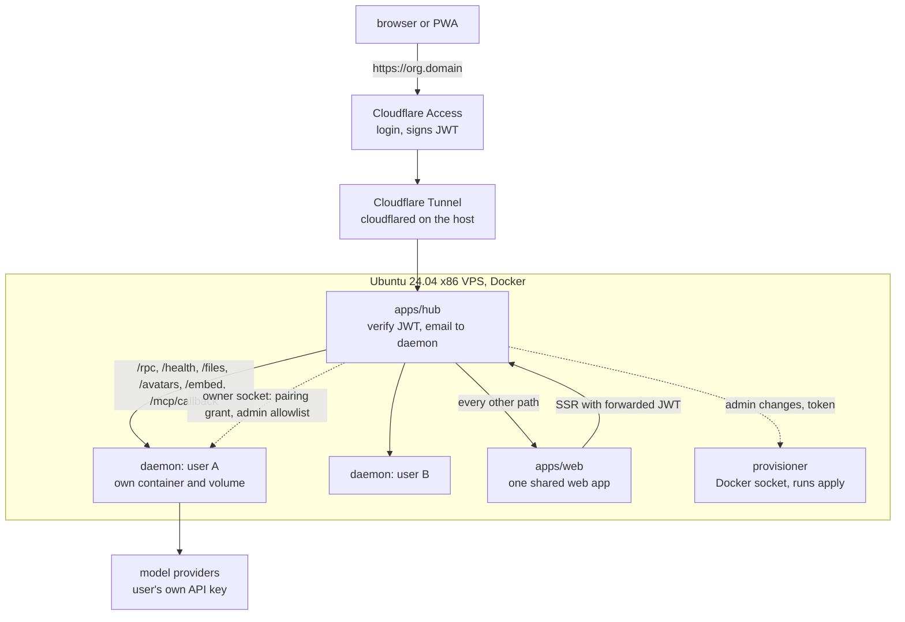

# Team workspace

How MeetVinci serves a small team (3-7 users per installation) without making the daemon multi-user. Human setup guides: [`docs/team-workspace/`](../../docs/team-workspace/README.md). Keep this file and those guides current when the design, phase status or a gotcha changes.

## Design

Each user gets an unchanged single-owner daemon in its own hardened Linux container. One hub per organization is the only front door: Cloudflare Access logs the user in, the hub verifies the Access JWT, maps the email to that user's daemon and forwards. The daemon never learns about users; its owner is whoever the hub routes to it.

- Hub routes by verified identity only. Cookies, `x-bots-server-id`, `Host` and `x-forwarded-*` never choose the daemon. Users come from `HUB_DATA_DIR/users.json` (email to id, `daemonUrl`, `socketPath`); the hub pins each daemon's serverId in `pins.json` on first contact and checks `/health` against it before forwarding. Hub env: `ACCESS_TEAM_DOMAIN`, `ACCESS_AUD`, `HUB_HOST`, `HUB_PORT`, `HUB_DATA_DIR`, `HUB_WEB_URL`, `HUB_PUBLIC_URL`, `HUB_ADMIN_EMAILS`, `PROVISIONER_URL`, `PROVISIONER_TOKEN`. Behaviour and wire details: the Hub section of [`api.md`](api.md).
- Admin panel (Phase 3): `/admin*` is a separate route for emails in `HUB_DATA_DIR/admins.json` (seeded from `HUB_ADMIN_EMAILS` while empty). An admin is just an email, not necessarily a user. Pages go to the web app (`HUB_WEB_URL`, the panel is an `/admin` area of `apps/web`); `/admin/api/*` is the hub's own JSON API: admins, users (through the provisioner, which alone holds the Docker socket and owns `users.yaml`), and `users/:id/rpc/*` relayed to that user's owner socket ("private door"), pinned by server ID, POST only. `admins.json` is the one admin list: the hub sends it to the provisioner at start and after every change, so the Access allow list follows it. Details: the Hub section of [`api.md`](api.md).
- Template workspace and global settings (Phase 3 wave 2): `apply` always runs one extra daemon with the reserved id `template` (service `daemon-template`, network `user-template`, volume `data-template`, `ipc/template`), in `users.json` as `"template"` with no email, so no login and no Access rule ever reaches it. The admin edits it through the relay as `users/template/rpc/*` with the same forms. Its five settings sections (`models`, `chat`, `tools`, `secrets`, `sources`) are followed (`global`) or overridden per user and section; the hub keeps modes and copy results in `HUB_DATA_DIR/global.json` and copies a section from the template's owner socket to each follower's, with the forms' procedures plus owner-socket-only exports for keys, secret values and `~/.agents`. Its bots are the suggested bots: copied, with their own files, to a new person at creation or later. Wire details: the Hub and Owner socket sections of [`api.md`](api.md).
- First visit: the hub marks onboarding complete and mints a pairing grant over that daemon's owner socket, then redirects to `/connect?code=<payload>`; the page redeems it once with the default device name, whatever addresses the code names (in hub mode the hub picks the daemon by identity), and shows *Opening your workspace* instead of a PIN form (gotcha 146). No PIN, no device-name form, and no onboarding steps: the admin configures the workspace. The device token lives in the web cookie as today.
- Private door (Phase 3): the owner socket also serves an explicit allowlist of the oRPC router (settings, providers, skills, MCP, secrets, bots, routine and todo lists, onboarding, devices) to the owner without a device, for the admin panel through the hub. Since wave 3 it also serves exactly the reads the read-only viewer uses (conversation list, history, search and reactions; since the overnight viewer work also waiting questions and approvals, and an artifact's version and version list; attachment download and poster only for the hub's file route), over HTTP only. Conversation and tool writes, watch streams, routine and todo changes and pairing beyond bootstrap are refused. The hub records every conversation, routine and todo read (admin, person, bot, conversation, procedure; no content) in its audit trail, accepting those reads only as JSON it parses, and serves a person's files to admins at `/admin/api/users/<id>/files/<botId>/<attachmentId>`. List and rules: the Owner socket and Hub sections of [`api.md`](api.md).
- Conversation viewer in the panel (Phase 3 wave 3): **Conversations** per person lists their chat with each bot, searches on Enter and shows the transcript read only, built from history reads only: no watch, no read marks, a **Refresh** instead of live updates. It reuses the app's transcript; controls that would write do not render in the admin scope. Subagent runs and private bot-to-bot chats open in a read-only pane from history. Files load through the hub's admin files route. An artifact opens read only at the version its message made, with its other versions, in the app's own renderer and sandbox; what the admin ticks or types stays in the pane and is never saved. A waiting approval or question shows as a read-only *Waiting for approval* or *Waiting for an answer* card with what was asked. Known gaps: a reply still being written (or a wait that starts later) appears on **Refresh**, and links show with no preview and no site icon (gotchas 105 and 137).
- Audit trail (Phase 3 wave 4): the hub keeps `HUB_DATA_DIR/audit.sqlite`, one append-only table, one row per admin read (the audited relay reads and the files route) and per admin change (people, admins, section modes, global sync, bot copy, every other relay call by procedure and bot id, never a body), with time, admin, kind, action, workspace, bot, conversation and status. `GET /admin/api/audit` pages it newest first with filters; the panel's **Activity** page shows it, and a person's page links to their rows. A read whose row cannot be written is refused (503); a change stands and logs an error. The `hub-audit` log line stays. Details: the Hub section of [`api.md`](api.md).
- Global settings in the panel: **Global settings** is the same per-user settings and bot screens pointed at `/admin/users/template/*` (only the sections `GET /admin/api/global` lists), plus a sync status view. A person's section that follows global is shown read-only with **Override for this person**; an overridden one has **Back to global** behind a confirmation that first lists, by name only, what the switch would remove, replace or add for that person (Phase 3 wave 5). **Add user** lists the template's bots ticked; a person's Bots page has **Add from suggested bots**.
- Daemon: `DAEMON_PUBLIC_URLS` makes it advertise only those origins and accept them as browser Origins. Web: `WEB_HUB_URL` turns on hub mode; SSR sends every daemon call to the hub with the request's Access JWT and the web server answers 404 on daemon paths. Do not confuse it with the hub's `HUB_WEB_URL` (where the hub sends non-daemon paths).
- Cloudflare (`bun scripts/deploy.ts cloudflare apply|emails|destroy`): one remotely managed tunnel per server, its routes kept in Cloudflare (team host to `http://hub:47192`, cloudflared also checks the Access JWT except on the exact icon paths), Access policies and apps, and a proxied DNS record created last. Objects are owned by exact names built from `--name meetvinci-<team>` (DNS by the comment `meetvinci deploy <name>`); the script refuses foreign objects on its hostnames. The allow policy (Phase 3 wave 2) is either a list of emails from `users.yaml` (enabled users plus `admins:`, the same list `apply` renders daemons from; `emails --users -` reads it over ssh) or, with `apply --domain <domain>` (repeatable), "emails ending in @<domain>" plus the `users.yaml` emails outside those domains (outside admins). Only `apply` sets the domain rule, exactly from its flags; `cloudflare emails` and the provisioner keep the policy's own domain rule and change only the listed emails. With a domain rule the hub is the real gate: anyone at the domain can get a login code and a valid Access JWT, and the hub serves only users and admins (others get its refusal page). The install token stays on the admin's computer; by hand, adding or removing someone is `apply` on the server, then `cloudflare emails` from the admin's computer, unless the person is inside the domain rule. A narrower token (Zone: Zone: Read, Access: Apps and Policies: Edit) in `.env` as `CLOUDFLARE_API_TOKEN` lets the provisioner update only the allow policy itself and show the panel whom it lets in (Read is enough for showing); the install recommends it for email-list installs. The server gets `MEETVINCI_PUBLIC_HOST`, `ACCESS_TEAM_DOMAIN`, `ACCESS_AUD`, `CLOUDFLARE_ZONE`, `CLOUDFLARE_NAME`, `CLOUDFLARE_ACCESS_DOMAINS` and `TUNNEL_TOKEN` in `/opt/meetvinci/.env`; cloudflared runs as `deploy/cloudflare/cloudflared.compose.yaml` on a `tunnel` network shared only with the hub.
- Images (`deploy/docker/Dockerfile`): Bun bundles without `node_modules`, the artifact embed prebuilt, uid 1000 under tini, read-only root. All daemon state lives on the user's `/data` volume: `DATA_DIR`, `HOME=/data/home` and `PI_CODING_AGENT_DIR=/data/pi`.
- Deployment (`deploy/compose/`, `/opt/meetvinci` on the server): `users.yaml` (`users: {<id>: <email> | {email, name, enabled, advanced}}`, `admins: [<email>]`; `advanced` is written only when true and reaches `users.json` as `advanced: true`, so existing people need no migration) is the only list of people; a disabled user is left out of `users.compose.yaml` and `users.json` (no login, container removed, volume and `ipc/<id>` kept). `bun deploy.ts apply` renders `users.compose.yaml` (per id: service `daemon-<id>` extending `daemon.yaml`, network `user-<id>`, volume `data-<id>`) and `hub/users.json` (`http://daemon-<id>:47191`, `/ipc/<id>/rpc.sock`), creates `ipc/<id>`, brings everything but the hub and provisioner up with `--remove-orphans`, creates those two only if missing, and connects or disconnects the hub to user networks at run time so the hub (and every WebSocket) survives adds and removes. Owner sockets live in one `ipc` volume: each daemon mounts only its subfolder at `/data/data/ipc`, the hub mounts the whole volume at `/ipc`. `backup`, `nightly`, `restore` and `purge` run tar or rm in the networkless root `tools` service. `nightly` (a host systemd timer that `nightly install` writes) backs up every volume one person at a time, then the hub folder with the hub stopped, then the deployment files, into `backups/<UTC time>/` with a `manifest.json` (tag, people, sizes, SHA-256), keeps every run of the 7 newest days with one and the newest of 4 weeks after a good run, records the last run in `backups/nightly.json` for `nightly status`, and, when `BACKUP_S3_BUCKET` is set, encrypts each kept run the bucket lacks with GnuPG (`BACKUP_PASSPHRASE`, in the daemon image by plain `docker run`) and uploads it with Bun's S3 client, under the same lock, recording the result in `backups/offsite.json`; `nightly fetch <time>` downloads, checks and decrypts one back; `restore <folder>` rebuilds a whole install on a server with an empty `hub/`. Upgrades are `MEETVINCI_TAG` in `.env` plus `docker compose up -d --wait`. Model keys reach daemons as provider env vars from `.env`. Volume and network names come from Compose's project name (`docker compose config`), so `COMPOSE_PROJECT_NAME` gives a second stack on one host.
- Firewall (`bun deploy.ts firewall` in the `meetvinci-firewall` image, overnight hardening E): bots keep the public internet (owner's decision: no allow-list) and reach nothing internal. Every daemon network is a bridge named `mv-d<first 9 hex of sha256(id)>` with `enable_icc=false` and `enable_ipv6: false`; the firewall service (host network, root with only `NET_ADMIN`, Debian slim with Bun and `iptables-nft`) keeps two named chains for `-i mv-d+`: `MEETVINCI-DAEMONS`, jumped from the first rule of `DOCKER-USER` (bridged: ACCEPT NEW tcp to 47191, the hub to the daemon, DROP other NEW, so a daemon cannot open the hub; routed: RETURN established and `MEETVINCI_INTERNAL_ALLOW`, REJECT private, CGNAT, link-local, loopback, benchmark, multicast and reserved ranges) and `MEETVINCI-DAEMONS-HOST`, jumped from the first rule of `INPUT` (RETURN established and the allow list, REJECT the rest: sshd, gateways, any host listener). Rules carry a tag of the whole set; the image's health check (`firewall check`, every 2 s, one failure is unhealthy) rewrites a missing or different chain in one `iptables-restore --noflush`, moves a jump that is not first, and fails when it had to or when `FORWARD` no longer jumps to `DOCKER-USER` or `bridge-nf-call-iptables` is not 1; a failure is also written to the container's log (`/proc/1/fd/1`), which `bun deploy.ts firewall status` reads. No policy or other rule is touched. The rules outlive the container. Fail closed at start (day worker F): `apply` starts the firewall first and stops with its last log line unless it is healthy; each daemon in `users.compose.yaml` has `depends_on: firewall: service_healthy` and `MEETVINCI_WAIT_FOR_FIREWALL=true`, with which `meetvinci.sh` first runs `firewall-wait` (`deploy/docker/firewall-wait.sh`): a bash `/dev/tcp` connection to the network gateway's port 9 until it fails with `Protocol not available` (ENOPROTOOPT: `MEETVINCI-DAEMONS-HOST` rejects port 9 alone with `icmp-proto-unreachable`, which no other firewall sends, so a host firewall's own reject cannot pass the wait; its jump is written after `DOCKER-USER`'s in the same pass). Docker ignores `depends_on` when it starts containers itself (reboot, its own restart), so the wait is what holds then: the container's network is unfiltered until the rules exist, but no daemon or bot process runs in it. Both live in `users.compose.yaml`, not `daemon.yaml`, so a pre-firewall install's old per-person file in an upgrade's step 2 does not leave daemons waiting on networks the firewall does not match. A flush while everything runs leaves bots unfiltered until the next check (at most about 2 s); when that flush removed Docker's chains too, the check also puts `-A FORWARD -i mv-d+ -j DROP` until Docker writes them again, and removes it then. The first by-hand `apply` after the upgrade to the firewall removes the hub and the daemons whose network predates it and recreates them (gotcha 142); the provisioner refuses that state, since it would remove the hub waiting for its answer. `apply` refuses a bad `MEETVINCI_INTERNAL_ALLOW` before the firewall sees it. Because the rules match the bridge prefix, a person added later is covered with no step, and a Docker restart or reboot just restarts the service. `MEETVINCI_INTERNAL_ALLOW` (`.env`, `<IPv4>:<port>` TCP, comma separated, empty by default) is the one way to let daemons reach an internal destination. `bun deploy.ts firewall remove` (root on the server) stops the service and deletes chains and jumps. Alternatives weighed: internal networks plus an egress proxy (loses non-HTTP traffic and needs proxy env in every tool), host rules installed by `deploy.ts` (lost on reboot without a systemd unit, and the provisioner cannot touch the host), per-network rules (need updating on every add).
- Provisioner (`bun deploy.ts provisioner` in the `meetvinci-provisioner` image, Phase 3): the only container with the Docker socket. It runs the same `apply` as by hand, one change at a time, for the hub's admin panel, and answers only `Authorization: Bearer $PROVISIONER_TOKEN` (sha256 then `timingSafeEqual`) on port 47193 of the internal `provisioner` network (hub and provisioner only); its own `egress` network reaches the Cloudflare API. Image: Bun distroless plus the static Docker CLI and Compose plugin from `docker:29.8.2-cli`, the smallest way to run the same Compose path (the raw Docker API would mean rewriting Compose). 73 MB compressed (arm64), 14 MiB idle. Root with every capability dropped, read-only root, `/opt/meetvinci` mounted at the same path so Compose resolves `./hub` as on the host. Wire (JSON; every request needs the token, else 401): `GET /health`; `GET /users` -> `{ users: [{ id, name, email, enabled, advanced, state }] }` (`state` from `docker compose ps`: `running`, `starting`, `stopped` for no container or exited, `unknown`); `PUT /users/:id { name, email, enabled, advanced? }` (only these keys, `content-type: application/json`; `advanced` defaults to `false`) -> `{ id, name, email, enabled, advanced, state, access }` once `apply` returned (that person's daemon healthy, `users.json` written; a panel change waits only for the changed person, so another person's unhealthy daemon cannot fail it), 409 when another user has the email; `DELETE /users/:id` -> `{ id, access }`, 404 if unknown; `PUT /access/admins { emails }` (at most 100) -> `{ emails, access }`, stored as `admins:` in `users.yaml` with no `apply`; `GET /access` -> `{ domains, emails }`, whom the allow policy lets in (`emails: null` when unknown: no token, Cloudflare unreadable, or rules MeetVinci does not manage; `domains` then from `CLOUDFLARE_ACCESS_DOMAINS`), never queued behind a change. Ids must match the hub's `^[a-z\d][a-z\d-]{0,62}$` (400), names 1-100 characters without control characters or outer spaces, emails at most 254. `access` is `synced` when `CLOUDFLARE_API_TOKEN` is set and the policy update succeeded, or, without a token, when the change adds or removes no email outside `CLOUDFLARE_ACCESS_DOMAINS` (nothing to change in Cloudflare); else `manual`. A failed `apply` is 500 `{ error, rolledBack, access }`: a change that leaves the person enabled is rolled back in `users.yaml` (so a retried create is not a 409), a disable or removal is kept (so the login stays gone), and Access follows whichever list stands. A panel change and a by-hand `apply` take `users.yaml.lock` in `/opt/meetvinci`; the second one fails at once with a message (a lock older than 10 minutes is a crash leftover and is taken over). A change takes 2-4 s locally; the hub's client must wait at least that long per queued change (the provisioner's own idle timeout is 240 s).
- Hub test suites (`apps/hub/tests`, hardening H): run them with `bun run test` in `apps/hub`, or `bunx turbo run test --concurrency=100% --continue` from the root as CI does (only the hub has tests, so that is the same run); one file with `bun run test tests/hub-admin.test.ts`. They need `bun install` and the compiled i18n messages (turbo builds them; by hand `bunx turbo run @repo/i18n#i18n:compile`). The fixture guarantees: the global setup (`tests/support/hub-ports.setup.ts`) picks one block of 100 free ports on 127.0.0.1 between 20000 and 32699 per run, below every ephemeral range, and each suite takes its own ten (`hub.test.ts` +0, admin +10, global +20, relay +30, audit +40), so suites never share a port, an outgoing connection never holds one, and two worktrees can run the suites at once; each suite has its own temporary data folder; a daemon or hub that exits during setup fails the suite at once, and one that does not answer its health URL fails it after 30 s, both with its label, health URL, exit code and the last 40 lines of its stdout and stderr (`redactSecrets` from the logger plus any `PIN <digits>`; team daemons print no PIN and the keys are dummies); a stub server that cannot listen names itself and its port; a process that dies while the tests run is reported on stderr the same way; a failed setup stops every process it started. CI has no automatic retries; a re-run job warns with a link to the earlier attempts, whose logs GitHub keeps.

## Decisions

| Decision | Why |
| --- | --- |
| One single-owner daemon per user, one container and volume each; no users table in the daemon | The container is the only isolation between users: a bot's bash sees the whole container. Keeps the daemon's security model intact |
| One public hostname per organization behind a Cloudflare Tunnel; Access is the login | No open inbound ports; Access gives identity, OTP or IdP, and revocation without MeetVinci accounts |
| The hub routes by the verified `Cf-Access-Jwt-Assertion` (fallback `CF_Authorization` cookie); clients never choose their daemon | Cookie-named addresses made the web server an SSRF and wrong-daemon surface |
| The hub reaches each daemon's owner socket through a mount of only `data/ipc`, as the daemon's uid | The socket serves pairing bootstrap and the admin allowlist only; the Docker socket would make the internet-facing hub root on the host. The user's bot controls that folder, so the hub must not trust what it finds there (risk 1) |
| No admin device and no impersonation. Admin may audit everything, but only through an admin panel over the owner socket, never as the user | A device paired into a user's daemon steals that user's pushes and can be revoked by them; acting as the user blurs accountability |
| Admin panel on the same hostname under `/admin`, open only to admin emails the hub checks in the Access JWT; an admin is just an email, not necessarily a user. Admins add and remove admins and users | One login and one hostname; admins need no workspace |
| The admin panel reaches a user's daemon only through its owner socket, relayed by the hub, never by pairing a device or using the public door. The socket serves an explicit allowlist that fails closed; anything acting as the user in a conversation is not on it | No impersonation: the panel sees the same settings and bot forms as the app, and reads chats read-only (wave 3), but cannot send messages, answer approvals or questions, or change anything in a chat |
| Wave 6: the user app of a team install hides complexity; it is not a permission system. Every person keeps appearance, Enter key, notifications, sidebar, artifacts, every chat action, approvals, answering questions (secrets included), routines, todos, reset, removing their own devices and secrets, creating and deleting bots and every bot field except the permission level, MCP presets, shared MCP and MCP sign-in, and choosing models from configured providers. An advanced user also sees the workspace chat settings, Models (providers, sign-ins, replace a model), the Jev key and Sources. Nobody sees the permission level, approval rules and timeout, the secrets mode, Server addresses, the desktop app's connection settings, onboarding, *Create pairing PIN* or the lab links. New bots start at **Ask first** | The owner's call (wave 6): most people were overwhelmed; hide, don't block. Only the security-relevant settings below are also refused, by the daemon's public door, and the admin keeps them in the panel. No visible form sends a refused call: the same permission is hidden in the chat's details panel too, and the team Tools form sends only the Jev key |
| One **Advanced user** switch per person, off by default, set by an admin on the person's page, stored in `users.yaml` through the provisioner like `name` and `enabled`, audited as `users/advanced` | A display preference the hub decides, not a role in the daemon: the daemon still has no users |
| The user app learns team mode and the advanced flag from the hub's `/hub/whoami` (SSR in hub mode, no new login step), never from the daemon | The hub already answers the web app in hub mode; the web app stays independent of the daemon's own team setting |
| Secrets are global (copied from the template, marked `isGlobal` in the person's daemon by the hub's `secrets.import`) or the person's own (everything else, such as what a bot asked for). A sync and **Back to global** replace only global secrets; the person removes their own in **Settings → Secrets** whatever the section's mode, never a global one; the admin sees and removes own secrets in the panel even while the section follows global. On a name clash the global one replaces the person's value (Phase 3 wave 7) | Following global must not delete what a person gave a bot, and a person must be able to take back a secret given by mistake; the flag lives where the copy already writes, so existing people need no migration |
| A section that follows global is read only in the user app (*Managed by your admin*), except Secrets, which always lists every secret and lets the person remove their own; an advanced person's **Change it for me** calls the hub (`POST /hub/sections/:section/override`), which flips that section to overridden for them, audited with their own email, before they edit. Since wave 7 it exists only for Models, Chat and Sources: the hub refuses Tools and Secrets (403) and the app shows no button there, so an advanced person can't set their own Jev key while Tools follows global (the field is hidden; the admin overrides their Tools in the panel and sets it there) | Browser RPC runs over the WebSocket, so the hub cannot see a person's first write without parsing frames; an explicit switch through the hub reuses the panel's override path and its audit. In Tools and Secrets what a person could edit is admin-only anyway (approval rules, timeout, secrets mode), so overriding would only cut them off from the admin's later changes (owner decision) |
| A team daemon's public door refuses, for every device (advanced or not), changing a bot's permission level, the approval rules and timeout, the secrets mode, adding an MCP server with a `command` or `env`, and `limits.configure`, with `TEAM_MANAGED` (403, "Your admin manages this"); the owner socket keeps every one of them. `DAEMON_TEAM=true`, set in `daemon.yaml`, is the one setting that marks a team daemon, read once at startup; without it a daemon behaves as before (Phase 3 wave 6) | These are the security-relevant settings; the daemon decides, so the hub parses no bodies. It is a property of the install, not of a person: the daemon still has no users or roles, and shared sources stay open to advanced users |
| A refusal fires only on a change: the same permission, rules, timeout or mode passes, and a bot created from a device must use the default permission `ask` (omitted or sent) | The web forms send whole objects (a bot with its unchanged permission, the tools form with the Jev key), so those saves keep working |
| Bots keep their own tools; only `bot_mcp_add` refuses a `command` in a team daemon (Phase 3 wave 6) | It calls the same bot action as `mcp.add`, so it was the one trivial way around the refusal; `bot_create` and `bot_update` never took a permission and `bot_mcp_add` never took `env` |
| Every person sees and clears their own bots' **Always approve** list in the bot's Tools tab (`tools.alwaysAllowed`, `tools.clearAlwaysAllowed`, names only); the admin sees and clears it in the panel through the owner socket, a clear audited as a change. Never refused in a team install (Phase 3 wave 6) | Always approve used to add a tool to a list no screen showed; clearing one only makes the bot ask again, so it is not security-relevant |
| A new user's id comes from the name (else the email), unique against current users and every pinned id | A removed user's volume is kept; reusing an id would hand a new person the old person's data |
| Admins are fully trusted. Stdio MCP servers, plugins and skills stay on the private door, so an admin can run code inside any user's workspace and can technically read that user's data; the panel simply offers no feature to chat or answer as the user (owner decision pending confirmation, Phase 3 integration) | Configuring a user's bots, MCP included, is what the panel is for; refusing code-bearing configuration would leave the panel unable to set bots up |
| Routines and todos belong to the user: the private door only lists them and the panel shows them read-only (owner decision pending confirmation) | A routine runs a prompt with the user's tools and secrets in the user's conversation list, which is acting as the user |
| The admin may read every conversation, "like Slack", read only, through the private door and the hub relay; the reads leave no trace in the person's app, every read is logged in the hub without content, and there is no export or live stream (Phase 3 wave 3) | Auditing without impersonation: the same owner-socket path as the forms, existing read procedures that are proven side-effect free, and accountability in the hub log |
| The audit trail is a SQLite file the hub owns in its data folder (`hub/audit.sqlite`), append-only, never content or values; a read that cannot be recorded is refused, a change that cannot be recorded stands and is logged as an error; no pruning (Phase 3 wave 4) | The container log vanished on every upgrade (gotcha 109); a file next to `admins.json` survives upgrades, `apply` and rollbacks with no new service. Refusing a change after it happened would only make the admin repeat it |
| The hub's `admins.json` is the one admin list; `admins:` in `users.yaml` is the provisioner's copy for Access, refreshed by the hub at start and on every change | Two lists drifted (review finding 5): an admin missing from `admins:` lost their Access login on the next user change |
| MCP OAuth sign-in is not offered in the panel (known gap); API-key MCP and every other MCP setting are | The provider's callback lands on the hub, which routes it by the admin's own identity, never the user's daemon (gotcha 42) |
| Notifications stay one device per notification, chosen per daemon as today | The daemon only knows its own user's devices once admin devices are gone |
| Models: Pi's provider system unchanged, each user's own API keys. No shared subscription logins, no model gateway yet | Provider terms forbid routing other users through one subscription: Anthropic's "Authentication and credential use" quoted in `ijpatricio/spike-hetzner:spikes/hetzner/FINDINGS.md` Spike 6, section 6; OpenAI forbids sharing account credentials (same section). [`cliproxy.md`](cliproxy.md) is for a single owner's own subscription only |
| Access allows either a list of emails or a whole email domain (`apply --domain`), plus outside emails; with a domain rule the hub's user and admin lists decide who gets in, and anyone else at the domain gets the hub's refusal page (Phase 3 wave 2) | One-step login for the admin: adding a person at the domain needs no Cloudflare change and no token on the server. A login code is not access to anything; the hub was already the gate for every path |
| The panel shows per user and admin whether Access lets them in (`allowed`, `not-allowed`, `unknown`) and the domain rule, read from the policy by the provisioner and cached 15 s; `unknown` without a token or when Cloudflare is down, never an error | The admin sees at once who cannot log in; only the provisioner holds a Cloudflare token, and a read-only one is enough |
| A page load by a signed-in person the hub refuses gets the hub's own static 403 page (who they are, why, whom to ask, sign out); API calls keep the empty 403. An admin who is not a user is sent to `/admin` instead | With a domain rule strangers at the domain reach the hub; the web app cannot render for someone with no daemon, so the page is plain English without i18n |
| Remotely managed tunnel; cloudflared as a container with only `TUNNEL_TOKEN`; one script owns tunnel, Access and DNS | One secret on the server and no config file; re-running the script restores routes, apps and DNS; the connector needs no host install and sits on a network with only the hub |
| Access emails follow `users.yaml`; no Access service tokens | One list of people. A token without "Access: Service Tokens: Edit" cannot create them (Phase 1 spike), so nothing depends on them |
| A separate provisioner holds the Docker socket; the hub never does | The internet-facing hub stays unprivileged; the root-equivalent part has a tiny API, one caller and no internet-facing surface |
| The provisioner runs `scripts/deploy.ts apply`, not its own Docker logic; it lives in that script as the `provisioner` subcommand | One code path for the panel and by hand; deploy tooling, not product logic, so no new app |
| Disabling a user removes their container (Compose leaves them out) instead of keeping it stopped | Same path as removing; no Compose scale or profile tricks; re-enabling recreates it on the same volume |
| The panel is an area of `apps/web` that reuses the user app's settings and bot forms through `useRpc()` and a section-scope context, not a second app | Real reuse with the least change: the same components, a per-user RPC client and per-user links |
| The panel shows each user the same settings and bot sections as the app, minus what is personal to one browser (theme, notification permission, Enter key, desktop) and anything the owner socket refuses (pairing, chat links). Provider sign-ins offer API keys only | The panel is the admin's full view of a person, whatever their app hides (wave 6); a subscription sign-in by an admin would put the admin's own account in the user's daemon |
| Global settings live in a hidden template workspace (reserved id `template`), edited with the same forms as a user; each settings section of each user follows global or is overridden (per section, not per field). Saving a global section copies it to every follower; switching back to global copies the global values in again (for Secrets, only the global ones); a new person starts with every section global | The admin learns one set of forms; per-section overrides keep the model simple; the template is an ordinary daemon, so nothing new runs inside a person's workspace |
| Bots on the template are suggested bots, copied (profile, avatar, instructions, model, fallback, approval mode, the bot's own skill, instruction and MCP files) to a person at creation when ticked, or later; copies are new bots, independent afterwards. Conversations, routines and todos never travel | Starting points, not shared bots: the person owns their copy |
| Sections are copied through the private door with the forms' procedures; only values the forms cannot read (stored API keys, secret values, the Jev key, `~/.agents` files, a bot's own files) use owner-socket-only export and import procedures that the public door and the admin relay both refuse | The narrowest new surface; secret values never reach a browser and cross the hub only in memory |
| A user the hub has no record of (added by hand, or present before global settings) has every section overridden; an unreadable `global.json` refuses section writes and global changes instead of guessing | Never overwrite someone's own settings by accident; fail closed |
| The `chat` section is the daemon-wide chat settings procedure as a whole: busy mode, verbose tools and GIFs | One procedure holds them, so the 409 refusal and the copy cannot split them |
| The panel's Global settings reuse the per-user routes at `/admin/users/template/*`, not a second route tree; a person's global section stays visible but inert, with one "Override for this person" control | Real reuse: the same settings and bot routes, the same per-user RPC client and query keys (`admin-user:template`), so switching between a person and Global never mixes caches |
| Target: x86 Ubuntu 24.04 VPS with Docker; web and PWA first | Proven on Hetzner; native clients need a Cloudflare login first (Phase 7) |
| Sizing: 512 MiB limit per daemon; plan up to 5 users on 4 GB and about 13 on 8 GB (the template is one more daemon; before wave 2, 6 and 14) | Measured idle on the x86 test server (Hetzner, 2 vCPU, 3.7 GiB usable, wave 3): daemons 104-110 MiB in `docker stats` (about 150 MB RSS) after one turn, web 34-53 MiB, cloudflared 15-36 MiB, hub 12 MiB, each under 0.5% CPU; OS, dockerd and containerd about 470 MiB. An artifact preview reached 190 MiB on arm64 (PR #4). With global settings (Phase 3 wave 2, same server, three people and the template, idle): people 90-104 MiB, template 106 MiB, web 34-47 MiB, cloudflared 38 MiB, hub 15-18 MiB, provisioner 5-6 MiB, host about 1 GiB used in all; the template counts as one more person. Wave 3 (same server, three people and the template, idle 6-7 minutes after the upgrade and the probe): people 90-92 MiB, template 94 MiB, web 34 MiB, cloudflared 38 MiB, hub 14-15 MiB, provisioner 6 MiB, each under 0.3% CPU, host about 1 GiB used. Wave 4 (same server and people, idle after the upgrade and the probe): people 90-95 MiB, template 93 MiB, web 34 MiB, cloudflared 38 MiB, hub 14-16 MiB, provisioner 5 MiB, each under 0.3% CPU, host about 1 GiB used; `hub/audit.sqlite` 12 KiB with 18 rows (its minimum of three 4 KiB pages). Wave 5 (same server and people, a few minutes after the upgrade, the probe and purge): people 98-101 MiB, template 97 MiB, web 35 MiB, cloudflared 38 MiB, hub 19 MiB, provisioner 6 MiB, each under 0.4% CPU, host about 1 GiB used; `audit.sqlite` still 12 KiB with 43 rows. Six daemons all at their 512 MiB limit fit in 4 GB with the shared services; typical use would fit two to three times more, but nothing caps the sum below the limits |
| Off-site backups go to one S3-compatible bucket (S3, R2, B2) through Bun's built-in S3 client, encrypted on the server with GnuPG symmetric OpenPGP (AES-256, passphrase in `.env`) before upload; no upload without a passphrase; the bucket keeps the local retention and only touches `<time>.tar.gpg` and `<time>.sha256` under its prefix; it replaced `BACKUP_OFFSITE_SCRIPT` | The owner chose an S3 provider. One built-in path is less to maintain than a root-run script; the copy holds every key, so the provider must see only ciphertext (the owner may still choose to rely on the bucket's own encryption) |
| The admin's conversation viewer loads nothing from another origin until the admin presses **Load outside content** on one artifact or message, recorded first as an `outside/load` read; pages lose their script until then; the choice lasts while it is shown (owner's decision, day worker I) | A picture or a page's WebRTC probe tells an outside server the admin's IP and when they looked; Chrome has no CSP for WebRTC, so only a frame without script stops it (gotcha 165). The person's app is unchanged |
| A hub start on a new version copies every global section to everyone who follows it, as **Sync now** does, in the background, audited as `global/sync` by `hub start`; a person whose daemon does not answer is tried again every 2 s for about a minute. A restart on the same version copies nothing (gotcha 170) | An upgrade or rollback restarts the hub, so the copy at start is the upgrade step (secrets an older hub copied get their `isGlobal` mark) without a migration framework. The nightly backup and every purge restart the hub too, and a copy each night replaced files bots left in `~/.agents` (owner decision) |
| In a team install a new bot reads the shared instructions (`inherit` includes `agentsFile`): the create form in the team app and in the panel starts with it on, so new suggested bots and bots people create get it; a copy keeps the template bot's own value (an explicit array, so "off" and "never set" cannot be told apart); existing bots are not changed; a single-owner app keeps it off | The team's shared instruction file was read by nobody (walkthrough finding 9). Single-owner `~/.agents/AGENTS.md` may be the owner's own coding-agent file, so turning it on there is not plainly free |
| One admin-set model for new bots, in the Models section (`models.settings`/`configure`, with reasoning and fallback): the create form starts from it when that model is offered, else the newest model as before; it follows global or is overridden with Models; only the panel shows it | Finding 18. No per-person or per-bot-type defaults; nothing is validated at save because offered models differ per person |
| No model runs before a person arrives: a bot created or given instructions over the owner socket (suggested-bot copy, panel, by hand) does not start then; it starts once, the first time the person opens its chat on one of their devices (`bots.open`, gotcha 196). A device or a bot's own tool still starts it at once, so a single-owner owner keeps the introduction | Finding 22: Add user ran a start turn per suggested bot. The start turn is also what creates the routines a bot's instructions describe, so it runs when the person arrives (owner decision) |
| The desktop app updates only from `DESKTOP_UPDATE_URL`, set at build time, with no default: a public S3-compatible bucket (R2) for now, later a gateway that checks a customer key in the URL path. `bun run publish:desktop` uploads a release there only after checking the uploaded bundle is Developer ID signed, notarized, stapled and built for that address; the app installs an update only when the downloaded app has its own signed bundle ID and team and Gatekeeper accepts it (`docs/desktop-release.md`) | The fork's releases are private and its old feed was the upstream author's; the address moves to the gateway with no code change. Electrobun checks no bytes itself, so the app's own check is the protection |
| On 2026-11-13 the product was renamed from Orbs (the upstream project's name) to MeetVinci, in one change with no aliases: `/opt/meetvinci`, `meetvinci-*` images, units and Cloudflare names, `MEETVINCI_*` env, `MEETVINCI-DAEMONS*` chains, daemon bridges `mv-d<9 hex>` (15-character interface limit), bundle IDs `pt.entrypoint.meetvinci*`, data folders `~/.config/meetvinci*`. Rows of the Phases table dated before this one use the old names | Nothing was in production and the test server is rebuilt from scratch, so a clean switch costs no migration |
| The secrets proxy keeps mockttp for the bot's side only and owns the upstream side in a forward server on loopback: resolve once, refuse internal answers except `MEETVINCI_INTERNAL_ALLOW`, connect to the checked address, scrub every response from a host any secret allows as a stream (decoding gzip, deflate, br and zstd, refusing other encodings) | mockttp's passthrough buffers whole responses before its response hook and has no hook on the address it connects to; a streaming scrub has no size limit, and refusing what cannot be decoded is the only safe answer for a body that may carry a secret. The firewall alone does not cover a bot that reaches only the proxy (sandbox, PR #41) |

## Phases

| Phase | Scope | Status |
| --- | --- | --- |
| 1 | Spikes: container, multi-daemon, shared models, Hetzner with Tunnel and Access | done |
| 2 | Fleet by hand. Wave 1: (A) daemon, web and hub images, PR #4; (B) hub, PR #3; (C) daemon public-origin env and web hub mode, PR #2; (D) these records, PR #1. Wave 2: (E) Compose deployment and users, PR #6; (F) Cloudflare script and cloudflared service, PR #5. Wave 3: a from-scratch install on a fresh x86 server by following only `docs/team-workspace/`, guide fixes and the `orbs-deploy` skill | wave 3 in review; everything up to the Access login verified on the real server (forged JWTs refused, isolation, hardening, reboot, add/remove, backup/restore, upgrade/rollback); a real login by the owner pending |
| 3 | Admin panel. Wave 1: (A) admin operations on the daemon's private door, PR #11; (B) hub admin list, admin API and relay, PR #9; (C) provisioner service, PR #10; (D) panel UI in `apps/web`, PR #12; integrated, seams and the independent review's findings fixed, in one PR that supersedes those four. Wave 2: (E) template workspace, sections with per-user overrides and bot copy, PR #19; (F) panel UI for Global settings, overrides, suggested bots and sync status, PR #17; (G) no onboarding or startup PIN for provisioned people, single redeem, panel avatars, PR #16; (H) Cloudflare domain rule and Access state in the panel, PR #18; integrated with the independent review's findings fixed, in one PR that supersedes those four. Wave 3: read-only conversation viewer: (J) reads on the private door, hub relay, file route and audit log, PR #22; (K) the panel's Conversations tab, PR #23; integrated with the independent review's findings fixed, in one PR that supersedes those two. Wave 4: a durable audit trail for the admin panel (`hub/audit.sqlite`, `GET /admin/api/audit`, the **Activity** page). Wave 5: **Back to global** previews what the person loses (`GET /admin/api/users/:id/sections/:section/preview`, names only) and refuses a stale preview. Owner questions at the end of the phase: what to remove from the user app, and whether users may change their own bots | wave 1 integrated and proven locally (OrbStack, real images, local JWKS, mock model, Cloudflare stub): install with one admin who is not a user, two users added and set up from the panel, each sees only their own bots and chats with the mock model, admin add/remove, 403s, disable/enable/remove, every act-as-the-user call refused through the relay. Installed on the real x86 test server (`orbs-test.example.com`, Docker 29.9.3) by following only the guides and the skill: everything up to the Access login verified (forged JWTs 401 on every path including `/admin*`, hardening, only the provisioner holds the Docker socket, daemons and web cannot reach the provisioner, add/disable/enable/delete through the provisioner in 1.8-3.7 s with another user's WebSocket open throughout and no other container restarted, owner socket refusals, reboot). A real login by the owner, as user and as admin, pending. Wave 2 integrated and proven locally (OrbStack, real images from the branch, project `orbs-p3w2`, minted Access JWTs, mock model, Cloudflare API stub, headless Chrome with screenshots): fresh install with one admin who is not a user (`/` sends them to `/admin`) and the template `ready`; every global section set and three suggested bots created in the panel; Ana added with two bots ticked and Bruno with none, both all-global and in sync before the create answered; both log in with no onboarding, one grant and one successful redeem each, no startup PIN in any daemon log; each sees exactly their bots and chats with the mock model using the copied global key, global skill and the bot's own copied skill; a global change reached both; Ana's override held while Bruno followed; Back to global behind its confirmation; the read-only section and the 409 message; Bruno disabled caught up when enabled, a stopped daemon showed *Sync failed* and Try again recovered; Add from suggested bots on Bruno and its per-bot failure message; the review's HIGH and MEDIUM races; Access state unknown without a token, allowed and not-allowed with the stub's email list, the domain notice with a domain rule; a domain-allowed stranger gets the refusal page; image avatars load for people and the template; the admin relay refuses act-as-the-user calls and the export/import procedures, the public door refuses them to a paired device, a person gets 403 on the admin API; phone width and light theme checked. Piece H's real-Cloudflare token sync is unproven (its commands are in PR #18's comment). Wave 2 upgraded on the real x86 test server from `7c0f545` to `436d820` by following `admin.md` "Upgrades" (images built on the Mac, loaded over SSH, backups first): the documented `docker compose up -d --wait` alone ran no template (gotcha 91), fixed by `apply`; the three existing people kept every value, bot, device and onboarding state and stayed overridden (gotcha 71); no daemon on the new tag logs a PIN; the template is isolated like a person (all daemon pairs blocked, the hub 200) and has no email in `users.json`; a throwaway person went through create with one copied suggested bot, every section copied, override, a global change, back to global, a later copy and its 409, disable, enable, delete and purge through the provisioner and the owner sockets from inside the hub in 2.1-4.2 s each, with no other container restarted; one real turn with a throwaway device answered through the mock with the global `AGENTS.md` and skill; the owner socket refuses conversation reads and writes, approvals and pairing, and the public door refuses the eight export and import procedures to a paired device (403); without a token the provisioner answers `access: manual` and `GET /access` `emails: null` (the panel's *unknown*); a rollback to `7c0f545` and forward again (gotcha 92). Not provable without a real login: the panel's Global settings screens, the hub's `global.json` modes and 409, and the admin relay's refusal of the export procedures. Wave 3 integrated and proven locally (OrbStack, real arm64 images from the branch, project `orbs-p3w3`, minted Access JWTs, mock model, Cloudflare stub, headless Chrome): an admin who is not a user read two people's conversations made through their own logins (text, 90+ entries paged in three pages, an image and a text file and a PDF, a bash call approved, an artifact, a subagent run and a private bot-to-bot chat opened in panes, a silent reply); search, a search hit, Refresh, switching person with the next person's history held for 3 s (no earlier transcript shown), phone width and light theme, the template's empty state; every request the tab made was a Contract 6 read or a wave-1 read, nothing on idle, focus, visibility or online; each person's chat list and sections, read with their own login, byte-identical before and after six full walk-throughs, and the mock model got no request; 25 content-free audit lines for one walk-through; 30 writes and 15 unused reads refused through the relay for a person and the template, the review's multipart audit bypass and five other bodies refused (422), a non-admin 403 on the relay and the files route, a cross-site file GET 403; wave 1 and 2 smoke (add with a suggested bot, a global change, an override, back to global). Wave 3 upgraded on the real x86 test server from `436d820` to `cef17a9` by following `admin.md` "Upgrades" literally (backups, `docker compose up -d --wait` in 8 s, `apply` in 2.3 s restarting nothing): every container healthy on the new tag, the template present, a before-and-after snapshot over the owner sockets of each person and the template (onboarding, chat, tools, secrets, sources, provider state, `auth.json` and `models.json` hashes, bots, devices, `~/.agents`) identical, `global.json` still absent (everyone overridden), pins and `users.json` unchanged, no PIN in any log. On a throwaway person `probe` (provisioner create, the mock, one bot, a throwaway device revoked afterwards; text, a text file, a bash call approved through `tools/answer`): the owner socket refused all 60 procedures outside `RPC_LOCAL_ALLOWLIST` with 403 (with a target and with an empty body), GET 404, an `Origin` 403, an upgrade 404; the viewer's reads answered 200 from inside the daemon and from inside the hub as the relay and file route send them (pinned server ID; a wrong one 409); the person's own view through their device and every file under `/data/data` and `/data/agents` (hash and mtime) were identical after the reads; the public door still 401 without a device and 403 on the exports with one. From outside, `/admin` and the viewer's relay and file paths 302 to the login and the hub logged nothing; from the tunnel network, with no or a forged JWT, 401. Not provable without a real login: the panel's Conversations tab and the audit lines. Wave 4 proven locally in the real arm64 images inside a throwaway `docker:29.8.2-dind` (Linux ownership; `apply` run as root from the provisioner image on a fresh `/opt/orbs` with no `hub/`): the hub created `audit.sqlite` itself as `1000:1000` mode 0600 under `read_only`, `cap_drop: ALL` and uid 1000, no `deploy.ts` change needed; every kind of read and change wrote its row (26 for one run, including two 409 retries and a refused `workspace/export` 403); a secret saved with `secrets/save`, an API key through `providers/login` and `providers/complete`, bot instructions and a search term appear neither in the file's bytes nor in the hub log; a recreated hub container kept all 58 rows while its Docker log started empty; the wave 3 hub (`cef17a9`) ran healthy against the folder, served reads and left the file byte-identical, and forward again kept every row; `purge` kept the rows about the purged person; a read with the folder unwritable got 503 `audit_unavailable` and a change still answered 200, each with its error line; non-admin and unknown identities 403, no or a forged JWT 401, POST, PUT, PATCH and DELETE on `/admin/api/audit` 404; the **Activity** page in headless Chrome (empty state, rows, filters, a filtered empty state, load more, the person link, phone width, light theme). Not provable here: the page behind a real Access login on the server. Wave 4 upgraded on the real x86 test server from `cef17a9` to `4d66102` by following `admin.md` "Upgrades" (backups of the three people, the template and the hub folder; `up -d --wait` 8.5 s; `apply` 2.3 s, restarted nobody): every container healthy on the new tag, the template included; the hub created `hub/audit.sqlite` as `1000:1000` mode 600 with no journal beside it; the three people, the template, `global.json`, pins, `users.json` and `admins.json` byte-identical before, after and after the probe (owner-socket snapshots: settings, bots, devices, no conversation reads); no onboarding, no PIN. On a throwaway person `probe` (provisioner, mock model, a bot, a chat with a file and an approved bash call through a throwaway device revoked afterwards), a second copy of the hub's code inside `orbs-hub-1` with its own test key and test admin (gotcha 114) wrote 18 rows to the real file: `secrets/save`, `providers/login`, `providers/complete`, `bots/update`, `sections/overridden` (detail `chat`), `users/update` 501 (no provisioner there), `workspace/export` 403, and the reads `conversation/list`, `history` (with bot, and with conversation when the body names one), `search`, `routines/list`, `todos/list` and a file (`attachments/download`, served with the sandbox CSP); `bots/list` and reading the trail wrote nothing, and POST, PUT, PATCH and DELETE on `/admin/api/audit` (and DELETE `/admin/api/audit/1`) answered 404. The dummy secret, the dummy provider key, the bot instructions and the chat text: 0 matches in the file's bytes, its copy, the hub log and the side hub's output. `up -d --force-recreate hub` kept all 15 rows then (same sha256) while the new container's log had 0 `hub-audit` lines, and new rows appended as 16-18. On a copy of the file in a folder made `chmod 500`, a history read answered 503 `audit_unavailable` and a `bots/update` 200, with both error lines; the real file and hub were untouched. `purge probe` kept the 18 rows. From outside, every method on `/admin/api/audit`, `/admin/api/audit/1` and `/admin/activity` 302 to the login; from the tunnel network with no or a forged JWT, 401. Wave 5 upgraded on the real x86 test server from `4d66102` to `c40d90a` by following `admin.md` "Upgrades" literally (images loaded in 9 s, deployment files byte-identical to wave 4's, Bun 1.4.2 on both; backups of the three people, the template and the hub folder; `up -d --wait` 8.4 s; `apply` 2.2 s, restarted nobody): every container healthy on the new tag, the template included; the owner-socket snapshots of the three people and the template, `global.json` (the owner follows global in three sections), pins, `users.json`, `admins.json` and `audit.sqlite` (21 rows) byte-identical before and after the upgrade, and again after the probe and purge (the trail then 43 rows, the first 21 unchanged); no onboarding, no PIN; one harmless 502 in the hub log (gotcha 118). On a throwaway person `probe` (provisioner create in 3.1 s, the mock), the side hub of gotcha 114 (gotcha 119): previews of all five sections answered in 3-43 ms; a dummy secret, a dummy OpenAI key, `whenBusy: steer` and a skill file made exactly `removed:provider:openai`, `changed:chatSetting:whenBusy`, `removed:secret:PROBE_DUMMY_SECRET` and `removed:skill:probe-skill` appear next to the template's `added` names (`anthropic`, `team-style`, `AGENTS.md`) and the default tool timeout's `changed`; 25 previews left all 11 files under the person's `/data` identical (size, mtime, sha256) and wrote no audit row; no dummy value in any response, the side hub's output, the hub log or `audit.sqlite`. Without a marker each section answered 422, with a made-up marker 409, with a stale one (preview, then a second secret saved) 409, the mode staying `overridden`; with fresh markers all five switched (200), a preview right after listed nothing, and the person's snapshot changed exactly as listed (both secrets gone, `openai` gone and `anthropic` stored, `whenBusy` `followUp`, timeout 10, `probe-skill` replaced by `team-style` and `AGENTS.md`), equal to the template's in every section. The trail recorded each attempt as `sections/global` with its section and status (five 422, two 409, five 200) and nothing for the previews. No other container restarted; `probe` deleted and purged. From outside, GET and PUT on the preview and section routes 302 to the login; from the tunnel network with no or a forged JWT, 401. Not provable without a real login: the panel's dialog. Left in Phase 3: the owner's deferred testing of wave 2 and a real login to the viewer, the open question whether **Back to global** should replace the person's section or merge into it, and the owner's two end-of-phase decisions (what to remove from the user app; whether users may modify their own bots) |
| 3 wave 6 | A simpler user app: (A) the Advanced user switch, what each person sees, read-only global sections and the hub's whoami, PR #32; (B) the daemon's public-door refusals in a team install (`DAEMON_TEAM`), PR #30; (C) the Always approve list, PR #31; integrated in one PR that supersedes those three, with the chat details panel's permission select hidden for team users (gotcha 122), the MCP empty state without Sources for people who can't see it, and the rollback step documented (gotcha 123) | Integrated and proven locally in the real arm64 images inside a throwaway `docker:29.8.2-dind` (minted Access JWTs, mock model, headless Chrome): a stack on the `team-workspace` images with a template and three people made in the panel (a normal one, one made advanced, one with chat and secrets overridden), each with a paired browser, upgraded by `up -d --wait` and `apply` with every hub file and each person's bots, devices, sections and settings identical and `DAEMON_TEAM=true` in every daemon; each refusal answered `TEAM_MANAGED` to the normal and the advanced person's own paired device through the hub, including the bot's `bot_mcp_add` with a command, while the whole-bot save, the Jev key and the Linear preset passed; the admin did each through the panel (directly, or through Global settings and a sync where the section follows global); a single-owner daemon from the same image accepted everything and a single-owner web app showed the Permissions control; what each person and the admin see per the docs; the advanced person's **Change it for me** on Chat kept her value through a global sync with an audit row by her email; a normal person created a bot on Opus 5.5 (`ask`), added and removed the Linear preset and deleted the bot; Always approve listed, ran without asking, was removed and asked again, and the admin's clear wrote one change row; a rollback to the base and forward again. Upgraded on the real x86 test server from `c40d90a` to `3335196` by following `admin.md` "Upgrades" literally (images loaded in 13 s, Bun 1.4.2 on both; backups of the three people, the template and the hub folder in 11 s; `up -d --wait` 8.3 s; `apply` 2.3 s, restarted nobody): every container healthy on the new tag, `DAEMON_TEAM=true` in every daemon and the template, nobody advanced; the owner-socket snapshots of the three people and the template, `global.json`, pins, `users.json`, `admins.json` and `audit.sqlite` (43 rows) byte-identical before and after, and again after the probe and purge apart from the trail (50 rows, the first 43 unchanged); no onboarding, no PIN; two harmless 502s from an open tab (gotcha 118). The backups ran after the new deployment files were copied, so `backup` recreated each daemon on the old image with the new `daemon.yaml` (gotcha 125, fixed). On a throwaway person `probe` (provisioner, the mock, a throwaway device revoked afterwards): each refusal answered 403 `TEAM_MANAGED` to the device (`bots/update` permission, `bots/create` with `full`, `tools/configure` timeout and rules, `secrets/configure` mode, `mcp/add` with a command and with env, `limits/configure`) and 200 on the owner socket except `limits/configure` (403 `FORBIDDEN`, gotcha 121); the unchanged values, a bot without a permission, `jevApiKey` alone and an `https` MCP server passed. Always approve listed `bash` on both doors and the next call ran without asking; the device's **Remove all** emptied it (no audit row) and the bot asked again. A side hub (gotcha 114) with a provisioner filter (gotcha 126): `/hub/whoami` as `probe` said not advanced with every section overridden, then `chat` and `tools` global after the admin switched them; the override answered 403 (and without a JSON or Orbs header, 403 from the header check first); the panel's PATCH reached the real provisioner (`users/advanced` `on`), whoami then said advanced, the override of `chat` with `owner` named in the body and query answered 200 for `probe` only, an unknown section 404, a foreign `Origin` 403; the panel's `tools/alwaysAllowed` wrote no row and its clear one; switched off again (`users/advanced` `off`) the override answered 403. Seven rows in all, none about anyone else. From outside the new routes 302 to the login; from the tunnel network with no or a forged JWT, 401. Not proven on the server: the bot's `bot_mcp_add` refusal (the mock calls only `bash`) and what the app shows, which needs a real login |
| 3 wave 7 | A person's own secrets: the hub's copy goes through the new owner-socket-only `secrets.import`, which marks what it copied `isGlobal` and keeps everything else; the Back to global preview skips own secrets and lists a name clash as `replaced`; the relay lets `secrets/remove` through on a section that follows global; a team daemon refuses a device's change or removal of a global secret; **Settings → Secrets** in the app and the panel always lists both kinds | Hub suites extended (own secrets survive sync and Back to global, preview, removal, name clash); container proof in the PR |
| 3 overnight V | The viewer's known gaps: an artifact opens read only by version, waiting approvals and questions show as read-only cards, link previews stay off and links lose their third-party favicon in the panel (gotchas 137-141) | Proven locally with a throwaway hub, daemon, web app, mock model and Ana's paired device (ports 49060-49064, headless Chrome): after four admin walk-throughs Ana's own view (list, sections, histories, artifacts and versions, pending approvals and questions) was byte-identical and every file under her data folder kept its size, mtime and sha256, with no model request; 12 writes and unused reads refused 403 on the door and through the relay; audit rows only for real reads, no content. Not proven on the real server |
| 3 night batch, real server | The batch merged into `team-workspace` at `a372868` (#35 own secrets, #36 daemon fixes, #37 nightly backups, #38 firewall, #39 viewer artifacts and waiting cards, #40 Back to global preview and Rate limits form, #42 hub race), upgraded on the real x86 test server by `admin.md` "Upgrades" | Upgraded from `3335196` to `a372868` on `orbs-test.example.com` (Ubuntu 24.04, kernel 6.8.0-138, Docker 29.9.3, `iptables v1.8.10 (nf_tables)`) by following the guide literally, with the review's precautions: host rules, nft ruleset, links and networks recorded under `backups/pre-firewall-*`; a second root SSH session open throughout; the 10-minute `firewall remove` undo armed before step 2 (and again around `systemctl restart docker`) and cancelled only after a fresh SSH login, `INPUT` unchanged apart from our jump, the hub reaching every daemon and a chat on a throwaway person; `ORBS_INTERNAL_ALLOW=172.17.0.1:48290` for the test mock. Images loaded in 9 s; nightly backup 17 s (hub stopped 6.8 s, gotcha 151); `up -d --wait` 7.6 s; the one-time `rm -sf` and `apply` 7.7 s. Every container on the new tag and healthy, the firewall `Up` with `Firewall on`, `DAEMON_TEAM=true` everywhere, nobody advanced; the three people's and the template's owner-socket snapshots (settings, secrets by name, bots with permissions, devices, `~/.agents`, Pi file hashes), `global.json`, `pins.json`, `admins.json` and `users.json` byte-identical after the upgrade and again after the probe was purged; `limits/settings` newly readable on the owner socket (403 before, gotcha 121); the audit trail 50 → 71 rows with the first 50 unchanged; no PIN in any log. From a throwaway person `probe` (provisioner, the mock), directly and through its bot's bash: example.com 200, `1.1.1.1:443`, DNS of existing and fresh names and the allowed mock open; 109 targets blocked (every internal container IP on every network on ports 22, 80, 2000 and 47191-47193; each bridge gateway's and docker0's sshd; the host's public address; the Docker API port; metadata; 10/8, 172.16/12, 192.168/16, 100.64/10; two DNS-rebinding names), the same verdicts both ways; the guide's own check printed `public: 200` and four `blocked`. `systemctl restart docker`: both chains byte-identical, everyone healthy within 13 s, chat worked. Backups on real systemd: `nightly install` wrote units that pass `systemd-analyze verify`, the timer lists the next 03:00; `systemctl start orbs-backup.service` ran 16 s (stops 2.2-2.7 s per workspace, hub 3.1 s), folder 700, files 600, manifest with tag and downtimes, journal clean, rules, bridges and networks unchanged; it deleted the upgrade's run of the same day (gotcha 150); the timer's own 03:00 run took 13 s (stops 2.1-2.6 s, hub 2.9 s) and a poller on the host every 100 ms saw each daemon without an answer for 1.9-2.1 s and the hub for 1.3 s, and `list-timers` then showed the next run 24 h later; `restore probe` from it in 3.1 s put back every file's size and sha256 and a device paired before the backup kept working. On `probe` through a side hub (gotcha 114): `artifacts/get` of versions 1, 2 and latest, `artifacts/versions`, `tools/pending` with a waiting `bash` approval and an empty `conversation/questions` answered 200 with one `read` row each except `versions` and the empty questions; `artifacts/saveState`, `restore`, `update` and `tools/answer` 403 with a change row; the person's own view (list, history, artifacts and versions, waiting, questions, pin, hide and mute flags) and every file under `/data` identical before and after. `limits/configure` inside the bounds 200, seven values outside them 400 with nothing changed, one change row each. A dummy own secret survived the per-person **Back to global** of Secrets (preview listed nothing to lose); the template has no secrets, so a marked global secret was not shown, and **Sync now** touches every follower (the owner follows Tools, Secrets and Sources), so it was left to the owner. From outside, 18 new and old routes 302 to the Access login for GET and POST (36 requests); forged JWTs 401 on every path. Idle: daemons 91-97 MiB, web 34, cloudflared 16, hub 15, provisioner 6, firewall 5.5; backups 1.3 MiB. |
| 3 night batch, real server, second upgrade | `a372868` → `f145f7e` (#44: first visit with no PIN form, React #419 in the images, expired approvals, read-only sections, panel fixes), an ordinary upgrade by `admin.md` "Upgrades" | Deployment files unchanged (`deploy.ts` same sha256), Bun 1.4.2 both. Backup 14 s (hub 2.9 s, gotcha 151 was once only), its run copied to `backups/pre-upgrade-a372868-…` (it deleted the 03:00 timer run of the same day, gotcha 150); `up -d --wait` 8.8 s, `apply` 2.5 s. Every container healthy on the new tag, the firewall `Up` with its 14 + 3 rules and both jumps first, `INPUT` as before, a fresh SSH login worked; the three people's and the template's snapshots, the hub files and the audit trail (71 rows) byte-identical before and after and after the probe's purge. From the throwaway `probe` the guide's check printed `public: 200` and four `blocked`, and the full list again 6 open and 109 blocked. First visit, through a side hub listening on the hub's `orbs_web` address and a throwaway web container (`orbs-n8-web`, on `orbs_web` only, removed after) whose `WEB_HUB_URL` was that side hub: `/hub/whoami` 200 for `probe`, `/hub/pair` 303 to `/connect?code=<200 chars>`, and the server-rendered `/connect?code=…` showed *Opening your workspace* and *Signing this browser in* with no PIN form on `f145f7e`, while `a372868` rendered *Connect a server* and the PIN field; the in-browser redeem itself needs a browser with a real login. React #419: `a372868`'s server bundle called `__require2("react")` twice through a runtime `createRequire`, `f145f7e`'s none; the web logs had no #419 after page requests on both containers, though only pages a logged-in person opens render the composer. An approval left waiting with the probe's timeout at 1 minute expired: nothing pending and the history's tool error carries `TOOL_APPROVAL.expiredResult`, the text the app shows as *Request expired*. `/connect` without an Access JWT now answers 500 (gotcha 152). Idle: daemons 95-102 MiB, the template 96, web 60, cloudflared 17, hub 17, provisioner 5, firewall 5.4. |
| 3 day batch, real server | `f145f7e` → `dfb2d48` (#43 secrets proxy over HTTPS and Bun 1.4.4, #46 sync at every hub start, #47 shared instructions and model for new bots, #48 viewer holds outside content, #49 encrypted off-site backups, #50 firewall gate, repairing check, `firewall status`), an ordinary upgrade by `admin.md` "Upgrades", then two real reboots | Deployment files: only `deploy.ts` changed; Bun 1.4.2 → 1.4.4 installed from the image as the guide says; no `BACKUP_OFFSITE_SCRIPT` in `.env`. Backup 16 s (hub 2.4 s; the same-day retention fix kept both of the day's runs), `up -d --wait` 9.0 s, `apply` 8.6 s and it recreated every daemon once more (gotcha 190). Every container healthy on the new tag, the firewall `healthy` with 14 + 4 rules, `INPUT` unchanged, fresh SSH logins after each step. With nothing pressed the hub synced once at start (`global/sync` by `hub start`, audit row 72): owner, the only real person following any section (tools, secrets, sources), got the three copies, and the owner sockets' snapshots of all three people and the template (settings, secrets with their global mark, limits, bots, devices, `~/.agents`, Pi file hashes), `global.json`, `pins.json`, `users.json` and the Advanced switches were identical before the upgrade, after it, after each reboot and at the end; nobody has secrets, so no global mark changed. Throwaway `probe` (provisioner, mock): Add user and the copy of both suggested bots made 0 mock calls while a device-made bot with instructions made 1; the reachability table 6 open, 109 blocked, the same targets as the night (some reasons now `ECONNREFUSED` from the `REJECT` rules instead of timeouts); the secrets proxy from the bot's bash: HTTPS to httpbin's basic-auth with the placeholder 200, without it 401, plain HTTP 403; the template's model for new bots (set and cleared again; no real person follows Models) reached `probe` through a side-hub Back to global for Models, the preview listing `defaultModel`; an artifact with an outside picture read through the relay unchanged, `POST /admin/api/users/probe/outside` 204 with an `outside/load` row, 422 for an extra key or no conversation, 404 for an unknown person, 401 without a JWT, and the held notice only in the new web image (the holding itself needs a browser with a real login). Reboots: booted 20 s and 18 s after `reboot`, SSH answering 14 s after boot, every container healthy about 15 s after boot, one `global/sync` per hub start, the timer still listed, `FORWARD` without the emergency drop, a chat answered; raw probes (Bun, then bash) on probe's network with `--restart always` and no wait logged 0 hits (gotcha 193). Off-site on real systemd against a throwaway SeaweedFS on `127.0.0.1:8333`: `systemctl start orbs-backup.service` 23 s uploaded all three kept runs (only OpenPGP packets in the bucket), `nightly status` showed the upload, `nightly fetch` in a scratch folder with only `deploy.ts` and an 8-line `.env` gave files identical to the server's run; then the lines, container, volume, image and `offsite.json` were removed and `nightly status` said `off`, exit 0. `probe` purged; audit rows 1-71 unchanged, 87 then. Then #51 merged and the server took one more plain upgrade to `e32c139` (images from a clean checkout of that commit): backup 18 s, `up -d --wait` 7.5 s, `apply` 3.2 s recreating nobody, `hub/users.json` gained each person's `name` (gotcha 183), every container healthy, the firewall healthy, `INPUT` unchanged, the start sync row 89 (row 88 came from the backup's hub restart, gotcha 191; three *Global section copy failed* lines for the owner, whose Orbs was restarting, before the copy went through), and the snapshots identical to the morning's. Memory and disk in the skill's Resources |
| 4 | Permissions: what users may change, after the owner's answers at the end of Phase 3 | planned |
| 5 | Read-only conversation viewer (now a later wave of Phase 3) | moved to 3 |
| 6 | Hardening: bot tools in a separate sandbox, outbound limits, backups, optional model gateway with per-user keys | Backups: nightly backups with retention, status, an encrypted off-site copy to any S3-compatible bucket (`nightly fetch` to bring one back; proven against a local SeaweedFS: only ciphertext in the bucket, retention in the bucket, wrong key and unreachable endpoint visible in `nightly status` with the local backup kept, retried by the next run, and a whole install restored from the bucket onto an empty dind with 63 of 63 values identical) and a tested restore (`deploy.ts nightly`, `restore <folder>`), proven in the real arm64 images inside a throwaway `docker:29.8.2-dind` with three people (conversations with the mock, a secret, a paired device, one advanced, one section global): every person, the template, the hub files, the audit trail and the section modes identical over the owner sockets and the admin API after a one-person restore in place and after a whole install on a second empty dind from the run folder alone; old browsers stayed paired there; units verified with `systemd-analyze verify` (systemd 255). Firewall (overnight E): daemons reach no internal address; the public internet stays open by the owner's decision. Other items planned |
| 7 | Clients: PWA push, Android build, stores, native login via Cloudflare Managed OAuth | planned |
| 8 | Computer use: headless browser, then a desktop container per user, then a cloud desktop | planned |
| 9 | Templates and per-user model overrides | planned |

## Risks and gotchas

Most important first. Spike sources are on branches, read with `git show <branch>:<path>`: container = `ijpatricio/spike-container:spikes/container/FINDINGS.md`, multi = `ijpatricio/spike-multi-daemon:spikes/multi-daemon/FINDINGS.md`, models = `ijpatricio/spike-shared-models:spikes/shared-models/FINDINGS.md`, hetzner = `ijpatricio/spike-hetzner:spikes/hetzner/FINDINGS.md`. "Review" = the independent Phase 2 wave 1 review of PRs #1-#4.

1. **Until Phase 6 a bot controls its own daemon and its own `data/ipc` folder.** Bash and Pi's in-process `read` run as the daemon uid: bash can call `data/ipc/rpc.sock` and mint an owner device on its own daemon, and both read `credentials.key`, `app.sqlite`, `auth.json` and `models.json`. Env vars reach bash unfiltered. AppArmor exec stacking (`meetvinci-daemon//&meetvinci-bot`) blocks bash only; `read` and non-bash children (stdio MCP) stay unconfined. Because the hub mounts that same folder, a bot can try to replace `rpc.sock` with a symlink to another user's socket. The hub refuses a `socketPath` that is not a real socket or sits below a symlinked folder, refuses duplicate `daemonUrl`/`socketPath` entries and a serverId already pinned to another user. One gap remains: the check and the connect are separate steps (fetch cannot connect from a file descriptor), so a bot can swap the socket in between; the grant it gets is for another daemon's server ID, which the hub refuses to hand out, and the bot cannot reach that daemon anyway. Per-daemon networks reachable only by the hub are the real boundary (risk 29). Do not deploy beyond a trusted team before Phase 6. Sources: multi Q2, models Q4, hetzner Q5, review finding 1, the Hub section of `api.md`.
   **Since Phase 3 the owner socket is also the admin's private door**, so everything on its allowlist (settings, provider keys, secrets, MCP, bots, devices) a bot's bash can also do to its own daemon, without pairing, until Phase 6 moves bot tools out of the daemon's uid. Keep the allowlist to what the settings and bot forms need. Since wave 2 it also serves owner-socket-only exports of stored API keys, secret values, the Jev key and `~/.agents` files for the hub's global copies; a bot's bash could already read all of them from its own volume, so they add no reach, and the admin relay refuses them so no value reaches a browser. **Admins are fully trusted**: stdio MCP servers, plugins and skills set through the panel run code inside the user's workspace, so an admin can technically read that user's data; the panel only offers no way to chat or answer as the user. Source: Phase 3 piece A, `curl --unix-socket` against a throwaway daemon; the independent Phase 3 review, finding 1.
2. **Pairing throttles are per user, not per organization.** Each daemon receives only its own user's traffic through the hub, so its peer-keyed `public` and redeem throttles count that user's devices and hub calls together. Every wrong PIN counts against all live grants of that daemon, so a user's own mistakes (or their bot) can block their own pairing for a while. The hub mints at most 5 grants per user per 10 minutes. Sources: hetzner Q2, multi Q2, PR #3 `api.md` Hub section.
3. **The first redeem on a daemon deletes all other socket-issued grants**, so a hub grant raced the startup pairing link. Since Phase 3 wave 2 a daemon with `DAEMON_PUBLIC_URLS` (every team daemon; Compose sets it) issues no startup grant and prints no PIN, only a `meetvinci pair` hint. Since the overnight small-fixes PR a team daemon (`DAEMON_TEAM=true`) prints no `meetvinci pair` hint either, only that the hub pairs its devices: running `meetvinci pair` there would race the hub the same way. Source: multi Q2, hetzner Q6, Phase 3 wave 2 piece G.
4. **Removing a user cuts access within seconds.** Removing the entry from `users.json` gives 403 within about a second, and open WebSockets are rechecked every 5 s and closed (1008) when the user is gone or the Access token expired. A missing, unreadable or invalid file means zero users: everyone gets 403 and the hub logs an error until it is fixed, including at startup. Source: review finding 2, `api.md` Hub.
5. **`users.json` must give each user a unique daemon.** A copied `daemonUrl` or `socketPath` would route one person to another person's daemon; the hub rejects such a file (zero users), and `pins.json` lets a server ID belong to one user only. Source: review finding 3.
6. **Wrong-daemon routing after container IPs change.** Recreated containers took each other's IPs; stale cookie addresses and a stale name in the long-running Bun web server (2-5.5 min, root cause unknown, `BUN_CONFIG_DNS_TIME_TO_LIVE_SECONDS` did not help) sent alice's requests to carol. Server ID and token checks stopped any data crossing, but the web client cleared the session. Hub mode removes cookie-named addresses. With one network per user holding only that daemon and the hub, a stale name or IP can only point at the same user's daemon or nothing, so fixed IPs are not needed; the serverId pin covers the rest. Recreating one daemon on OrbStack kept its IP and the hub reached it at once. Sources: hetzner Q3, PR E.
7. **Hub mode misconfiguration reopens the old surface.** Without `WEB_HUB_URL` the web server falls back to its cookie-address proxy, which from the web container can reach any internal daemon. `WEB_HUB_URL` (web, points at the hub) and `HUB_WEB_URL` (hub, points at the web app) are easy to swap. The hub answers 400 to paths with empty or dot segments (`//rpc`) before routing. `HUB_PUBLIC_URL` is required: the hub sets `X-Forwarded-Proto` and `X-Forwarded-Host` from it. Unset `DAEMON_PUBLIC_URLS` or `ACCESS_*` fail closed. `vite dev` fronts one fixed daemon; only the built server works with several. Sources: review finding 5, multi Q1, hetzner Q3.
8. **A public origin gets 403 from every daemon** unless it is in `DAEMON_PUBLIC_URLS` or `DAEMON_ALLOWED_ORIGINS`: the hub passes the browser `Origin` through. Origins must be bare (no path), so native clients need host-based routing. Sources: hetzner Q3, PR #2.
9. **After "revoked" or "replaced" the hub re-pairs the browser.** `GET /connect` without `code` mints a grant whenever the request has no `bots.connection` cookie for this user's daemon, including after `?reason=…`; the 5-grants-per-10-minutes limit ends any loop. Source: review finding 4, `api.md` Hub.
10. **`HOME` must live on the volume** (`HOME=/data/home`, set by the image): Pi's global skills (`~/.agents/skills`), `~/.agents/AGENTS.md`, `~/.agents/mcp.json` and bot dotfiles otherwise vanish or are unwritable under `--read-only`. Sources: container 4-5, models risk 9.
11. **Pi needs a writable Pi dir even to read credentials** (lock directory `auth.json.lock`, `models-store.json`). A read-only Pi dir breaks every turn; a file bind mount into a missing `/data/pi` makes Docker create the directory as root and every turn silently stalls (the image pre-creates `/data/home` and `/data/pi` as uid 1000; its wrapper creates them on an empty bind mount). Mount shared files as symlinks or nested read-only mounts inside a writable per-user Pi dir; never bind-mount `auth.json` alone (it disables cross-process locking). Sources: models Q2, Q5; hetzner Q2; PR #4.
12. **Settings → Providers stores API keys and OAuth logins in plaintext `auth.json`**, not the encrypted credentials table, and a stored key beats `models.json` and env. `models.json` is read once at start (restart to apply); skills and instructions are picked up within 30 s. Source: models Q1, Q2.
13. **Images.** PR #4 ships the desktop server bundles (no `node_modules`) with the artifact embed prebuilt: daemon image 89 MB compressed for amd64, web 51 MB, hub 44 MB. All three ran together hardened on OrbStack (arm64): two daemons idled at 140-150 MiB after a turn, web at 100 MiB and hub at 33 MiB. Bundles run with `bun --no-install`, or an optional `require` makes Bun download from npm at runtime and crash with `EROFS` on a read-only root. A daemon run from source still builds the embed at runtime (Bun.build + Tailwind, about 450 MiB). The daemon image has no git, curl or ffmpeg (videos get no poster). Build on CI or a workstation, not the production host (dockerd held 790 MB; the build cache reached 14 GB). Bun on x64 needs AVX2. Sources: PR #4, container 1, hetzner Q1, Q4.
14. **Hub image env** (review finding 6): the image sets `HUB_HOST=0.0.0.0`, `HUB_PORT=47192` and `HUB_DATA_DIR=/data`, exposes 47192 and checks `/hub/health`; `HUB_WEB_URL`, `HUB_PUBLIC_URL`, `ACCESS_TEAM_DOMAIN` and `ACCESS_AUD` come at run time. Compose mounts the shared `ipc` volume at `/ipc`, so each `socketPath` is `/ipc/<id>/rpc.sock` with no symlinks; a volume subpath per user would force a hub recreate on every add. The hub bundle is about 0.5 MB.
15. **Owner socket constraints.** No peer-credential check: any same-uid process can mint a grant. The hub must run as the daemon's uid (socket 0600, directory 0700 with an owner check); every image runs as uid 1000, the hub included. Distinct uids per user would need one hub process per uid. The mount must be read-write and exist before the hub starts. Host uid 1000 equals the container uid, which matters for bind mounts; a high uid or userns-remap is a later hardening option. Unix socket paths are limited (104 bytes on macOS). Sources: multi Q2, hetzner Q5, Q6, PR #4.
16. **Bun as PID 1 ignores SIGTERM**: the images run tini, so stops take about 0.2 s; any other Bun container needs an init. Use `restart: unless-stopped`; routines and alarms run only while the daemon runs, and an overdue routine fires once on start. Sources: hetzner Q7, container 4, PR #4.
17. **PWA behind Access.** The manifest, its icons and `/favicon.ico` 302 to the login unless an Access Bypass covers `/img/favicon/*` and `/favicon.ico` (the hub also lets those icon files, not their folder, through without a JWT). The script creates one bypass app with both paths and a tunnel route that skips cloudflared's JWT check only for `^/(?:img/favicon/[^/]+|favicon\.ico)$`. On session expiry the web client sees a redirect on `/health` and reloads at most once a minute so Access can sign the user in; the app session defaults to 24 h. iOS standalone login cookie handoff is untested. Sources: hetzner Q5, PR #2, PR #3.
18. **Native clients and Access.** Managed OAuth sends `Authorization: Bearer`, the header MeetVinci uses for device tokens, so the device token must move first. React Native's WebSocket needs Access headers on the upgrade. Don't build on cloudflared's undocumented CLI handoff. Source: hetzner Q4.
19. **Hub state must persist** in `HUB_DATA_DIR` (`users.json`, `pins.json`) on a volume. A pin mismatch is a 502 with an admin-facing log line, never a forward; change `pins.json` only after confirming which daemon belongs to whom (for example after a deliberate daemon reset). Sources: hetzner Q6, `api.md` Hub.
20. **Any paired device can revoke every other device and change daemon-wide settings** (providers, addresses). Acceptable while each daemon has only its own user's devices; admin roles are Phase 4. Sources: multi Q4, models Q3.
21. **Push targets one device per daemon and carries no serverId**; each daemon needs outbound access to `exp.host`. Push receipts and `DeviceNotRegistered` are not handled. Source: multi Q5.
22. **`bots.create` rejects the default `thinkingLevel: 'off'` for some models** (Opus 5.5): anything provisioning default bots must send it. Source: container 3.
23. **Keep the 512 MiB limit per daemon** until server measurements exist; a heavy tool run adds to the base, and `meetvinci pair` runs a second Bun of about 110 MiB in the same cgroup. `apt`, `npm -g` and `pip` by bots fail under a read-only root and no root user. Sources: container 5, hetzner Q4, PR #4.
24. **A `?code=` link pairs automatically in every mode** (PR #2): in single-daemon mode a crafted link can pair an unpaired browser to another server without a click. Source: review finding 7.
25. **Access bypass paths match more than they say.** `//img/favicon/x`, `/img/./favicon/x`, `/IMG/FAVICON/x`, `/favicon.ico/x`, `/img/favicon/`, `/img/favicon/..%2frpc` and `/img/favicon/..;/rpc` all passed the Access bypass at the edge. cloudflared's JWT check refused each (403, "no access token in request"), so only the exact icon paths reached the origin. Keep `originRequest.access.required` on the main route and the strict icon route. Plain `..` and `%2e%2e` forms are normalized by the edge and get the login 302. Source: Phase 2 piece F probes against `orbs-test.example.com` (PR description).
26. **The tunnel token is a full connector credential.** Whoever holds `TUNNEL_TOKEN` can run a connector for the tunnel and receive the team's traffic; it lives only in `/opt/meetvinci/.env` (mode 600). The routes live in Cloudflare: anyone with the API token can change them, and dashboard edits are undone by the next `apply`. `destroy` needs the connector stopped first, then deletes DNS, tunnel, apps and policies in that order. Source: piece F.
27. **Docker networks reach host services.** From a container on the `tunnel` network, the host's sshd answered at `host.docker.internal:22` (the SSH route relies on it). Any host service listening on `0.0.0.0` is reachable from every bridge network, daemons included; "reachable only by the hub" holds between containers, not for host ports. Source: piece F, busybox `nc` on the test server. **Closed for daemons by the firewall service**: `MEETVINCI-DAEMONS-HOST` rejects everything a daemon bridge sends to the host. cloudflared still reaches the host's sshd (its SSH route), and the hub and web reach host listeners as before.
28. **The account holds unrelated objects with an `orbs` prefix** (`orbs`, `orbs-pwa-icons` Access apps on `orbs.example.com`, from before the rename). Ownership is by exact name, never by prefix; `--name` must start with `meetvinci-`. Source: piece F account listing.
29. **Isolation between users is Docker's per-bridge drop rule** (`DOCKER` chain: `! -i br-X -o br-X -j DROP`), not anything MeetVinci adds. On a stock Linux dockerd (docker:29-dind) daemon A could not reach daemon B by name or IP, the web app, cloudflared or the hub's other addresses, while reaching the internet; the hub reached every daemon; this held for a user added later and after a dockerd restart. **OrbStack does not enforce it**: there daemon A reached B's IP. Prove isolation on Linux, never on a Mac. Daemons still reach host services (risk 27) and the provider metadata service (risk 37); outbound limits are Phase 6. The same proof on the x86 Hetzner server: daemon A could not reach B by name or IP, nor the web app, cloudflared or the hub's addresses on other networks; the hub reached both. Sources: PR E, wave 3.
30. **A nested mount into a fresh volume makes Docker create the missing parent as root**: mounting `ipc/<id>` at `/data/data/ipc` left `/data/data` root-owned and unwritable. The daemon image pre-creates `/data/data/ipc` owned by uid 1000. Source: PR E.
31. **`apply` changes the hub's networks at run time.** `docker network connect` adds a new user's network to the running hub; a full `docker compose up` later recreates the hub with the same networks from `users.compose.yaml` (dropping every WebSocket once, as any upgrade does). The connections survive a dockerd restart. Source: PR E.
32. **The hub keeps pins in memory and rewrites the whole `pins.json`**, so `purge` stops the hub, removes the user's pin and their `global.json` modes, and starts it again; otherwise a re-added id gets 502 forever. Source: PR E, `daemon.service.ts`.
33. **Backups are a tar of the whole volume with the daemon stopped**, not `meetvinci backup`: the app bundle leaves out `/data/pi` (provider auth) and `/data/home` (skills, instructions). The tar holds `credentials.key` and `auth.json`. `restore` takes a safety backup first. A restore to an older image after a migration is unsupported. The nightly run stops one person at a time (about 2.5 s each, 0.5-1.8 s without answers seen from outside) and the hub once (about 3 s, 1.3 s without answers for everyone): `audit.sqlite` is a rollback-journal SQLite file the hub writes at any time, and stopping it is the one consistent copy that needs no code in the hub. Source: PR E, `backup.constants.ts`, Phase 6 backups.
34. **Shared model keys are plain env vars on every daemon** (`ANTHROPIC_API_KEY`, `OPENAI_API_KEY`, `GEMINI_API_KEY`, `OPENROUTER_API_KEY`, `MISTRAL_API_KEY`, `GROQ_API_KEY`, `XAI_API_KEY`, `DEEPSEEK_API_KEY`); Pi ignores empty ones. Every user's bot can read them. The daemon service lists them one by one: never give daemons the whole `.env` (it holds `TUNNEL_TOKEN`). Source: PR E, pi-ai `env-api-keys.js`.
35. **Docker Compose tries to pull a missing image tag** (`pull access denied for meetvinci-daemon`): load images before changing `MEETVINCI_TAG`. Source: PR E.
36. **The hub reloads `users.json` lazily**: on the first request at least a second after the last check, not on a timer or file watch. Its `Users loaded` log line keeps the old count after `apply` until someone uses MeetVinci, so check `grep -c daemonUrl hub/users.json` instead. Source: wave 3, `user-query.find.ts`.
37. **Daemons reach the cloud provider's metadata service.** On Hetzner, every daemon read `http://169.254.169.254/hetzner/v1/metadata/` including `user-data`, and opened TCP to the host's sshd on its bridge gateway and public IP. Never put secrets in a server's user-data or cloud-init. Source: wave 3, `Bun.connect` and `fetch` from `meetvinci-daemon-owner-1`. **Closed by the firewall service** (169.254.0.0/16 and the host rejected); proven in dind with a stand-in metadata address routed through the host, not yet on the server.
38. **Provisioning a bot without a device** goes through the owner socket since Phase 3 piece A (`bots.create` with no device; `docker compose exec daemon-<id> bun -e` with `fetch(..., { unix })`, see `docs/team-workspace/admin.md`). Before it, wave 3 had to redeem a bootstrap grant, call `bots.create` and revoke the device again. Templates are Phase 9. Source: wave 3, Phase 3 piece A.
39. **Nothing else may join a `meetvinci_user-<id>` network.** Besides breaking isolation, `apply` removing that person runs `docker network rm`, which fails while another container is attached. The wave 3 test mock model was attached to both user networks for this reason and must be removed before those users. Source: wave 3, `connectHub` in `scripts/deploy.ts`.
40. **`docker stats` reads lower than RSS** for Bun containers (daemon 105 MiB vs about 150 MB RSS): stats subtract reclaimable page cache. Size by `docker stats` and the cgroup limit, not `ps`. Source: wave 3.
41. **The token read can fail silently.** A locked 1Password makes `$(op read …)` empty; the script now refuses an empty `CLOUDFLARE_API_TOKEN` instead of reporting Cloudflare's `6003 Invalid request headers`. `cloudflare.env` (holds `TUNNEL_TOKEN`) is in `.gitignore`, as the install writes it in the checkout. Source: wave 3.
42. **MCP OAuth cannot finish from the admin panel.** The hub routes `/mcp/callback` by the caller's identity to the caller's own daemon, so a provider redirect after an admin started a login on another user's daemon reaches the wrong daemon (or a 403 when the admin is not a user). Logins started on the owner socket belong to `deviceId: null` and only the socket can complete them. The panel hides MCP sign-in (`canSignIn={false}` on `BotMcpPanel`); the user signs in from their own app. Fix later by passing the callback URL to `mcpAuth.complete` through the relay, or by routing the callback by `state`. Source: Phase 3 piece A, `coreMcpCallback` in `server/src/core/core.handler.ts`; review finding 7.
43. **The owner socket refuses `reset` with handoff text.** The bot form's reset is `commands.execute` with `name: 'reset'`; handoff text becomes the first message of the fresh chat, so only a bare reset is allowed there, and `compact`, `retry` and `cancel` are refused. Source: Phase 3 piece A, `RPC_LOCAL_ALLOWLIST`.
44. **Hub tests run under Node**, so Bun's `fetch(url, { unix })` silently ignores `unix` and hits `localhost:80` (a 405 from whatever listens there on this Mac). Talk to owner sockets in tests with `node:http` `request({ socketPath })`. Source: Phase 3 piece A, `apps/hub/tests/hub.test.ts`.
45. **Every `/admin*` path is admin territory.** `/admins`, `/adminx` and `/admin/api` without a route are 404 for admins and 403 for others; none of them reaches a daemon or the user web routes. An admin who is not a user gets 403 on every non-admin path except GET/HEAD on the web app's static files (`ADMIN_WEB_FILES`: `/assets/*`; the favicon paths are public for everyone). A production `/admin` load in a browser requested only `/admin`, `/assets/*` and `/admin/api/*`, all 200. Source: Phase 3 piece B, `hub-admin.test.ts`; integration browser run.
46. **Same-origin fetch GETs carry no `Origin`.** The admin relay requires a same-origin `Origin` on every call (oRPC accepts any procedure over GET, so a cross-site `` could otherwise call a write), which means the panel's RPC client must use POST, the oRPC default. Plain API reads (`GET me|admins|users`) need no Origin. Source: Phase 3 piece B.
47. **The admin relay pins by header, not by reply.** The hub sets `X-Bots-Server-Id` to the pinned ID; the daemon's base RPC middleware refuses a mismatch (409) before any procedure runs. A route on the socket outside oRPC would not check it; today the socket serves only `/rpc/*`. Source: Phase 3 piece B, `server-query.validate-connection.ts`.
48. **An admin passes Access only once the allow list has their email.** The hub sends `admins.json` to the provisioner at start (retrying for about a minute while it starts) and after every admin change; the provisioner stores it as `admins:` in `users.yaml` and syncs Access when it has a Cloudflare token. Without a token, or on a by-hand install, put the admin under `admins:` and run `cloudflare emails` (the panel says `access: 'manual'`), unless the admin is inside the domain rule. Source: Phase 3 piece B, Contract 3; review finding 5; integration run (the stub policy held the seeded admin about 4 s after start).
49. **The provisioner holds the Docker socket, which is root on the host.** Whoever controls it, or holds `PROVISIONER_TOKEN` and can reach port 47193, controls the server. Mitigations: only the hub shares its network; the token is compared in constant time; the API is six fixed routes with strict validation and no shell interpolation (ids reach `sh -c` only as `"$@"` arguments of the `tools` job, after the id pattern); no capabilities, read-only root, no published port. Residual: a hub compromise (the internet-facing process) now reaches the socket through the provisioner's API (add, disable, remove users and rewrite the allow list, nothing else); a bug in the provisioner, Bun or the Docker CLI is root; `/opt/meetvinci` is mounted read-write, so the provisioner can rewrite `.env` and the Compose files. `docker compose stop provisioner` turns it off; by-hand `apply` keeps working. Source: piece C.
50. **OrbStack lets a daemon reach the provisioner by IP** (401 without the token; by name it does not resolve), the same missing cross-bridge drop as risk 29. A stock dockerd (`docker:29.8.2-dind`) blocked daemon and web to both provisioner addresses by name and IP, while the hub reached it. The web app is on an internal network and was blocked on OrbStack too. **On the real x86 server (Ubuntu 24.04, Docker Engine 29.9.3) the same holds**: from both daemons, `provisioner` does not resolve (`DNS_ESERVFAIL`, fetch `ETIMEOUT`) and both of its IPs (`meetvinci_provisioner` and `meetvinci_egress`) time out; from web, the name does not resolve and both IPs fail with `FailedToOpenSocket` (an internal network has no route); the hub gets 401 from `provisioner` and its `meetvinci_provisioner` IP, and times out on the egress IP. Rechecked after a reboot. The risk is closed on Linux and stays open on OrbStack, which must never run a team. Source: Phase 3 real-server install.
51. **Root without capabilities cannot write a folder it does not own.** The provisioner runs as uid 0 with `cap_drop: ALL`, so the hub folder (1000:1000, 0700 before Phase 3) gave EACCES on `users.json`; `apply` as root now makes it `1000:0` mode 770, and the provisioner can only write there after one by-hand `apply` on an older install. Root-owned `.env` (600) and the Docker socket (root-owned) stay readable without capabilities. Source: piece C, volume test with the provisioner image.
52. **Compose in the provisioner must see the same interpolation as by hand.** Any variable in the provisioner's process env that `compose.yaml` interpolates with a different value than `.env` would change a service's config hash and recreate daemons on the next change. The provisioner gets only `PROVISIONER_TOKEN` and the `CLOUDFLARE_*` values from `.env`, plus `HOME` and `PROVISIONER_PORT`, which Compose does not interpolate; a by-hand `apply` after panel changes recreated nothing. An operator shell that exports one of the `.env` names breaks this either way. Source: piece C.
53. **The provisioner rewrites `users.yaml`** in the long form and drops comments. A panel change and a by-hand `apply` take `users.yaml.lock`, so they cannot run at once (the second fails with a message), but a hand edit of the file itself is not locked: don't edit it while someone uses the panel. Source: piece C; review finding 6; integration run (a panel create during a by-hand `apply` got `Another apply or admin panel change is running`).
54. **The admin panel needs its own query client and per-user query keys.** The user app's query cache treats `UNAUTHORIZED` or `SERVER_MISMATCH` as a lost pairing and clears the `bots.connection` cookie, so the panel's routes swap in `adminQueryClient` from the router context, and `adminRpc` prefixes every key with `admin-user:<id>` so switching users never shows the previous user's data. Source: `apps/web/src/services/tanstack/tanstack.client.ts`, piece D.
55. **A loader error in the client-rendered `/admin` routes blanked the page and re-ran the loader about once a second** (TanStack Router 1.170, `ssr: false`), and a component-level boundary froze the tab. Tab loaders there only prefetch; the tab component shows *Can't reach this user's workspace* from the query state (`AdminUserGate`), and child loaders ignore daemon errors. Source: piece D, stand-in hub with a stopped daemon.
56. **The panel's static files live outside `/admin`.** The `/admin` page is the web app's shell, so an admin who is not a user also needs `/assets/*`, `/img/favicon/*` and `/favicon.ico` from the web app; `ADMIN_WEB_FILES` covers `/assets/*` and the favicons are public. `/admin` routes render only in the browser (`ssr: false`), and the root route skips the pairing cookie on `/admin`, so the web server never calls a daemon or the hub for them. Source: piece D.
57. **oRPC calls without input send no `Content-Type`** (for example `bots.list`), but every call carries `X-Bots-Protocol`, so the relay can require that header instead of a JSON content type. Source: piece D, request capture.
58. **Compose cannot start a paused container.** With one daemon paused (`docker pause`), every panel change failed (`cannot start a paused container`) and was rolled back; an unhealthy but running daemon does not block a change (create answered in 2.4 s). Unpause before using the panel. Source: integration run on OrbStack.
59. **The user app has no form to add a secret**: a bot asks for one in chat. The panel, which reuses the app's forms, has none either; an admin can add one through the relay (`secrets.save`), and the panel and the user app then list it. Source: integration run.
60. **A local proof needs an http team origin everywhere.** `daemon.yaml` hard-codes `https://${MEETVINCI_PUBLIC_HOST}` in `DAEMON_PUBLIC_URLS`, so a plain-HTTP local stack must use a copy with `http://`, plus an override for `HUB_PUBLIC_URL` and `WEB_PUBLIC_URL`; otherwise the panel's writes fail the Origin check. Source: integration run.
61. **Memory with the panel in use** (OrbStack, arm64, after the integration run): daemons 110-131 MiB, web 131 MiB (34-53 MiB idle on the x86 server before the panel), hub 43 MiB, provisioner 12 MiB. On the real x86 server (Phase 3 wave 1 images, two users with one bot each, idle a few minutes after a reboot): daemons 106-136 MiB, web 66-69 MiB, cloudflared 38 MiB, hub 14-21 MiB, provisioner 14 MiB at start and 65 MiB after it ran a few changes (`docker stats` counts the page cache of the Docker CLI it runs), each under 0.4% CPU; the host used about 810 MiB of 3.7 GiB in all. The panel itself was not used (no real login), so the web number under load is still open. Source: integration run and Phase 3 real-server install, `docker stats`.
62. **CI lints `scripts/` with a separate step** (`bunx oxlint scripts -c ./oxlint.config.ts --disable-nested-config`, job *TS lint*) that `bun run lint` does not run; run it locally after changing `scripts/deploy.ts`. Source: PR #13 CI.
63. **The hub warns while the first `apply` runs.** `apply` starts the hub and provisioner last and holds `users.yaml.lock` until they are healthy, so the hub's first admin-list sync gets 500 (`Another apply … is running`) and logs `The provisioner did not take the admin list yet; trying again` three or four times over about 6 s; the provisioner then answers `PUT /access/admins 200`. Harmless; the install guide says so. An upgrade logs it once with `Can't reach your server`, since `up -d` recreates the provisioner at the same moment, and the retry succeeds. Source: Phase 3 real-server install, hub and provisioner logs; wave 4 real-server upgrade.
64. **A test mock model must stay off the user networks.** On the real server it ran as a separate container (`test-mock-model`, not in the Compose project) on the host network, bound only to the docker0 gateway `172.17.0.1:48290`; every daemon reached it (a host address, risk 27) and nothing outside could. `ss -ltnp` then shows that one extra line. Since the firewall it needs `MEETVINCI_INTERNAL_ALLOW=172.17.0.1:48290` in `.env`, or every bot's turn fails. Each person's `models.json` pointed `anthropic` at it with a per-person test key; bots were created on the owner socket. Source: Phase 3 real-server install.
65. **Only the daemon image has a shell.** The hub, web and provisioner images are distroless and cloudflared has no shell, so `docker exec <c> sh` fails; checks run as `docker exec <c> bun -e '…'`. In Bun's fetch errors, code 23 is a timeout, `ETIMEOUT` an unresolved name and `FailedToOpenSocket` no route. Source: Phase 3 real-server install.
66. **There is no command to let in an email that is not in `users.yaml` yet, and since Phase 3 wave 2 none is needed.** `cloudflare emails --users` allows enabled users plus `admins:` (and keeps the domain rule), nothing else. With a domain rule, people at the domain need nothing; with an email list and a server token, the provisioner adds them; only an email-list install without a token needs a by-hand step after the add, and the panel then says *<email> can't sign in yet* with the dashboard path (Zero Trust › Access controls › Policies › `meetvinci-<team>-allow`). To pre-allow a future user, the real-server test piped a copy of `users.yaml` with one extra `admins:` line from the admin's computer (the server file unchanged); the next `cloudflare emails` from the real file drops it again unless that person was added in the meantime. Source: Phase 3 real-server install.
67. **The `chat` section is one procedure, so the Chat tab holds all its fields.** `conversation.configure` holds busy mode, *hide tool calls* and the GIF provider. Wave 2 integration moved the last two rows from the General tab to the Chat tab (user app and panel), so the `chat` lock, badge and 409 cover exactly the fields of that tab; General keeps only notifications (per person, in no section). Source: piece E, `conversationSettings` in `contracts/src/types/conversation.types.ts`; integration, `settings-chat.tsx`.
68. **Following a section replaces the person's own values, wholesale.** Switching `secrets` to global removes every global secret the template no longer has and replaces a person's own secret with a global one's name, but keeps their other own secrets (since wave 7, gotcha 127); switching `sources` to global replaces the person's whole `~/.agents` folder (skills, `AGENTS.md`, `mcp.json`, plugins) with the template's; `models` signs out every stored API key the template does not have (OAuth sign-ins stay). Overriding first keeps them. Since wave 5 the panel shows the switch's effect first (gotcha 117). Source: piece E, `globalActionCopy`, `providerActionImport`, `workspaceActionImport`.
69. **What global cannot carry.** OAuth provider sign-ins (bound to one daemon; only stored API keys travel), `models.json` (provider addresses and custom models, read once at start), files outside `~/.agents` (a shared path elsewhere is copied as a path only), `node_modules` and `.git` inside it (a plugin with dependencies needs them installed per person), symlinks (a symlinked file or folder inside `~/.agents` is skipped, never followed: before the integration `readdir`'s recursive mode followed symlinked folders, so a link to `/data/data` would have exported `credentials.key`), each person's own bots, and per-person or per-browser settings (notifications, devices, theme, Enter key). Editing template files by hand triggers no copy: run `POST /admin/api/global/sync { "section": "sources" }`. Each person's MCP OAuth sign-ins (`mcpAuth/*`) are per person like provider OAuth: in no section, never copied, and not refused while a person follows `sources`. Source: piece E; independent review findings 5 and 12.
70. **The template workspace costs a daemon.** `meetvinci-daemon-template-1` idled at 128 MiB in `docker stats` on OrbStack (arm64) with two bots and no chats (159 MiB right after a burst of copies), next to people at 115-142 MiB; on the x86 test server it idled at 106 MiB with two suggested bots, against 90-104 MiB for people with one or two bots; plan it like one more person (risk 23 sizing). Source: piece E local proof; wave 2 real-server upgrade, `docker stats`.
71. **People without a record in `global.json` are overridden.** An install upgraded to wave 2, or a person added by hand in `users.yaml`, starts with every section overridden: nothing of theirs is replaced until an admin switches a section to global. Only panel creates start all-global. A hub restart during a copy leaves that section `pending` until the next save or `global/sync`; nothing retries on start. If `global.json` disappears while the hub runs, the hub logs an error (everyone then counts as overridden); a missing file at start is the normal state of an upgraded install and is not logged. On the real server the upgrade from `7c0f545` wrote no `global.json`, and a before-and-after snapshot of every person's chat, tools, secrets and source settings, provider state, bots, devices, onboarding and `~/.agents` was identical; a person whose values differ from the template (`second` hides no tool calls) would get the template's on a switch back to global. Source: piece E, `globalSectionState`; review finding 11; wave 2 real-server upgrade.
72. **Copied MCP header values carry secrets.** A bot's own `mcp.json` may reference a header value derived from a secret (`mcp.<botId>.<server>.<n>`); a bot copy renames it to the new bot and copies the value only to a person whose `secrets` section is global, else the server is copied without it. Source: piece E, `mcpActionOwn`, `globalActionBots`.
73. **A copied bot's skills appear within 30 s** (the daemon's skill cache), like hand-edited skills (gotcha in the server tour); its instructions and MCP servers apply on the next message. A copy whose handle the person already has fails that one bot (`This user already has a bot with that handle`); the others still copy. Source: piece E local proof.
74. **Hub tests used fixed ports** (48610-48699, moved with `HUB_TEST_*_PORT`) until hardening H: two worktrees collided and CI failed by chance (gotcha 225). They now take a free block per run (Design, hub test suites); the `HUB_TEST_*_PORT` variables are gone. A killed run can still leave its daemons listening: `lsof -iTCP:20000-32699 -sTCP:LISTEN`. Source: piece E.
75. **The reused settings forms keep their own values across a refetch.** Forms such as Tools use react-hook-form `values` with `keepDirtyValues`; after an override, an edit and **Back to global**, the daemon held the global value but the form still showed the person's old one. The panel remounts a section's content whenever it switches between read-only and editable, so it reads fresh values. Source: Phase 3 wave 2 piece F, stand-in click-through.
76. **A hub refusal with a plain JSON body reaches the panel as an oRPC `MALFORMED_ORPC_RESPONSE` error** whose `data` is `{ status, headers, body }`. The panel recognises it by `status: 409` with `body.code: 'SECTION_FOLLOWS_GLOBAL'` (`adminRelayRefusal` in the contracts), shows one clear message instead of the form's generic error, and refreshes the person's section modes. The hub's real 409 `{ code, section }` arrives this way; the integration proof showed the message. Source: `@orpc/client` 2.0.0-beta.39 `RPCLinkCodec.decodeResponse`, piece F.
77. **macOS limits Unix socket paths to 104 bytes**, so a local stand-in with throwaway daemons under a long scratch folder needs a relative `DATA_DIR` (the daemon binds `DATA_DIR/data/ipc/rpc.sock` as given). Source: piece F.
78. **A pairing link redeemed twice.** Every hub login logged a refused `pairing.redeem` (`UNAUTHORIZED`, "You must be logged in") right after the grant. The connect page fills the PIN from the link, which fires the PIN field's `onComplete` (input-otp calls it for any change to six digits, typed or not), and also submits itself: two redeems 1 ms apart, the second failing because the first used the PIN. A failed redeem counts as a wrong PIN against every other live grant. The page now redeems once. Source: Phase 3 wave 2 piece G, local hub with a browser (before: two `POST /rpc/pairing/redeem`, 200 and 401; after: one).
79. **Bot avatars in the panel need the hub's avatar route.** An image avatar is a relative `/avatars/<id>.webp`, and the hub routes `/avatars/*` by the viewer's identity: an admin who is not a user got 403, and an admin who is a user would get their own daemon's file. The panel loads them from `/admin/api/users/<id>/avatars/<file>`, which the hub fetches from that user's pinned daemon. Panel code that shows a user's bots outside that user's RPC context must map the source the same way (`avatarSrc`). Source: Phase 3 wave 2 piece G, local hub.
80. **`tool_search` does load MCP tools into the request, but not into the top-level `tools` list.** After "Loaded 1 tool", every later Anthropic request keeps the same `tools` list (the declared tools plus a `__pi_deferred_placeholder__` with `defer_loading: true`) and carries the loaded tool's full schema in a `system` message in `messages`, as a `tool_addition` block right after the `tool_search` result. Pi Durable records the load in the conversation's `modelTools` and writes it as a positional tool change, so the cached prefix stays the same. A mock that reads only `tools` sees no change. Not a defect. Source: Phase 3 wave 2 piece G; rechecked in the overnight small-fixes PR with a throwaway daemon, a stdio MCP server and a mock that saved request bodies.
81. **No shared skills folder is normal.** The default shared folder `~/.agents/skills` (`/data/home/.agents/skills` in the image) does not exist until someone adds a skill there; the daemon used to warn about it on every message and now skips missing shared folders quietly. Source: Phase 3 wave 2 piece G.
82. **A domain rule lets anyone at the domain request a login code.** Cloudflare's "Emails ending in @example.com" (`email_domain`) matches the exact domain, not subdomains. Such a person gets a valid Access JWT for the team host; cloudflared and the hub accept the JWT, and the hub then refuses them: its 403 page for a page load (`core-refusal.native.ts`), an empty 403 for API calls, never a daemon, the web app or `/admin`. So never set `--domain` to a public mail domain (`gmail.com`): it is safe for data, but anyone could probe the login and see the refusal page. Source: Phase 3 wave 2 piece H, real policy on `orbs-h.example.com` and the local stack's refusal page.
83. **An empty `CLOUDFLARE_API_TOKEN` reaches the provisioner silently.** `CLOUDFLARE_API_TOKEN="$(op read …)" bun deploy.ts apply` with 1Password locked (`authorization timeout`) started the provisioner with an empty token: Compose interpolates `${CLOUDFLARE_API_TOKEN:-}` without complaint, the provisioner logs `Access sync off (manual)`, and the panel shows `unknown` and `manual`. Check that log line after adding a token. Source: Phase 3 wave 2 piece H, local stack.
84. **Without a token the panel trusts `CLOUDFLARE_ACCESS_DOMAINS`.** The provisioner cannot read the policy, so it answers `synced` for changes inside those domains and the panel shows the domain notice from that value; each person's state is `unknown`. Keep the value in line with the last `apply --domain` (`--env-out` writes it). With a token the panel shows the real policy. Source: Phase 3 wave 2 piece H.
85. **A section's mode is read again before each section is copied.** A multi-section copy (create, enable, `global/sync` without a section) used to work out the followed sections once, so an override saved during the run was set back to global and overwritten (review finding 1). Now each section re-reads its mode inside the person's queue and skips it if overridden, and the final save keeps an override. Switching a section to overridden also waits in the person's queue, so it returns only after a copy already running for that person has finished, and nothing written after it is overwritten. Before, a copy started by a template save could still import its values after the switch and wipe the person's own edit: CI run 43345312450 caught it in the hub test `degrades the preview…` (a secret value cleared right after the switch came back). Proven: Ana re-enabled, `secrets` switched to overridden while it was `global/pending` 10.7 s into the enable, her own secret saved; afterwards `secrets` was `overridden/in-sync` with both secrets; the late-import case was proven by delaying a copy's import 400 ms locally (the test failed as in CI without the fix, passed with it). Source: integration, `global-action.apply.ts`, `global-action.mode.ts`.
86. **`global.json` is not re-read while a save is queued or writing.** Saves change memory first and write in order; a reload in between used to read the older file and drop them (review finding 2). The hub now counts pending saves and skips reloads (and discards a read that finished) while any is pending. Proven: three `global/sync` runs for everyone, each with a mode flip landing 150 ms in; the file and the API both held the last flip each time. Source: integration, `global-action.reload.ts`, `global-action.save.ts`.
87. **A bot copy reads the template bot's files before it creates the bot, and deletes the new bot if writing the files fails.** Before, a too-large bot folder or a failed import left a bot without its files whose handle blocked a retry (review finding 3). Proven: a 7 MiB file in the template Researcher's `.pi/` made the copy to Bruno answer `botId: null` with no bot created (the error now reads *The bot's own files are too large to copy (over 2000 files or 6 MiB)*); after removing the file the same copy succeeded. The panel shows per-bot failures (*Couldn't copy Sales helper (This user already has a bot with that handle).*) and keeps the failed ones ticked. Source: integration.
88. **Admin avatar images are `Cache-Control: private, no-store`.** The daemon serves `/avatars/*` as `public, immutable`; passed through the admin route, a shared cache (Cloudflare caches `.webp`/`.png`) could have served it to anyone signed in. The suggested-bots checklist loads template avatars through `/admin/api/users/template/avatars/*`. Source: review findings 6 and 7.
89. **A local proof on Apple silicon runs the amd64 images under emulation.** `deploy.ts images` builds `linux/amd64` by default; on OrbStack (arm64) every container then runs emulated and uses far more memory than on the x86 server: template 240 MiB, people 195-204 MiB, web 226 MiB, hub 91 MiB, provisioner 24 MiB in `docker stats` after the wave 2 proof, against piece E's native arm64 128 MiB for the template. Measure sizing on the x86 server, not here. Source: integration, project `meetvinci-p3w2`.
90. **`apply` does not recreate the provisioner after `.env` changes.** Adding `CLOUDFLARE_API_TOKEN` or `CLOUDFLARE_ACCESS_DOMAINS` to `.env` and running `bun deploy.ts apply` left the provisioner on `Access sync off (manual)`; `docker compose up -d --wait provisioner` picked them up (`Access sync on; domain rule @example.com.`). The guides already say so. Source: integration.
91. **`docker compose up -d --wait` alone does not finish an upgrade.** The template service exists only in `users.compose.yaml`, which only `apply` writes, so the upgrade from `7c0f545` ended with every container healthy on the new tag, no `meetvinci-daemon-template-1`, `users.json` without `template` and the hub logging `Users loaded … template: false`. `bun deploy.ts apply` afterwards created the template in 3.5 s and restarted nothing else (container IDs unchanged). `apply` alone would not upgrade the hub and provisioner (it starts them `--no-recreate`), so an upgrade is both commands. The guide now says so. Source: wave 2 real-server upgrade.
92. **A rollback past global settings locks everyone out until the old `apply` runs.** The wave 1 hub parses `users.json` with `z.strictObject`, so the new file's `template` key made it log `unrecognized_keys` and *Users file … invalid: every request is refused*. Copying the `7c0f545` deployment files and running their `apply` rewrote the file, removed the template container (volume kept) and let the three people in again; rolling forward with the new files, `docker compose up -d --wait` and `apply` brought the template back with its settings and bots. Source: wave 2 real-server rollback test.
93. **Global settings never carry `models.json`, so a test server's new people cannot chat until they get one.** A person created through the provisioner got the template's stored API key (the Models section), but with no `models.json` their first turn went to the real Anthropic API and ended `401` (`stopReason: error`). After writing the mock's address into their `/data/pi/models.json` and restarting them, the copied Assistant answered `stub reply for team … markers: MARKER_TEAM_SKILL MARKER_TEAM_GLOBAL`. A real install with plain provider keys needs nothing; one behind a gateway or proxy needs the same per-person step. Source: wave 2 real-server probe.
94. **`daemonUrl` counts the template.** `users.json` has one more `daemonUrl` than people since wave 2; count people with `grep -c '"id"' hub/users.json` (the template entry has no id). Source: wave 2 real-server upgrade.
95. **A test mock run on the daemon image inherits its health check.** Started without `--no-healthcheck`, `test-mock-model` showed `health: starting` and would turn unhealthy (nothing listens on 47191). Its per-client keys (`STUB_KEYS`) are fixed at start: the template and new people need a key it knows, so it was recreated with a third key, `team`. Source: wave 2 real-server setup.
96. **An open panel tab keeps reading through the relay.** During the upgrade the hub logged `Admin call relayed to a private door` for `providers/list`, `bots/list` and `models/list` on one person every few seconds to minutes, with nobody changing anything: the panel's queries refetch. Harmless, but don't read those lines as admin activity. Source: wave 2 real-server upgrade, hub log.
97. **The conversation viewer reads, never watches.** The private door serves history and the other reads over HTTP; every `watch*` stream stays refused (WebSocket upgrades are a 404 on the socket anyway). A reply that is still being written is not in history until Pi commits it, so the viewer shows it on the next refresh. Source: Phase 3 wave 3 piece J.
98. **Reads must stay free of side effects, so check each new read before allowing it.** Every allowed read was traced to SQL reads, Pi `snapshot` and `entries` and attachment files. Proven twice: by piece J on a throwaway daemon (the person's own view and the sha256 of the `bot_preference` rows and every `runtime.sql`, `-wal` and `-shm` identical), and by the integration on OrbStack (each person's chat list and sections, read with their own login, byte-identical after six admin walk-throughs, no model request). `markRead`, `arrange` and the watches write or keep state, and stay refused. One edge: a read on a bot whose store failed and closed reopens it and resumes its tasks, exactly as the person's next request or the alarm would. Source: Phase 3 wave 3 piece J and integration.
99. **A person's file opened by an admin must not run as the panel.** The hub's admin file route answers with `Content-Security-Policy: sandbox; default-src 'none'`, `nosniff` and `private, no-store`, because files a bot sends can be any type and the route is same-origin with `/admin`. Only PNG, JPEG, WebP, GIF, video and audio are served `inline`; anything else (SVG included) downloads as an attachment. `` and `<video>` are unaffected. Source: Phase 3 wave 3 piece J.
100. **After a clear the admin sees only the new store.** `conversation.clear` replaces the store; the old messages, attachments (the file route then answers 404), subagent runs and private links are gone, and only routines, todos and the latest artifact versions carry over. Private conversations the cleared bot had opened in other bots stay in those stores but no longer appear in any list. Proven on the throwaway daemon. Source: Phase 3 wave 3 piece J.
101. **The hub's audit lines are multi-line in a terminal.** evlog prints `Admin read a conversation` as a header line plus one indented line per field; grep with context (`grep -B1 -A9` since wave 4: the line before holds the time). Tests split the hub's output into records at unindented lines. Every audited read writes a line, so the viewer reads on open, on **Refresh** and on each older page only: one walk-through of two people (opens, three pages, two panes, a search over two bots, a search hit, two refreshes, three files each) wrote 25 lines, and 15 idle seconds plus focus, visibility and online events wrote none. Source: Phase 3 wave 3 piece J, integration.
102. **A mock Anthropic model must read the last `user` message.** Pi sends a trailing `system` message after the user's, so a mock that looks at `messages.at(-1)` sees no text and cannot steer tool calls; tool results arrive as `tool_result` blocks in the last user message. Source: Phase 3 wave 3 piece J proof mock.
103. **The panel's transcript must never use the app's global RPC client.** Transcript parts that imported the static `rpc` (`@/services/rpc/rpc.client`) would have sent `/rpc` from the admin's browser: a 403 for an admin who is not a user, the admin's own daemon for one who is. They now read `useRpc()`, which the panel points at the person's relay; anything new in the transcript tree must do the same. Source: Phase 3 wave 3 piece K, stand-in request recording.
104. **An `` sends no `X-Bots-Protocol`.** The daemon's `/files/*` answers 400 `PROTOCOL_MISMATCH` without it, so the hub's admin files route adds it (and the pinned server ID) when it fetches an attachment for the panel. Source: Phase 3 wave 3 piece K stand-in.
105. **The door serves only what the panel uses.** J first allowed 17 reads; the independent review found 10 that the panel never called (questions, contexts, pending approvals, artifacts, activity, attachment list, link previews), so the integration removed them: subagent and private panes read `conversation.history` by `conversationId` instead of `contexts`, the artifact card uses the title in its tool call, and link previews are off in the panel (`links.preview` would let an admin make the person's daemon fetch an address of their choice, with a DNS-rebinding window). A new viewer feature adds its read to the allowlist and the hub's audited list together. The overnight viewer work added back exactly four of them, each now used: `conversation.questions`, `tools.pending`, `artifacts.get` and `artifacts.versions` (traced to the bot row, Pi `snapshot` and `taskGraph`, no writes). Source: Phase 3 wave 3 integration, review finding 2; overnight viewer work.
106. **An audited read must be forwarded as the bytes the hub parsed.** The daemon's oRPC handler also decodes multipart and form bodies, so a relay that logged its own `JSON.parse` and forwarded the original body let an admin send `multipart/form-data` with `data={"json":{"botId":…}}`: the line said `bot: null`, the daemon served the history. The hub now takes only `application/json` up to 64 KiB for audited reads, answers 422 otherwise, drops the query string and forwards what it parsed. Proven through the real hub with the review's request. Source: Phase 3 wave 3 integration, review finding 1.
107. **The admin's transcript is virtualized and searched from the end.** Only rows near the viewport are in the DOM, so a browser proof scrolls before looking for a message. `conversation.search` scans backwards from the newest entries and can answer `messages: []` with `hasMore: true`; the panel (like the app's own search) shows only the first answer, so an old match may need a more recent word. Source: Phase 3 wave 3 integration proof.
108. **A template bot introduces itself once.** Creating a suggested bot on the template starts its first turn ("You have just been created…"), so `users/template/rpc/conversation/list` returns that bot's chat with a last message; the panel's template tab still shows its empty state and makes no call. A bot created before the mock model was wired shows a *Reply failed* line in the person's chat. Source: Phase 3 wave 3 integration proof. No longer for bots made after the day-bots change: a bot created over the owner socket never starts (gotcha 185).
109. **The audit log was the hub container's Docker log and an upgrade dropped it.** The hub wrote `hub-audit` lines to stdout only; the upgrade's `docker compose up -d --wait` recreates the hub, so after the wave 3 upgrade every earlier line was gone. Since wave 4 the rows live in `hub/audit.sqlite` (gotcha 111); the log line stays as a second copy that still goes with the container. Source: wave 3 real-server upgrade; wave 4.
110. **The real-server mock needed gotcha 102 too.** `test-mock-model`'s stub read `messages.at(-1)`, so `RUNBASH:` never became a tool call (three plain replies, no `TOOL_RESULT`); reading the last `user` message fixed it, and the bash call then waited in `tools/pending` until answered. The wave 2 stub is kept as `/root/probe/stub.ts.wave2`. Source: wave 3 real-server probe.
111. **The audit trail refuses an unrecordable read after the daemon answered.** The row needs the reply's status, so the hub forwards the read, then inserts; if the insert fails it discards the body and answers 503 `audit_unavailable`. The daemon did serve the read, the admin never sees it. A change is recorded after it ran and stands when the insert fails (`The audit trail could not record a change; the change stands`). The file uses a rollback journal, not WAL: `audit.sqlite-journal` exists only during a write, so the folder holds one file. A folder the hub cannot write (proof: `chmod 500 hub`) fails every insert at once, since the journal cannot be created. Source: Phase 3 wave 4, `core-audit.native.ts`, dind proof.
112. **Which relay calls are changes is decided by name.** The forms re-read `providers/list`, `bots/list`, `models/list` and the like on every load and refetch (gotcha 96), so relay procedures whose last segment is `list`, `get`, `catalog`, `settings`, `discover`, `shared`, `local`, `state`, `info`, `status` or `session` write no row, and so does `tools/alwaysAllowed` (listed by name); every other relayed procedure is a change, refused ones included, so a new read-only procedure on the door with another name would be recorded as a change until it is added there (`RELAY_QUIET` in `core-admin.native.ts`). Source: Phase 3 wave 4.
113. **A rollback past wave 4 leaves a gap, not a broken file.** The wave 3 hub ignores `hub/audit.sqlite`; what admins do while it runs is only in its container log. Rolling forward appends to the same file. Source: Phase 3 wave 4 dind proof (file sha256 identical before and after the old hub served reads).
114. **Audit rows on a real server need an admin identity nobody can mint.** The real hub trusts only the team's Access keys, so the wave 4 server check ran a second copy of the hub's own code inside `meetvinci-hub-1` (`docker exec … bun -e`: a key server and the hub on `127.0.0.1`, `ACCESS_TEAM_DOMAIN` pointing at that key server, `PROVISIONER_URL` and `HUB_ADMIN_EMAILS` deleted, then `import('/app/hub/entry.native.js')` without awaiting it, since its top-level await lasts until the process is stopped; the same script waits for `/hub/health`, makes its calls over HTTP and exits). Its data folder `hub/.side` (`1000:0` 770) held its own `admins.json` (`probe-admin@example.com`) and symlinks to the real `users.json`, `pins.json`, `global.json` and `audit.sqlite`. SQLite resolves the symlink, so the journal sits next to the real file and the real hub's locks apply; the hub's JSON writes are a temp file plus rename, so they replaced the symlinks in `.side` (`global.json` and `pins.json` became files there) and the real files kept their sha256. With `PROVISIONER_URL` it would have synced its test admin into `users.yaml` at start (gotcha 63's sync), so changes through the provisioner answered 501 and were recorded with that status. Writes to the panel's API also need `Origin` equal to `HUB_PUBLIC_URL` and a JSON or `X-Bots-Protocol` header. Source: wave 4 real-server check, `/root/probe/side-hub.js` and `w4.sh` on the test server.
115. **A read the hub refuses before forwarding writes no row.** `conversation/search` without `botId` got 422 from the hub's own body check and left the row count unchanged: nothing reached the daemon, so nothing was read. Rows record what the daemon answered (gotcha 111), refused changes included. Source: wave 4 real-server check.
116. **The unwritable-folder proof works on a copy, without touching the live trail.** A second side folder held a copy of `audit.sqlite`; the side hub made that folder `chmod 500` itself (it owns it as uid 1000), read (503 `audit_unavailable`), changed (200, `The audit trail could not record a change; the change stands`), and set it back to 770 (read 200). The copy gained only the two successful reads (15 to 17); the real file stayed at 15 rows and no container restarted. Source: wave 4 real-server check.
117. **The Back to global preview reads the same exports as the copy and never returns a value.** `globalQueryPreview` reads, for the person and the template, exactly what `globalActionCopy` reads (provider keys and stored OAuth sign-ins, chat and tool settings with the Jev key, secret settings and values, the four source settings and the `~/.agents` files), compares them in the hub's memory and answers only names: provider ids, setting keys, secret names, skill and plugin folders, `AGENTS.md`, MCP server names from `mcp.json`, other file paths. Its `marker` is an HMAC (per-process random key) over both sides' data, so it reveals nothing and changes with any change on either side; `PUT …/sections/:section { mode: 'global', marker }` recomputes it inside the person's queue, just before the copy, and answers 409 without changing the mode when it differs. A hub restart therefore invalidates open previews (the panel reloads the list). An overridden section can't be switched without `marker` (422); a section already global accepts `{ mode: 'global' }` alone and copies again (the panel's *Try again*). Global sync, enabling a person and creating one copy without a marker. A disabled person has no running daemon, so the preview answers 404 and the panel offers no switch until they are enabled again (before, the mode flipped and the copy waited for the enable). Known gaps the dialog states: `models.json` and OAuth sign-ins are not carried (a sign-in shows as replaced only when the template has a key for that provider), and what the export skips inside `~/.agents` (`node_modules`, `.git`, symlinks) is removed by the replace but not listed. Since the night H work the preview also lists a stored provider entry with an empty key (the export skips it, the import signs it out) and a global secret rule with no stored value (the export skips it, the import drops it), and degrades instead of failing when the person's `~/.agents` is over the export limits (gotcha 130). The preview is a settings read: no audit row (a refused stale switch is a `sections/global` change with status 409). Proven: hub test `previews switching back to global…`; a local stand-in (three daemons, hub, web) where all 805 files of the person's data were byte-identical after five previews, each switch matched its preview and dummy values appeared in neither the responses, `hub.log` nor `audit.sqlite`. Source: Phase 3 wave 5.
118. **An open tab logs one 502 during an upgrade.** The wave 5 upgrade's hub log had, besides gotcha 63's warning, `ERROR … 502`, `Request refused`, path `/health`, `The daemon of owner did not answer /health`, 0.3 s after the new hub started: someone's open app polled `/health` while that daemon was being recreated. Nothing followed it and the app reconnects by itself. `admin.md` "Upgrades" now says so, because an agent following the guide literally reads it as the error line that makes the provisioner warning not harmless. Source: wave 5 real-server upgrade, hub log.
119. **The preview needs its switch in the same hub process.** The marker's key is random per hub process (gotcha 117), so the side hub of gotcha 114 must preview and switch in one run; a marker from the real hub, an earlier side run or a restart is stale (409). A person created through the provisioner has no `global.json` record, so every section starts overridden and the switch needs a marker. The side hub's mode and pin writes replace the `global.json` and `pins.json` symlinks in its own folder, so the real hub's modes never changed (its `global.json` sha256 identical throughout) and the real hub never knew `probe` followed anything; its audit rows land in the real file through the `audit.sqlite` symlink. A refused switch without a marker answers 422 with an empty body. Source: wave 5 real-server check, `/root/probe/side-w5.js` and `w5side.sh` on the test server.
120. **A `models.json` key is not the person's own in the Models preview, yet the switch overrides it.** `probe` used the mock through `models.json` (`anthropic:api_key:models_json_key`); the preview listed `anthropic` as `added`, and after the switch the template's stored key took over (`anthropic:api_key:stored`), since a stored key beats `models.json` (gotcha 12); the `models.json` file itself was unchanged (same sha256). Fixed in the night H work: the preview reads the person's `providers.list` and lists a provider whose source is `models_json_key` or `models_json_command` and for which global has a key as `replaced`, shown in the Models dialog as *Global's key will be used instead of the key in this person's models.json (the file itself stays as it is)*; the hub never sees the key. Source: wave 5 real-server check, owner-socket snapshots before and after; hub test `previews switching back to global…`.
121. **`limits.configure` was never on the owner socket.** The wave 6 refusal left the admin no way to change a team daemon's rate limits: the panel had no form and `RPC_LOCAL_ALLOWLIST` had no `limits`. Both limits handlers were also on `authedRouter`, so allowlisting them alone would have answered 401 (a listed procedure on `authedRouter` stays refused). Night H moved them to `ownerRouter` (devices still authenticate as before), allowed both on the socket, added **Rate limits** on the person's **Devices** page and bounded the input in the contract (`LIMIT_BOUNDS`: 60-100,000 requests per window for `public` and `device`, 1-100 for `redeem`, a window of exactly 60 s, 4-1,000 in flight; the review of night H fixed the window, since a free window let 100 pairing tries per second or 60 requests per hour through the bounds), so a bad value is a 400 from the daemon for every caller. A save is a `limits/configure` change row; `limits/settings` is a quiet read. Source: Phase 3 wave 6 piece B proof; hub test `reads and changes a person's rate limits…`.
122. **A hidden setting can have a second control.** Piece A hid the bot's Permissions control in its Tools tab, but the chat's details panel (`rooms-details-bot.tsx`) had its own permission select that sends `bots.update { permission }`, which a team daemon refuses (piece B). The integration hid it too. Before hiding a setting, search for every caller of the procedure, not just the settings screen. Source: Phase 3 wave 6 integration.
123. **A rollback past wave 6 locks everyone out until the old `apply` runs, and forgets who was advanced.** The wave 5 hub parses `users.json` strictly, so one `"advanced": true` made it log `Unrecognized key: "advanced"` and *Users file … invalid: every request is refused* (403 for everyone) after `up -d --wait`; the old `apply` rewrote `users.json` without the key and everyone got in again. Upgrading forward then had everyone's switch off until the admin turned it on again (`users.yaml` lost the key through the old provisioner, gotcha 171) (no other data lost, the overridden sections kept). The hub writes the key only when true, so an install with no advanced person rolls back like gotcha 92 with nothing to redo. Source: Phase 3 wave 6 integration, local rollback in the real images.
124. **A single-owner web server answers a browser's `/hub/whoami` with 406.** TanStack Start serves only HTML on paths it has no route for, so a JSON `fetch` gets 406, not 404. Wave 6 first fetched `/hub/whoami` from the browser whenever the team query was not in the cache (a full load of `/lab/avatars`, then a link to the chats), and a single-owner app showed *Can't reach your server*. `teamRead` is a server function, so only the web server, which knows `WEB_HUB_URL`, asks the hub. Source: Phase 3 wave 6 review.
125. **A backup during an upgrade recreated each daemon under the new deployment files.** `admin.md` "Upgrades" copies the new `compose.yaml`, `daemon.yaml` and `deploy.ts` before the backups; `backup` restarted the stopped daemon with `docker compose up --detach --wait`, which recreated it because `daemon.yaml` had changed (wave 6 added `DAEMON_TEAM`), so each person ran the old image with the new environment until `up -d --wait` moved them to the new tag. Harmless that time (the old daemon ignored the variable), but a new file could need what the old image lacks. `backup` and `restore` now start the same container with `--no-recreate`; the copied `deploy.ts` is the one that runs, so the next upgrade already has the fix (proved on the server: the template's container ID unchanged across a backup, `Started`, not `Recreate`). Source: wave 6 real-server upgrade.
126. **A side hub with a provisioner must not reach `/access/admins`.** The panel's Advanced switch goes through the provisioner (`PATCH /admin/api/users/<id>` → `GET /users` and `PUT /users/<id>`), so the side hub of gotcha 114 needs `PROVISIONER_URL` for it. The hub sends its own `admins.json` to `PUT /access/admins` at start (up to 30 attempts, 2 s apart) and after every admin change; through the real provisioner that would write the side hub's test admin into `users.yaml` (and into Access with sync on). The wave 6 check pointed `PROVISIONER_URL` at a filter on `127.0.0.1` in the same process that forwarded only `GET /users` and `PUT /users/probe` and refused the rest (five `/access/admins` attempts refused); `users.yaml` gained and lost `advanced: true` for `probe` only. The provisioner's reply then says `access: synced` although Access sync is off: no email changed, so nothing in Access needed changing. Source: wave 6 real-server check, `/root/probe/side-w6.js` and `w6side.sh` on the test server.
127. **Global secrets are marked only by a copy.** `isGlobal` is written by the hub's `secrets.import`, so after an upgrade to wave 7 the secrets an older hub copied looked like the person's own until the next copy of the `secrets` section (*Sync now*, a template save or **Back to global**); removing one in the meantime was undone by that copy. Since the copy at every hub start (gotcha 170) an upgrade needs no *Sync now*. A person who follows global needs nothing else: whatever the template does not have counts as theirs. A flag survives an override, so a person still can't remove a template-origin secret in an overridden section; the admin can, through the panel. Any save outside `secrets.import` drops the flag, and a team daemon refuses that save, or a `credentials.set` of the secret's key, from a device. A rollback past wave 7 keeps every secret (an older daemon ignores the flag), but the older hub's next copy deletes each follower's own secrets again. Source: Phase 3 wave 7, `secretActionImport`, `rpc.secrets.ts`.
128. **A clash loses the person's value.** When the template has a secret with the name of a person's own, the next copy replaces the value and marks it global; if the template later drops it, it is removed like any global secret, and the person's old value does not come back. A bot that asks for a global secret's name gets the global value: the answer is accepted and not stored. Chosen over keeping a shadowed copy, which would need a second store. Source: Phase 3 wave 7, owner decision to choose the simplest correct rule.
129. **The relay cannot read which secret `secrets/remove` names.** The hub parses no bodies, so its section guard lets every `secrets/remove` through to a person who follows global; the panel offers it only for own secrets there. A global secret removed through the API is put back by the next copy. Source: Phase 3 wave 7, `GLOBAL.ownWrites`.
130. **The Back to global preview degrades for a too-large `~/.agents`.** `workspace.export` refuses a folder over 2000 files or 6 MiB (`validation_workspace_too_large`), so the preview of Sources failed and the panel offered no switch, although `workspace.import` replaces the folder without reading it. The preview now catches that error on the person's side only (a too-large template still fails, since the copy would), lists the four source settings, returns `isPartial: true` and lists no file items; the dialog says the folder is too large to list and the switch still works. The marker then covers the settings and the fact that the folder was too large, not its files, so a change inside the folder between preview and switch is not detected. Proven: hub test `degrades the preview for a too-large ~/.agents…` (a 7 MiB file, then the switch, then the file gone) and the local stand-in dialog.
131. **The panel itself caused no refused rows in the Activity trail on this code.** Night H walked every panel page on a local stand-in (hub, real web build, two team daemons): users, each settings section of a person and of the template, Global settings, each bot tab with todos and a routine present, the conversation viewer with a failed turn, devices and Activity, and also expanded the run. The trail gained only `read` rows and two `change` rows with status 200: `bots/create` (made by the walk) and `mcp/connect`, which the bot's MCP tab sent on open to start the bot's MCP servers. Merely viewing the tab therefore logged *Made a change* and made the person's daemon connect on the admin's behalf; the review of night H stopped it: `useBotMcp` takes `canStart`, false in the panel (`BotMcpPanel` `canStart={!scope.isAdmin}`), so the panel's MCP tab reads `mcp/discover` only (a quiet read) and shows the servers' current status. Every device-only procedure the reused components call is either not rendered in the admin scope (`isAdmin`, no `rooms` scope: todo and routine controls, artifact cards, reactions, pairing), or goes to the app's own client rather than the relay (activity timeline, subagent pane), so none reached the relay. Refused rows seen on the real server were not traced tonight (no access); the server tour, for example, called `routines/create`, `todos/create` and `conversation/submit` on the door and got 403. Such direct calls are genuine refused attempts and stay recorded; the relay's recording is unchanged. Source: night H stand-in, `orca network` and `/admin/api/audit` after each walk.
132. **`.env` values cannot carry `$`.** Bun loads `/opt/meetvinci/.env` for `deploy.ts` and expands `$NAME` in values, and Compose reads the same file and warns `The "NAME" variable is not set` on every call. A first off-site hook taken as a shell command with `"$BACKUP_DIR"` received an empty string (`cp: can't stat ''`) and filled every `docker compose` call with warnings. The hook is now `BACKUP_OFFSITE_SCRIPT`, a program run without a shell with the run's folder as its argument. Source: Phase 6 backups, dind proof.
133. **The hub's health check needed a start interval.** With only the image's 30 s interval, `docker compose up --wait hub` waited about 5 s for the first probe, so the nightly run kept the hub "down" 6.8 s while it already answered after about 1 s. `compose.yaml` gives the hub `start_period: 30s` and `start_interval: 1s` like `daemon.yaml`; the stop is now 2.8-2.9 s. `--no-recreate` keeps a running hub on its old health check until the next `up -d`. Source: Phase 6 backups, dind proof.
134. **A whole restore must put the hub folder and every volume back before anything starts.** A hub with the backup's `pins.json` that met a fresh daemon would refuse it (a new server ID, gotcha 19), and one without pins would pin the fresh ID. `restore <folder>` unpacks `hub/`, lets `docker compose create` make every volume, disabled people's too (so Compose owns it), fills every volume, and only then runs `apply`, which removes the disabled people's containers. A volume made plainly by a `tools` run worked when that person was enabled again, but every `apply` then warned `volume "meetvinci_data-<id>" already exists but was not created by Docker Compose`. Source: Phase 6 backups, review.
135. **A one-person restore leaves the hub as it is.** `global.json` keeps today's modes and *in sync* states, while the person's sections hold the values from backup time; the admin's **Sync now** (`POST /admin/api/global/sync`, one `global/sync` row) brings global sections up to date. The audit trail keeps rows about changes the restore undid, and the restore writes none. A device paired after the backup gets 401 and the web client's `connectionLost` sends the browser to `/connect`, where the hub hands out a new grant without a PIN. `restore` empties the volume before it unpacks, so it first refuses a file that does not unpack (`tar -tzf`) or is not named for that id: before that check, a wrong file left the person stopped with an empty volume. Source: Phase 6 backups, dind proof, review.
136. **A nightly run must survive being stopped and a full disk.** systemd stops a slow run or a shutdown with SIGTERM to every process of the unit. Without a handler, Bun exited mid-run and left the person being copied stopped (`unless-stopped` does not start a stopped container again), the lock held for ten minutes and `nightly.json` at `running`, which `status` reported as fine. The run now catches SIGTERM and SIGINT, the `compose stop` sits inside the `try` that starts the daemon again, and `status` counts `running` older than the unit's timeout as failed. On a full disk the manifest was written as 0 bytes (a folder that looked finished) and the status write failed too; the manifest is now written atomically and a failed run removes its own folder. Source: Phase 6 backups, review.
137. **A link in the panel called Google with the link's host.** Turning off `links.preview` (gotcha 105) left the link chip's favicon, an `` from `https://www.google.com/s2/favicons?domain=<host>`, so reading a chat made the admin's browser tell a third party which sites the person's messages named. The panel's `hasLinkPreviews: false` now drops the favicon too; the person's app keeps it. An artifact's **Image** block still loads its URL in the admin's browser, as in the app. Source: overnight viewer work, request recording in headless Chrome.
138. **Pending approvals and questions are audited only when something waits.** The viewer reads `tools.pending` and `conversation.questions` on every chat it opens; a row each would triple the trail for chats where nothing waits. The hub reads those two replies and writes a row unless the reply is exactly an empty list (`{"json":[]}`), then forwards the same bytes; a failed or unparsable reply still writes one. `artifacts.versions` (numbers and dates) writes none, like `conversation.reactions`. Source: overnight viewer work.
139. **An admin's artifact pane must not get the app's store.** The app renders a structured artifact with `artifactsStore`, which saves every tick through `artifacts.saveState`; the panel renders `ArtifactView` with no store, so json-render keeps state in memory (uncontrolled `initialState`). The door refuses `saveState` anyway, but the app's store would have shown a save error on every click. Source: overnight viewer work.
140. **A tool call waiting for approval carries no link to its approval in history.** The app maps a step to its approval through the live watch's task id; the panel has no watch, so it matches an approval to a tool step by tool name and identical arguments. Two identical waiting calls in one chat would both show *Needs approval*, which is true of both. Source: overnight viewer work.
141. **An HTML artifact can still signal outside the sandbox.** `sandbox="allow-scripts"` and the frame's CSP stop requests, storage, cookies, popups, top navigation and forms (proven in headless Chrome with a hostile page in the admin's frame), but CSP does not cover WebRTC (STUN packets left) or the frame navigating itself. `HtmlFrame` closes the page on any load after the first, so a bot's page cannot show an outside site inside the app or the panel; the first request still reaches that site, with the viewer's IP and the time. Image blocks in structured artifacts load remote URLs by design. Source: overnight viewer review.
142. **Moving existing daemon networks to the firewall's bridge options needs the hub and daemons removed first.** Docker cannot change a network's options in place, so Compose recreates `meetvinci_user-<id>`. With the hub attached (`connectHub`) `apply` fails with `network meetvinci_user-template has active endpoints`; with only the hub removed, Compose recreates the network and reconnects the existing daemon without its service alias (`DNSNames` only the container name), so the hub gets `ENOTFOUND daemon-<id>` and answers 502 to everyone. `docker compose rm -sf $(docker compose ps --services | grep -e '^hub$' -e '^daemon-')` before the first new `apply` works (dind: `apply` 9 s, every daemon and the hub created fresh). The same applies to a rollback. A half-failed attempt can leave Compose unable to disconnect a container that is no longer connected; removing the daemon containers clears it. The failing `apply` first stops every daemon, so `apply` now refuses (`… predate the firewall`, nothing changed) while a `meetvinci_user-<id>` network without a `mv-d` bridge name still has containers; once they are removed Compose recreates it. Source: overnight E dind proof and its review. **Since day worker F, a by-hand `apply` does this itself** (gotcha 177).
143. **Docker 29's DNS needs no firewall exception.** The embedded resolver forwards to the host's upstream servers from the host's namespace, not through the daemon's bridge: in dind (upstream `0.250.250.200`, inside the rejected `0.0.0.0/8`) lookups of new names kept working with no port-53 rule and the reject counter for that range stayed 0. Source: overnight E dind proof.
144. **The firewall uses `iptables-nft` only.** Listing a chain with `iptables-legacy` on an nft host makes the kernel create an empty legacy `filter` table, and every later `iptables` command prints `# Warning: iptables-legacy tables present`. Legacy iptables also rewrites a whole table under `/run/xtables.lock`, which the container does not share with the host, so it could undo a rule Docker writes at the same moment (both start at boot). `iptables-nft` needs only `NET_ADMIN`. A host whose Docker uses `iptables-legacy` gets `No DOCKER-USER chain in iptables-nft` and the hub reaches nobody. `iptables-nft` 1.8.11 in the image read and wrote next to the host's 1.8.13 in dind. Source: overnight E dind proof and its review. Since day worker F, `apply` starts the firewall first and stops on such a host with `This server's Docker uses iptables-legacy` before starting anyone's MeetVinci (the firewall reads `/proc/net/ip_tables_names` to tell legacy apart, without running `iptables-legacy`); proven in a `docker:29.8.2-dind` with `DOCKER_IPTABLES_LEGACY=1` (1.3 s, no daemon created).
145. **ICMP rejects are rate-limited.** Many blocked connections at once from one daemon show partly as `ECONNREFUSED`/unreachable (the reject arrived) and partly as timeouts (the kernel's ICMP rate limit dropped the reject); both mean blocked. Count `iptables -nvL MEETVINCI-DAEMONS` to see the rejects. Source: overnight E reachability probe.
146. **The first visit stopped on the PIN form when the advertised address differed from the page's origin.** The connect page redeemed a code at once only when every address in it equalled `location.origin`; otherwise it prefilled the PIN and waited for **Connect**. `daemon.yaml` always advertises `https://${MEETVINCI_PUBLIC_HOST}`, so any other origin (plain `http` in a local stack, another hostname, a port) left a new person on *Connect a server*. In hub mode the hub's whoami now tells the page that the hub chose the daemon, so it redeems any code and shows no PIN form; a crafted code can only be redeemed against the person's own daemon, where its PIN fails. Source: overnight walkthrough finding 1, reproduced on a local hub with a stub login (base: PIN form; fixed: `/rooms`, also for a returning person, a second browser and a device removed in the panel).
147. **Every page of the images logged React error #419.** Vite's SSR build keeps a bundled CommonJS package's own `require("react")` (tiptap's `use-sync-external-store`, in the composer's chunk) as a runtime `createRequire` call. The image's server bundle (`bun scripts/desktop.ts bundle`, also the desktop app's) has no `node_modules`, so server rendering threw `Cannot find package 'react'` in the composer's Suspense boundary and React fell back to client rendering. The bundle step now turns each `__require("x")` in the SSR output into a static import Bun bundles (`ssrRequires` in `scripts/desktop.ts`). `bun run start` in `apps/web` never showed it because `node_modules` resolves there. Source: overnight walkthrough finding 1, `web.log` of the local stack.
148. **A stock Ubuntu 24.04 kernel loads what the firewall needs on demand.** Before the upgrade the real server (kernel 6.8.0-138-generic, Docker 29.9.3) had neither `br_netfilter` nor `xt_physdev` loaded and no `net.bridge.bridge-nf-call-iptables`; the firewall's first `iptables-nft-restore` with `-m physdev` loaded both and the sysctl read `1`. The review's worry that a stock kernel might lack them (the restore would fail and the hub reach nobody) did not happen. Loading `br_netfilter` sends bridged frames on every Linux bridge through `FORWARD`, whose policy Docker sets to `DROP`: a host with other bridges (LXD, libvirt) would need their own rules; the test server has none. Source: night batch real-server upgrade, `/opt/meetvinci/backups/pre-firewall-*` and `/root/probe/n8/fwcheck.sh`.
149. **The firewall starts in the upgrade's step 2, so a safety net must be armed before it.** It is a Compose service: `docker compose up -d --wait` starts it (the review's precaution said before step 3). On the server it wrote both chains during step 2 while the old networks did not match `mv-d+` yet, which was harmless. `systemd-run --on-active=10m --unit=meetvinci-fw-undo --working-directory=/opt/meetvinci /usr/local/bin/bun deploy.ts firewall remove` works from a transient unit (a no-op run first: success in 0.2 s; Bun reads `.env` from the working directory, `docker` and `iptables-nft` are on systemd's default PATH); `systemctl stop meetvinci-fw-undo.timer` cancels it. The firewall has no health check: `docker compose ps` shows it `Up` without `(healthy)` although `up --wait` prints `Healthy`. Source: night batch real-server upgrade. Since day worker F the firewall has a health check (gotcha 179).
150. **A later run on the same day deletes an upgrade's backup.** Retention keeps the newest finished run per UTC day, so `systemctl start meetvinci-backup.service` seven minutes after the upgrade deleted the pre-upgrade run (`Deleted backups/2026-11-13T020828Z`). The 03:00 timer run would have done the same, since the upgrade ran at 02:08 UTC; a daytime upgrade's run survives that night's run (a different date) and goes only with the 7-day retention. A copy under `backups/pre-upgrade-3335196-…` survived: retention only touches names matching a run's time, and `restore` accepts any folder with a manifest. Fixed since (gotcha 160): retention keeps every run of its newest days. Source: night batch real-server upgrade, the journal of `meetvinci-backup.service`.
151. **The first upgrade to nightly backups stops the hub about 7 s.** The run before the upgrade restarts the old hub with `--no-recreate`, which keeps the old health check without `start_interval` (gotcha 133): 6.8 s, against 3.1 s on the next run. Once only. Source: night batch real-server upgrade, both manifests.
152. **`/connect` answers 500 when the hub refuses whoami.** The connect route's loader (`teamQuery`, `teamParse`) returns `null` only for a 404 and throws `SERVER_UNREACHABLE` for any other non-OK answer. A request without an Access JWT gets 401 from the hub, so the web container answered 500 and logged `ERROR … Can't reach your server` for `/connect` (the `a372868` image answered 200 with the PIN form). Cloudflare never lets a request through without a JWT, so people should not meet it; a hub that is restarting or down would also turn `/connect` into an error page instead of the form. Left as is (app code, not deployment): letting the page show its retry state on any whoami failure would cover both. Source: night batch second upgrade, `/root/probe/n8/pages.sh` against both images. Fixed: gotcha 172.
153. **The secrets proxy never worked over HTTPS on the pinned Bun.** Every image ran Bun 1.4.2, pinned since the first commit. In Bun 1.4.0 to 1.4.3 a TLS socket wrapped over an existing socket has no `_parent`, so mockttp loses the token sent with `CONNECT`, and the proxy answered every HTTPS request `403 Proxy authorization required` (curl, Bun `fetch`, `git clone`), for team and single-owner daemons alike. Plain HTTP reached the swap step and was refused as it should be (`<NAME> may only be sent over HTTPS`). A daemon run from source on a Mac with Bun 1.4.4 worked, which hid it. Fixed by pinning Bun 1.4.4 (Bun's fix is oven-sh/bun#44618, merged after the 1.4.3 tag). `git clone` then still got 403: git's default proxy auth method waits for a `407` challenge that mockttp never sends, so the proxy env now sets `GIT_HTTP_PROXY_AUTHMETHOD=basic`. The desktop app runs the Bun its Electrobun release bundles: 2.0.2 bundled Bun 1.4.0, so the desktop app moved to Electrobun 2.0.5, the first release with Bun 1.4.4 (gotcha 155). Source: night Y, real daemon images before and after; its independent review; day P.
154. **What the secrets proxy does not stop.** Until hardening F a response over 2 MB reached the bot's process unscrubbed, and with its token the proxy forwarded any request without a placeholder to any address the daemon reached, its own loopback included. Both are closed (gotchas 220-224, `api.md` Secrets): every response from an allowed host is scrubbed as a stream at any size, and the proxy resolves once, refuses internal answers and connects to the checked address. What remains: a destination that transforms the value in another way (a hash, another encoding, a split) still hands it over, so a secret's hosts must be ones the admin trusts with it; a response in an encoding other than gzip, deflate, br or zstd from an allowed host is refused rather than scrubbed; base64 forms of values under 8 bytes are not scrubbed. Source: night Y independent review; hardening F.
155. **The desktop app stays on Electrobun 2.0.5, not 2.0.6.** Each Electrobun release bundles one Bun (`package/src/shared/bun-version.ts` upstream: 2.0.2 has 1.4.0, 2.0.5 and 2.0.6 have 1.4.4); its release notes are in its docs changelog, not on the GitHub release. 2.0.6 replaces the updater's retained tar with a staged app and an archive recipe: the prepared-update file no longer has `retained_tar_path`, which `desktopUpdateVerify` unpacks to check the team ID and Gatekeeper, and its new `*-update-v2.json` carries the SHA-256 of the unsigned tar that `scripts/desktop.ts release` replaces with the signed app. Moving to 2.0.6 needs both reworked and an update tested from a real install. 2.0.5's updater differs from 2.0.2's only in disk-full and descriptor fixes. 2.0.5 keeps macOS 14 as the minimum (`minos 14.0`, as 2.0.2), and its Bun binary is about 25 MB larger (about 11 MB compressed in the update). Source: day P, Electrobun's source at each tag and a stable build on this Mac.
160. **Retention keeps every run of its newest days.** It kept only the newest run per UTC day, so a later run deleted the one taken before an upgrade (gotcha 150). Now it keeps every finished run of the `BACKUP_KEEP_DAILY` newest days with a run, and the newest run of each of the `BACKUP_KEEP_WEEKLY` newest weeks; the same rule runs in the off-site bucket. Two runs at 11:35:32 and 11:35:46 on one day both stayed, here and in the bucket; with 43 runs from October 1 and the defaults, both kept the seven newest days in full plus 2026-11-01 and 2026-10-25 (the newest of the older weeks; 2026-11-13 was a Friday). Source: day worker O, local proof.
161. **MinIO's images are no longer public.** `minio/minio` and `minio/mc` answer `pull access denied` on Docker Hub and `401` on quay.io, so the off-site proof used SeaweedFS (`chrislusf/seaweedfs`, 4.53, `weed server -s3` with an identity file; buckets from `weed shell` `s3.bucket.create`). Bun's S3 client worked against it unchanged: a 30 MiB multipart write, `list` paging with `startAfter`, read and delete. Source: day worker O, local proof.
162. **Bun's S3 client hides the cause of a connection failure.** An unreachable endpoint throws `S3Error` with the message `an unexpected error has occurred`; only its `code` says `ConnectionRefused` or `DNSResolveFailed`. `deploy.ts` adds the code to every off-site reason (`SignatureDoesNotMatch` for a wrong key). An endpoint that accepts the connection and never answers fails with code `Timeout` after about 6 minutes (Bun 1.4.4, measured on `list`); one that drops packets fails after about 2 minutes with `ConnectionRefused`. So a run cannot hang, and the unit's 2-hour limit is only a backstop. Source: day worker O, local proof; reviewer.
163. **The off-site archive must name the run folder, not `.`.** `tar -C /backup -cf - .` stores the mount point itself, and unpacking it with `-p` on a fresh server turned `backups/` into mode 755. The archive now holds `<time>/` only; a fetch leaves `backups/` 700, the run 700 and its files 600, and GnuPG 2.2.40 (Debian 12) decrypts it by hand to that one folder. Source: day worker O, local proof.
164. **GnuPG for the off-site copy runs from the meetvinci-daemon image of `MEETVINCI_TAG`.** It is `docker run` of that image, not the tools service, so `nightly fetch` works on a fresh server with only `deploy.ts`, the images and a short `.env`. GnuPG 2.4.7 there writes RFC 4880 packets (an encrypted session key with iterated S2K, SHA-512, 65011712 rounds, and an integrity-protected AES-256 packet, no AEAD), which older GnuPG reads. An image from before this version has no `gpg`: an upload during an upgrade whose old tag predates it fails, keeps the local backup, and goes up with the next run on the new tag. Source: day worker O, local proof.
165. **No content security policy stops WebRTC in Chrome.** `webrtc 'block'` in a frame's CSP logs `Unrecognized Content-Security-Policy directive 'webrtc'` and STUN packets still leave (headless Chrome, a sandboxed `srcdoc` frame with the app's CSP). Removing `RTCPeerConnection` in the page (non-configurable `undefined`) is not enough either: the page appends a child `srcdoc` frame (`frame-src 'none'` does not cover it, and it inherits script), which builds its own and the packets leave; an `about:blank` child is a different opaque origin and cannot be reached. A frame without `allow-scripts` is the browser mechanism that holds: no script, no WebRTC. The panel's viewer therefore renders pages with `sandbox=""` until the admin loads outside content (gotchas 137, 141). Source: day worker I experiment.
166. **A frame without `allow-scripts` refuses meta refresh but follows a clicked link.** Chrome logs `Refused to execute the redirect specified via <meta http-equiv='refresh'>` for a `sandbox=""` frame, and script cannot navigate; a click on a plain link still sends the frame to that address (the bootstrap that turns links into new tabs is script, so it is off too), and `HtmlFrame` then closes the page. Only a CSP `frame-src` of the frame's parent stops a frame navigating itself; the frame's own `frame-src` does not. Source: day worker I experiment.
167. **A `srcdoc` frame inherits its parent's CSP.** A `srcdoc` iframe inside another `srcdoc` document with `default-src 'none'` had its inline script refused although its own CSP allowed it: a nested page frame needs the outer document to allow what the inner one does. Source: day worker I experiment (a wrapper frame was tried and not used).
168. **Chrome connects for links and frames before CSP or sandbox refuse them.** In a `sandbox=""` `srcdoc` frame with the app's CSP, `<link rel=prerender>` sends a full GET (Chrome's no-state prefetch), `<link rel=preconnect>` opens a TCP connection, `<link rel=dns-prefetch>` resolves the host, and `<iframe src>` preconnects to its address although `frame-src 'none'` then refuses it; the same works from inside `<noscript>` (no script means it is parsed as markup), a declarative shadow root (`<template shadowrootmode>`), MathML text and in any letter case. So the panel's held page goes through `htmlInert` (DOMParser, which loads nothing; removes `link`, `iframe`, `frame` and `template`) as well as `sandbox=""`; 38 escape vectors then reach no listener (HTTP, TCP, UDP and the net log's DNS). The person's app still makes these connections (as gotcha 141's navigation). Source: day review of PR #48, headless Chrome 157 with `--log-net-log`.
169. **Streamdown's sanitizer keeps `<picture><source srcset>`.** The browser loads the source in place of the picture's `img`, so holding `img` alone is not enough; the viewer also holds `source`. In the transcript the raw `<picture>` did not render at all; in plain Streamdown (an artifact's Markdown block) it does. Reaction GIFs (`bot_gif`) come from `fonts.gstatic.com` or `cdn.otakugifs.xyz`, so the viewer shows their emoji instead. Source: day review of PR #48.
170. **A hub start on a new version copies the global sections again.** Since gotcha 197 only when `HUB_VERSION` (the `MEETVINCI_TAG` in `compose.yaml`) differs from `hub/start-sync.json`, a hub of another version synced since, or a section is left *failed*; otherwise the start copies nothing and writes no row. The rest of this entry describes that copy. `coreNativeGlobalStart` runs `global.actions.start` in the background once the server listens: the same `globalActionSync` as **Sync now** (overridden sections skipped, a turned-off person left *pending* until turned on), then each person's failed sections again every 2 s, 30 attempts, because `up -d --wait` restarts the daemons with the hub and a daemon that is still starting fails its copy. A person still down after that shows *failed* until the next *Sync now* or hub start. It writes one audit row, `global/sync` by `hub start` (503 when `global.json` is unreadable, nothing copied). It is what marks the secrets an older hub copied as `isGlobal` after an upgrade, also after a rollback and a new upgrade. A restart also rewrites each follower's `~/.agents` from the template, the same files. Proven in the real arm64 images in a throwaway `docker:29.8.2-dind`: an install on `6a635cf` (template secret copied, one person with Secrets overridden and an own secret, one advanced, one turned off) upgraded by `admin.md` with nothing pressed had the secret `isGlobal` for both followers (a paired device got 403 `TEAM_MANAGED` removing or changing it, and still added and removed its own), the overridden person's secret list unchanged (no mark, own secret kept), the turned-off person *pending* and *in sync* with the mark once turned on, and one `global/sync` row by `hub start` per hub start that finishes. The row is written when the copy and its retries end, so a hub stopped before then (`apply` restarting it right after `up -d --wait`) leaves no row for that start; the next start copies again and writes its own. The retry waits do not hold the process, so a stop mid-retry exits at once (review: 1 s, exit 0). A daemon stopped across a hub restart and started 10 s later failed 6 attempts per section, then was copied and *in sync*. A rollback to `6a635cf`, a template save there and a new upgrade ended with every mark back. Source: day worker U.
171. **A rollback past wave 6 loses the Advanced switch through the old provisioner, not `apply`.** The old `apply` never writes `users.yaml`. The old hub sends its admin list at start (`PUT /access/admins`, gotcha 126), and the old provisioner's `putAdmins` rewrites `users.yaml` from its own parse, which has no `advanced`. A rollback to wave 6 or later keeps it (that provisioner writes `advanced: true` back). Proven: after a rollback to `6a635cf` (its hub sent the admin list, `PUT /access/admins 200`) and a new upgrade, `users.yaml` still had `advanced: true` and whoami said `isAdvanced: true`. Old code cannot be changed, so the rollback procedure copies `users.yaml` first and puts `advanced: true` back after upgrading again (`admin.md`, "Upgrades"). Source: day worker U, `git show a4cc8d4:scripts/deploy.ts`.
172. **The `/connect` 500 of gotcha 152 came from the web container, not the hub.** The hub verifies the Access JWT before any route and answers an empty 401 for `/connect` too (hub suite). Only a request straight to the web container (the probe's throwaway web) reached the loader without a token. The web app in hub mode (`WEB_HUB_URL`) now answers any page request without the Access header or cookie with the same empty 401 before rendering; static files (the health check's `/favicon.ico`) are served before that check. Proven in the images: without a login `/connect`, `/connect?code=x` and `/rooms` got an empty 401 from both the hub and the web container (the `6a635cf` web answered 200 with the PIN form), `/favicon.ico` 200, and with a login `/connect` the 303 hand-off and `/admin` 200, no `ERROR` in the web log. Source: day worker U.
175. **Bun reports every failed TCP connect as `ECONNREFUSED`.** Against the firewall's `icmp-admin-prohibited` reject, `node:net` gave `ECONNREFUSED` (errno -111) and `Bun.connect` `ECONNREFUSED Failed to connect`, while bash's `/dev/tcp` in the same container said `No route to host` (EHOSTUNREACH) and the `REJECT` counter rose. So the daemon's wait for the firewall (`firewall-wait.sh`) uses bash, and a Bun probe cannot tell a reject from a closed port (gotcha 145's mix of refusals and timeouts is partly this). Source: day worker F, Bun 1.4.2 and 1.4.4 in `meetvinci-daemon` in dind.
176. **The reject reaches a connecting process only with the SYN sent again after 1 s.** A connection from a daemon to its gateway failed with `No route to host` after 1.04-1.05 s every time, with two packets on the `REJECT` counter and `IcmpOutDestUnreachs` rising but no rate limit hit (`IcmpOutRateLimitHost` 0): the error for the first SYN never reached the socket. A first version of the wait gave each try 1 s and waited 65-72 s for a firewall that was already up; each try now gets 3 s, so a daemon starts about 1.1 s after the rules exist. Source: day worker F dind.
177. **`apply` moves pre-firewall daemon networks itself.** The upgrade from the version before the firewall (`4f42227`, arm64 images) to day worker F's, by `admin.md` "Upgrades" with no other step: step 2 (`up -d --wait`) recreates everyone on the old networks and they start without waiting (their old `users.compose.yaml` has no `MEETVINCI_WAIT_FOR_FIREWALL`); step 3's `apply` printed `Moving daemon-template, daemon-ana, daemon-bruno to the firewall's networks`, removed those containers and the hub's, and ended healthy in 8 s with three `mv-d` bridges and the hub reaching every daemon (200). Only a by-hand `apply` does it; the provisioner refuses (it would remove the hub waiting for its answer), and any other container on such a network makes both refuse. Rolling back past the firewall still needs the manual `docker compose rm -sf …`, since the old `apply` does not do it. Source: day worker F dind.
178. **Docker ignores `depends_on` when it starts containers itself, so each daemon waits for the firewall.** In a dind reboot stand-in (dockerd stopped, `nft flush ruleset`, dockerd started; ruleset 0 lines) the start order varied: once the firewall came first (no window); once the daemons came first and each waited about 1.1 s; once a probe container that did not wait connected to the host's listener 39 times in the 18 ms before the firewall wrote its rules, while the probe that waited and the daemons saw nothing. There was no window at all in a Docker-only restart (rules stay in the kernel) and a firewall-only restart (rules outlive the container), each with 0 hits for both probes over 15-45 s. With the firewall stopped before the reboot and started 3 s after Docker answered, a probe container on Ana's network that did not wait connected to the host's listener and the metadata stand-in 2082 times, its last success 26 ms before the firewall logged `Firewall on`; the probe that ran the daemon's wait first and all three daemons logged `Waiting for the firewall` and started 4.5 s later with 0 successes. The probe loop tried each target every 70 ms at most (longest gap 46-106 ms over about 30 tries a second). What only a real reboot shows: systemd's start of Docker, the real start order, and Docker's restart of every container on a stock Ubuntu kernel. Source: day worker F dind.
179. **The firewall's health check repairs within 2 s, but a flush while everything runs is not fail closed.** The check (`bun deploy.ts firewall check`, every 2 s, `retries 1`) rewrites missing chains or jumps and fails when it had to. Deleting both jumps and chains by hand left both probes reaching internal targets until the next check put them back, 0.17 s and 0.83 s in two runs (2 s at most); the firewall was `unhealthy` 0.2-1.0 s after the flush and `healthy` again 2 s later, and `firewall status` listed what was restored. `nft flush ruleset` also removes Docker's chains: the check puts `MEETVINCI-DAEMONS-HOST` and its `INPUT` jump back (the server itself was closed again 50 ms later) and stays unhealthy with `Docker's DOCKER-USER chain is gone … restart Docker`; until then forwarded traffic is unfiltered (the metadata stand-in and the hub's other networks answered in dind) and containers have no NAT. After a Docker restart it was healthy and both probes saw 0 (the review added a drop of daemon forwarding for that state, below). The check costs about 1.4% of one core (850 ms of CPU a minute on arm64) and 7 MiB. Source: day worker F dind. **Review of PR #50: a host firewall's own reject passed the daemon's wait, and a full flush left forwarding open.** The wait first passed on any `No route to host` from the gateway: with no MeetVinci firewall at all, one `iptables -I INPUT -i br-+ -p tcp --dport 9 -j REJECT --reject-with icmp-host-prohibited` (what firewalld-style rules send) gave exactly that. Port 9 now gets `icmp-proto-unreachable` and the wait expects `Protocol not available`: the same host rule, or a closed port (`Connection refused`), leaves it waiting (proven, `timeout 8 firewall-wait` exit 124), and the reboot stand-in with the firewall 3 s late still showed 210 hits from a probe that did not wait, 0 from one that did, and every daemon starting about 1 s after `Firewall on`. After `nft flush ruleset` a probe on Ana's network reached the metadata stand-in, the host and Bruno's daemon across bridges (Docker's isolation chains are gone too) until the next check, about 2 s, which now adds `-A FORWARD -i mv-d+ -j DROP` (no NAT then, so no internet is lost); hits then stopped, and after a Docker restart the drop was gone, the firewall healthy and the probes at 0. Deleting only MeetVinci's chains by hand still leaves up to 2 s (1.4 s measured); closing that needs rules Docker and `iptables` do not manage, a redesign, and doing it takes root on the host. Source: PR #50 review dind.
185. **A bot made over the owner socket never starts.** `bots.create` with instructions, and `bots.update` that first gives a bot instructions, run the start turn ("You have just been created…") only from a device or a bot's own tool (`canStart: !context.isLocal` in `rpc.bots.ts`). On `a28f05b` a suggested-bot copy at *Add user* made one model call per copied bot with instructions (and one on the template when the bot was made); now *Add user*, *Sync now*, a panel bot and its instructions make none, and the person's first message is the bot's first turn. The start turn also created the routines a bot's instructions describe; since gotcha 196 it runs the first time the person opens the bot's chat. Source: day-bots proof, counting mock.
186. **A volume made before a person exists lacks the image's `/data` skeleton.** Docker copies an image's `/data` into a volume only when the volume is empty, so a test volume pre-made with just `pi/models.json` (to send even creation-time turns to a mock) left `/data/data` root-owned and the daemon restarted on `EACCES: mkdir '/data/data/bots'`. Make `/data/pi`, `/data/home` and `/data/data/ipc` and `chown -R 1000:1000 /data`. Source: day-bots proof.
187. **Suggested bots made before the shared-instructions default keep it off.** A copy sends the template bot's own `inherit`, an explicit list, so "off" and "never set" are the same; only bots created afterwards with the form (panel or a team person's app) start with **Also read the shared instructions** on. After the upgrade, turn it on in each older suggested bot; people's existing bots are untouched (proved: identical `bots/list` before and after the upgrade). Source: day-bots proof.
188. **The model for new bots is not checked when saved.** `models.configure` stores any well-formed model, because the models offered differ per person; the create form uses it only when that person's `models.list` offers it (the fallback likewise), else the newest model. The Models copy now also calls `models.configure`, so a person's daemon on an image older than the hub's fails the Models copy until it is upgraded too; upgrade all images together. Source: day-bots.
180. **Pi skips a shared skill with a bad `SKILL.md` with only a log line.** `loadSkills` turns a YAML header that does not parse (an unquoted colon in `description` gives `Nested mappings are not allowed in compact mappings`), a missing description or a name collision into a diagnostic and leaves the skill out; the daemon only logged it (`skill-query.load.ts`). `skills/status` now reads the same diagnostics for the shared folders and Settings → Sources lists them as *Skipped skills*, in Global settings and on a person's page. Bot-local skills are not checked there. Source: day-findings proof, finding 21.
181. **A browser's first visit drops the address it asked for.** A new browser (no `bots.connection` cookie) goes through `/connect`, which pairs it and lands on `/rooms`, not on the deep link (`/settings/tools`, a bot tab) it was opened with. Seen the same before and after the day-findings work; a bookmark works from the second visit on. Source: day-findings proof.
182. **The chat list opens on a phone only after hydration.** The server renders the empty start page because `useIsMobile` is false there; `LayoutAppSidebar` opens the drawer in an effect when the person arrives at `/rooms` with nothing in the URL and the width is a phone's, so the start page shows for a moment first. A link with `?start=true` (the + button, *New chat*) keeps the start page, and a search change on `/rooms` (closing the start list, *New section*'s `?section=create`) does not reopen the drawer over it. Single-owner installs get the same, since the sidebar is shared. Source: day-findings proof, finding 14.
183. **`hub/users.json` carries each person's name, and older hubs refuse it.** `deploy.ts apply` writes `name` next to the id (from `users.yaml`) so `/hub/whoami` can show the person's name in the sidebar foot without calling the provisioner, whose `GET /users` runs `docker compose ps` and would cost every page load. The hub's `users.json` schema is strict: after a rollback to an image from before this field, the old hub refuses the file and lets nobody in until the old `deploy.ts apply` rewrites it, the same as the `template` key (rollback steps in `admin.md` already end with that apply). The field is an unchecked optional string in the hub, so a `users.yaml` name the panel could not have set (up to 100 characters) never locks the file. Source: day-findings review.
190. **`apply` can restart everyone a second time in an upgrade.** The upgrade guide says step 3's `apply` restarts nobody, but the new `deploy.ts` of #50 adds `MEETVINCI_WAIT_FOR_FIREWALL` and a `depends_on` on the firewall to each daemon in `users.compose.yaml`, so `apply` recreated every daemon and the template right after `up -d --wait` had (8.6 s; the hub stayed up and logged one `502` for the owner's open tab). Any `deploy.ts` that changes the daemons' rendered settings does the same. The guide now says so. Source: day upgrade to `dfb2d48` on the test server.
191. **Every nightly backup and every purge was a global sync.** Both restart the hub, and from #46 until gotcha 197 every hub start copied every global section to whoever follows it and wrote a `global/sync` row by `hub start` (rows 86 and 87 on the test server): **Activity** gained one such row per night, files bots left in a person's `~/.agents` were replaced each night, and a template file edited by hand reached followers by the next night without *Sync now*. Now they copy nothing unless a section was left *failed*; a template file edited by hand needs *Sync now*. Source: day upgrade to `dfb2d48`.
192. **A side hub with a symlinked `global.json` syncs real people.** The side-hub technique of the skill symlinked `../global.json`; since #46 its start-up sync copied the owner's three global sections and wrote a `global/sync` row by `hub start` to the real trail (row 83). The values were identical, so the owner's snapshot did not change, but it was a sync of a real person the worker did not mean to run. The side hub now gets its own `global.json` of `{"users":{}}`. Earlier short side-hub runs that day ended before their start-up sync ran (no row then), which hid it. Source: day upgrade to `dfb2d48`.
193. **On a real reboot no process ran before the firewall.** Docker started all 13 containers within 50 ms (12:36:40.39); `Firewall on` followed 0.94 s later (0.92 s in the first reboot). A raw probe in Bun and one in bash, both on a person's network with `--restart always` and no wait, logged their first line 1.0 s after their container's `StartedAt`, just after the rules, and 0 hits on the host's sshd and Hetzner's metadata service across both reboots. In the first reboot one daemon logged `Waiting for the firewall` 33 ms before the rules and `confines this container after 1202 ms`; the others started after the rules and logged nothing. So on this host the natural window is under a second and empty, and the gate covers a slower firewall start. Source: day upgrade to `dfb2d48`, two reboots of the test server.
194. **A person made through the provisioner by hand follows no global section.** `PUT /users/<id>` on the provisioner (as the skill's checks do) writes no record in `hub/global.json`, unlike *Add user* in the panel, so every hub-start sync skips them and the template's model for new bots never reaches them; a side-hub Back to global for Models brought it (the preview lists `defaultModel`). Source: day upgrade to `dfb2d48`.
195. **`nightly status` showed another bucket's last upload.** `backups/offsite.json` recorded the last upload and failure without the bucket, so after a change of `BACKUP_S3_BUCKET` or `BACKUP_S3_PREFIX` status reported the old bucket's upload as current, and with the copy turned off it still printed an old failure. The record now carries `where` (bucket and prefix) and is ignored for another one; a record without it counts until the next run. On the test server the throwaway bucket's record was deleted by name. Source: day upgrade to `dfb2d48`.
196. **A bot made over the owner socket starts when its person first opens it.** `bots.create` with instructions over the owner socket, and `bots.update` there that first gives a bot instructions, add a `bot_start` row (migration `0006_bot_start`, which also marks every existing bot with instructions). The chat screen of the web app and the iOS app calls `bots.open` once per mount of a bot's main chat (`useBotOpen` in `useChatRoom`); the daemon then, in the bot's queue, runs the start turn if the bot still has instructions and its conversation has no entry, and deletes the row. Only a paired device can call it: the owner socket refuses it (not on the private door's allowlist), so neither the hub nor the admin panel starts a bot. Hover preloading (`defaultPreload: 'intent'`), the chat list, notifications and the admin's viewer never mount the chat. A bot already marked by the migration that had turns (any single-owner bot) gets nothing and loses its row on first open; one whose chat was cleared and never used since gets the start turn again. A message written during the start turn is queued as the person's busy mode says. Proven in the real arm64 images: Add user, *Sync now*, a hub restart and the admin opening the bot and its conversation in the panel made 0 model calls, two browser sessions of the person opening the chat together made exactly one start turn (start request, routine created, follow-up), a later open after a daemon restart 0, and the same for a copied bot from `305db06` after the upgrade and for one restored from a backup. Source: day worker X.
197. **The start sync runs once per version.** The hub records `{ version, row }` in `hub/start-sync.json` after a start sync ends with 200: `HUB_VERSION` and the id of its `global/sync` audit row by `hub start`. A later start skips the copy (log `The global sync at start already ran for this version`, no audit row) only when the version matches, the newest `hub start` row is still that row, and no section in `global.json` is *failed*. An older hub writes its own start row, so a rollback and a new upgrade copy again; a start stopped before the copy ended writes neither row nor record and copies again; a person down at the last copy is caught up at the next start. Without `HUB_VERSION` (a `compose.yaml` from before this, a dev hub) every start copies, as before. A rebuild under the same tag counts as the same version. Proven in the real images: an upgrade wrote one row; two hub restarts and a nightly backup none; a rollback to the previous hub one, the new upgrade again one, a restart none, an upgrade to another tag one; a person stopped across *Sync now* was copied at the next start, and the restart after that wrote none. Source: day worker X.
198. **The team sidebar foot shows only the person's name.** In a team install the foot of the sidebar shows whoami's `name`, or the email when `users.json` has no name (a file written before gotcha 183), and no second line; a single-owner install still shows the app name and server address. Source: day worker X.
199. **A rollback past `0006_bot_start` needs every daemon restored.** It is the first daemon database migration since team installs existed. Kysely refuses a database with a migration the code lacks, so after a rollback to `305db06` images every daemon and the template restarted over and over with `corrupted migrations: previously executed migration 0006_bot_start is missing`, and the old hub's start sync marked everyone *failed*. Restore each person and `template` from the backup made before the upgrade (`deploy.ts restore <id> backups/<time>`; `known()` accepts `template`); upgrading again instead brings them back as they were. Any later migration has the same effect. Source: review of PR #53 in the real arm64 images.
200. **A desktop app built from this fork updated from the upstream author.** `electrobun.config.ts` had `release.baseUrl` set to the upstream repository's `releases/latest/download`, and the default bundle IDs were upstream's (`app.orbs.desktop`, mobile `app.openbots.mobile`): a stable build would have downloaded the upstream author's update, and only the in-app team check kept it from installing (a build without `DESKTOP_BUNDLE_ID` also shared upstream's identity, so the manifest matched). The address is now `DESKTOP_UPDATE_URL` with no default (a build without it has updates off, a release refuses to start), the defaults are `pt.entrypoint.meetvinci.desktop` and `pt.entrypoint.meetvinci`, and the README no longer links upstream's releases or clone URL. `LICENSE` keeps the upstream copyright line, which the MIT license requires. Source: day D.
201. **Electrobun 2.0.5 verifies nothing it downloads.** The manifest's identifier, channel, platform and architecture must match the app and its `hash` must differ, but the hash is only a build name: the bundle has no checksum or signature check, and a full download is not compared with the manifest's hash. `desktopUpdateVerify` (same signed bundle ID and Developer ID team as the running app, `codesign --verify --deep --strict`, `spctl`) is the only protection, and it now also compares the signed bundle ID, so another notarized app of the same team is refused. It does not stop the files being deleted or held back. Rollbacks are refused by the app (gotcha 203). Electrobun's own `updateInfo().updateReady` is true even when this check refuses the bundle: only `desktopUpdateApply` after a `ready` state may install. Source: day D, Electrobun 2.0.5's `Updater.ts` and a run of `desktopUpdateCheck` on it against a local server with an unsigned and an ad hoc signed bundle.
202. **The update address takes a key in its path, never in a query.** Electrobun builds `<baseUrl>/stable-macos-arm64-update.json?<random>`, `<baseUrl>/<file>?cache=<id>` and `<baseUrl>/stable-macos-arm64-<hash>.patch` by plain string joins after stripping trailing slashes, so `https://host/<key>/` works (shown with `/k3y-abc123/` against a local server) and `https://host/?key=x` would break every URL; `scripts/desktop.ts` refuses a query, a fragment, user info and non-`https` addresses. When the running app's own tar is still on disk Electrobun first asks for a patch even with `generatePatch: false`; any non-OK answer falls back to the full bundle, so a future gateway may answer 404 or 403 there. Source: day D.
203. **The update check must not lean on Gatekeeper or on the downloaded tar.** `spctl --assess` passes anything when a user has turned Gatekeeper off, and the TeamIdentifier `codesign -dv` prints is just a field in the code directory, so `desktopUpdateVerify` checks the code requirement `anchor apple generic and identifier "<id>" and certificate leaf[subject.OU] = "<team>"` (built from the running app's own signature) with `codesign --verify -R`. Electrobun's native helper installs from the retained tar with its own Zig tar reader, not `/usr/bin/tar`, so after the check the tar is rewritten from the one checked folder (exactly one top-level real `.app`, no symlink) and that is what gets installed. The downloaded app's `CFBundleShortVersionString` (added by `scripts/desktop.ts release`) must be semver-greater than the running version, since Electrobun takes any differing hash, older releases included. Shown with the real verify against real notarized Developer ID apps on a Mac: unsigned, ad hoc, self-signed "Developer ID", another team, an extra file, a changed resource and extra top-level entries are refused, and `codesign -R` refuses a same-team app with another bundle ID and accepts the genuine one; the version rule is shown with `Bun.semver`. The positive path through the tar rewrite and a forged code-directory team ID were not run. Source: review of PR #54.
205. **An install made before the rename cannot be upgraded in place.** Its objects keep the old names (`/opt/orbs`, `orbs-*` images and containers, the `orbs` Compose project, `orbs_data-<id>` volumes, `orbs-d*` bridges, `ORBS-DAEMONS*` chains, `orbs-backup.timer`, `orbs-<team>` Cloudflare objects) and nothing reads them under the new names. Tear it down with the checkout it was installed from (the Cloudflare `destroy` of a new checkout refuses a name without the `meetvinci-` prefix), then install from scratch. Source: the rename, 2026-11-13.
206. **A `docker:dind` stand-in for the server needs a musl Bun.** It is Alpine (arm64 on Apple silicon), so the glibc amd64 Bun that install step 3 copies out of the daemon image does not start there (`Dynamic loader not found`); copy `/usr/local/bin/bun` from `oven/bun:<same version>-alpine` instead and `apk add openssl` for the provisioner token. The containers themselves run the amd64 images under emulation as usual. Source: the rename proof, 2026-11-13.
220. **mockttp kept every proxied response whole in memory.** Its `trackResponse` copies each chunk written to a response into a `PassThrough` that nothing reads unless the server has a `response` listener, so the daemon held a whole response until it ended: a 200 MB download through the proxy took a 512 MB daemon to an OOM kill. With `recordTraffic` on (the default) it also kept every request it ever handled. The proxy now sets `recordTraffic: false`, `maxBodySize` 64 KB and a no-op `server.on('response')`, with which mockttp reads that copy itself and drops it past 64 KB. The same limit empties mockttp's copy of a request body past 64 KB, and mockttp sets a changed request's `Content-Length` from that copy, so every upload over 64 KB failed (`EPIPE`, 400) until the swap sent such bodies to the forward server chunked with the length in a header. Measured on the real daemon image (`--memory 512m`, arm64): 200 MB downloads at 0.5-0.8 GB/s peaked at about 310 MB RSS and fell back to 125-135 MB; a 40 s endless response with the secret (8-10.5 GB at 204-264 MB/s) kept RSS at 125-134 MB. Source: hardening F.
221. **`BlockList` checks IPv4 addresses against IPv6 rules as mapped addresses.** A rule for `::ffff:0:0/96` therefore refuses every IPv4 address, public ones included; the proxy leaves it out, since `BlockList` already checks `::ffff:127.0.0.1` and `::ffff:7f00:1` against the IPv4 rules (Bun 1.4.4 and Node 26 alike). Source: hardening F, the first proof run refused a public address.
222. **The proxy drops response trailers and serves HTTP/1.1 to clients.** mockttp 4.6.4 on Bun forwards no trailers even with no MeetVinci code in the path, so the forward server drops them and the `Trailer` header. mockttp's `http2: 'fallback'` answered `curl --http2` with HTTP/1.1, and the forward server speaks HTTP/1.1 upstream. Source: hardening F.
223. **Scrubbing costs about a third of the proxy's throughput, only for allowed hosts.** Inside one container on this Mac (arm64, OrbStack), 200 MB over HTTPS, the warmed-up rounds of two runs: direct 1.9-2.4 GB/s, through the proxy to a host no secret allows 0.63-0.79 GB/s, to a host a secret allows (scrubbed) 0.48-0.60 GB/s. A 50 MB br body took 2.2 s (brotli decoding), gzip, zstd and deflate 0.3-0.4 s. A request cut by the 60 s idle or 20 minute limit after its headers ends like a complete short body for the client (curl exited 0 on the stalled test). Source: hardening F.
224. **Still open around the proxy.** mockttp listens on every interface on the first free port from 8000 (it refuses any client that is not loopback, 403), and has no option to listen on loopback only. One request from anything that reaches that port, without credentials, ends the daemon's process: `GET http://[fe80::1%25eth0]/ HTTP/1.1` makes Bun's `url.parse` throw inside mockttp's connect app (`parseurl`), outside any handler (proven from another container on the same network, Bun 1.4.4 on Linux and macOS; the same mockttp front was there before hardening F). A guard needs mockttp's private `app`, which the lint rules forbid, so it waits for the owner (lint exception, a mockttp or Bun fix, or another front). A large upload is not memory-flat: Bun's `node:http` client applies backpressure, but somewhere in mockttp's request path a 2 GB upload grew the proxy to 542 MB (before hardening F the whole body was buffered; with hardening F's first version any body over 64 KB failed). An HTTPS request to an IP literal fails the client's certificate check, because mockttp's certificate for it has no IP name. Source: hardening F and its independent review.
225. **On Linux an outgoing connection's local port blocks a listener on that port, on macOS it does not.** In `oven/bun:1.4.4-slim` (the CI Bun), `Bun.serve` on 127.0.0.1 or 0.0.0.0 failed with `Failed to start server. Is port N in use?` (the daemon exits 1 with `EADDRINUSE`) while the port was the local end of an open connection, and also for 60 s after the client closed it (TIME_WAIT); on this Mac the same bind succeeded. Linux picks local ports from 32768-60999, so fixed test ports inside that range (the hub suites' old 486xx) can fail on a CI runner only, at random. Ports a test passes to a child belong below 32768 (macOS starts at 49152). The 2026-11-13 CI failure of `hub-admin.test.ts` (run 43462116429, attempt 1) fits this, but its log could not say which daemon failed or why, so it is not proven. Source: hardening H.
226. **Vitest does not print an app error's `internal` text.** A fixture that threw `Errors.INTERNAL_ERROR({ internal })` showed only `ORPCError: Unexpected error` and `{ defined: false, code: 'INTERNAL_ERROR', data: {} }` in CI; the label it waited for was lost. Test fixtures fail with `assert.fail(message)` from `vitest`, whose message is printed in full (lint forbids `new Error`). Source: hardening H.
227. **An invalid `DAEMON_PUBLIC_URLS` crashes env parsing with a misleading message.** `DAEMON_PUBLIC_URLS=not-a-url` makes the `.refine` call `new URL` on the bad value, which throws `TypeError: Invalid URL`, and t3-env then reports `Validation must be synchronous, but DAEMON_PUBLIC_URLS returned a Promise`, for the daemon and the hub alike. Fixed in the review of hardening H: the `.refine` uses `URL.parse`, so a bad value reports `Invalid URL` for `DAEMON_PUBLIC_URLS`. Source: hardening H.
228. **The hub's sync at start writes an audit row after the hub already answers health.** `coreNativeGlobalStart` runs in the background (`void`) and records `global/sync` by `hub start` when it ends, so a test that reads the audit right after start can see the row appear mid-test. `hub-audit.test.ts` ("is for admins only…") failed once this way in 30 runs (`expected 1 to be undefined`) and now waits for that row first. Source: hardening H.
