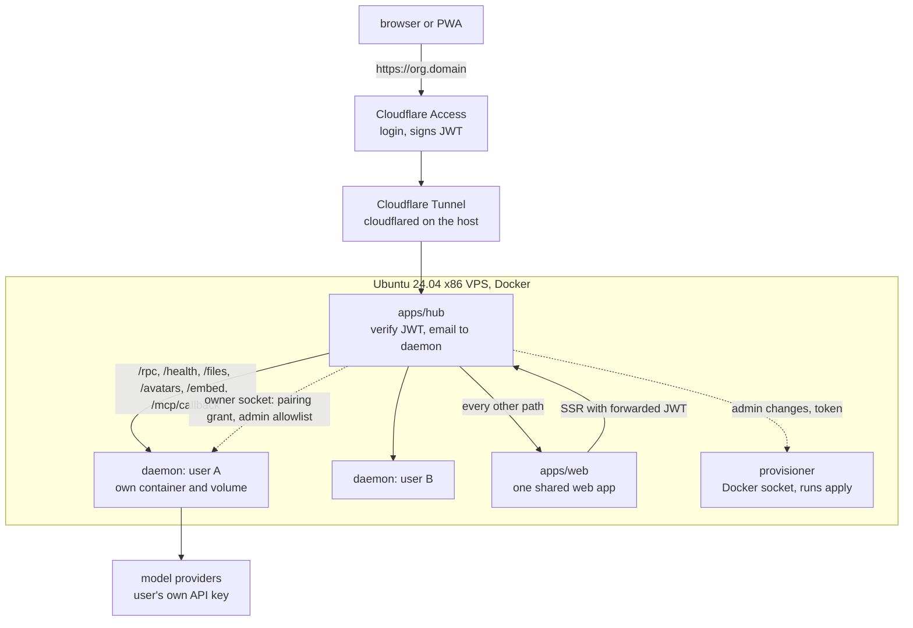

# Team workspace

How Orbs serves a small team (3-7 users per installation) without making the daemon multi-user. Human setup guides: [`docs/team-workspace/`](../../docs/team-workspace/README.md). Keep this file and those guides current when the design, phase status or a gotcha changes.

## Design

Each user gets an unchanged single-owner daemon in its own hardened Linux container. One hub per organization is the only front door: Cloudflare Access logs the user in, the hub verifies the Access JWT, maps the email to that user's daemon and forwards. The daemon never learns about users; its owner is whoever the hub routes to it.

- Hub routes by verified identity only. Cookies, `x-bots-server-id`, `Host` and `x-forwarded-*` never choose the daemon. Users come from `HUB_DATA_DIR/users.json` (email to id, `daemonUrl`, `socketPath`); the hub pins each daemon's serverId in `pins.json` on first contact and checks `/health` against it before forwarding. Hub env: `ACCESS_TEAM_DOMAIN`, `ACCESS_AUD`, `HUB_HOST`, `HUB_PORT`, `HUB_DATA_DIR`, `HUB_WEB_URL`, `HUB_PUBLIC_URL`, `HUB_ADMIN_EMAILS`, `PROVISIONER_URL`, `PROVISIONER_TOKEN`. Behaviour and wire details: the Hub section of [`api.md`](api.md).
- Admin panel (Phase 3): `/admin*` is a separate route for emails in `HUB_DATA_DIR/admins.json` (seeded from `HUB_ADMIN_EMAILS` while empty). An admin is just an email, not necessarily a user. Pages go to the web app (`HUB_WEB_URL`, the panel is an `/admin` area of `apps/web`); `/admin/api/*` is the hub's own JSON API: admins, users (through the provisioner, which alone holds the Docker socket and owns `users.yaml`), and `users/:id/rpc/*` relayed to that user's owner socket ("private door"), pinned by server ID, POST only. `admins.json` is the one admin list: the hub sends it to the provisioner at start and after every change, so the Access allow list follows it. Details: the Hub section of [`api.md`](api.md).
- Template workspace and global settings (Phase 3 wave 2): `apply` always runs one extra daemon with the reserved id `template` (service `daemon-template`, network `user-template`, volume `data-template`, `ipc/template`), in `users.json` as `"template"` with no email, so no login and no Access rule ever reaches it. The admin edits it through the relay as `users/template/rpc/*` with the same forms. Its five settings sections (`models`, `chat`, `tools`, `secrets`, `sources`) are followed (`global`) or overridden per user and section; the hub keeps modes and copy results in `HUB_DATA_DIR/global.json` and copies a section from the template's owner socket to each follower's, with the forms' procedures plus owner-socket-only exports for keys, secret values and `~/.agents`. Its bots are the suggested bots: copied, with their own files, to a new person at creation or later. Wire details: the Hub and Owner socket sections of [`api.md`](api.md).
- First visit: the hub marks onboarding complete and mints a pairing grant over that daemon's owner socket, then redirects to `/connect?code=<payload>`; the page redeems it once with the default device name. No PIN, no device-name form, and no onboarding steps: the admin configures the workspace. The device token lives in the web cookie as today.
- Private door (Phase 3): the owner socket also serves an explicit allowlist of the oRPC router (settings, providers, skills, MCP, secrets, bots, routine and todo lists, onboarding, devices) to the owner without a device, for the admin panel through the hub. Since wave 3 it also serves exactly the reads the read-only viewer uses (conversation list, history, search and reactions; attachment download and poster only for the hub's file route), over HTTP only. Conversation and tool writes, watch streams, routine and todo changes and pairing beyond bootstrap are refused. The hub records every conversation, routine and todo read (admin, person, bot, conversation, procedure; no content) in its audit trail, accepting those reads only as JSON it parses, and serves a person's files to admins at `/admin/api/users/<id>/files/<botId>/<attachmentId>`. List and rules: the Owner socket and Hub sections of [`api.md`](api.md).
- Conversation viewer in the panel (Phase 3 wave 3): **Conversations** per person lists their chat with each bot, searches on Enter and shows the transcript read only, built from history reads only: no watch, no read marks, a **Refresh** instead of live updates. It reuses the app's transcript; controls that would write do not render in the admin scope. Subagent runs and private bot-to-bot chats open in a read-only pane from history. Files load through the hub's admin files route. Known gaps: an artifact shows only its title (its code would run in the panel), a waiting approval or question shows as an unfinished tool step (no approval card), a reply still being written appears on **Refresh**, and link previews are off.
- Audit trail (Phase 3 wave 4): the hub keeps `HUB_DATA_DIR/audit.sqlite`, one append-only table, one row per admin read (the audited relay reads and the files route) and per admin change (people, admins, section modes, global sync, bot copy, every other relay call by procedure and bot id, never a body), with time, admin, kind, action, workspace, bot, conversation and status. `GET /admin/api/audit` pages it newest first with filters; the panel's **Activity** page shows it, and a person's page links to their rows. A read whose row cannot be written is refused (503); a change stands and logs an error. The `hub-audit` log line stays. Details: the Hub section of [`api.md`](api.md).
- Global settings in the panel: **Global settings** is the same per-user settings and bot screens pointed at `/admin/users/template/*` (only the sections `GET /admin/api/global` lists), plus a sync status view. A person's section that follows global is shown read-only with **Override for this person**; an overridden one has **Back to global** behind a confirmation. **Add user** lists the template's bots ticked; a person's Bots page has **Add from suggested bots**.
- Daemon: `DAEMON_PUBLIC_URLS` makes it advertise only those origins and accept them as browser Origins. Web: `WEB_HUB_URL` turns on hub mode; SSR sends every daemon call to the hub with the request's Access JWT and the web server answers 404 on daemon paths. Do not confuse it with the hub's `HUB_WEB_URL` (where the hub sends non-daemon paths).
- Cloudflare (`bun scripts/deploy.ts cloudflare apply|emails|destroy`): one remotely managed tunnel per server, its routes kept in Cloudflare (team host to `http://hub:47192`, cloudflared also checks the Access JWT except on the exact icon paths), Access policies and apps, and a proxied DNS record created last. Objects are owned by exact names built from `--name orbs-<team>` (DNS by the comment `orbs deploy <name>`); the script refuses foreign objects on its hostnames. The allow policy (Phase 3 wave 2) is either a list of emails from `users.yaml` (enabled users plus `admins:`, the same list `apply` renders daemons from; `emails --users -` reads it over ssh) or, with `apply --domain <domain>` (repeatable), "emails ending in @<domain>" plus the `users.yaml` emails outside those domains (outside admins). Only `apply` sets the domain rule, exactly from its flags; `cloudflare emails` and the provisioner keep the policy's own domain rule and change only the listed emails. With a domain rule the hub is the real gate: anyone at the domain can get a login code and a valid Access JWT, and the hub serves only users and admins (others get its refusal page). The install token stays on the admin's computer; by hand, adding or removing someone is `apply` on the server, then `cloudflare emails` from the admin's computer, unless the person is inside the domain rule. A narrower token (Zone: Zone: Read, Access: Apps and Policies: Edit) in `.env` as `CLOUDFLARE_API_TOKEN` lets the provisioner update only the allow policy itself and show the panel whom it lets in (Read is enough for showing); the install recommends it for email-list installs. The server gets `ORBS_PUBLIC_HOST`, `ACCESS_TEAM_DOMAIN`, `ACCESS_AUD`, `CLOUDFLARE_ZONE`, `CLOUDFLARE_NAME`, `CLOUDFLARE_ACCESS_DOMAINS` and `TUNNEL_TOKEN` in `/opt/orbs/.env`; cloudflared runs as `deploy/cloudflare/cloudflared.compose.yaml` on a `tunnel` network shared only with the hub.
- Images (`deploy/docker/Dockerfile`): Bun bundles without `node_modules`, the artifact embed prebuilt, uid 1000 under tini, read-only root. All daemon state lives on the user's `/data` volume: `DATA_DIR`, `HOME=/data/home` and `PI_CODING_AGENT_DIR=/data/pi`.
- Deployment (`deploy/compose/`, `/opt/orbs` on the server): `users.yaml` (`users: {<id>: <email> | {email, name, enabled}}`, `admins: [<email>]`) is the only list of people; a disabled user is left out of `users.compose.yaml` and `users.json` (no login, container removed, volume and `ipc/<id>` kept). `bun deploy.ts apply` renders `users.compose.yaml` (per id: service `daemon-<id>` extending `daemon.yaml`, network `user-<id>`, volume `data-<id>`) and `hub/users.json` (`http://daemon-<id>:47191`, `/ipc/<id>/rpc.sock`), creates `ipc/<id>`, brings everything but the hub and provisioner up with `--remove-orphans`, creates those two only if missing, and connects or disconnects the hub to user networks at run time so the hub (and every WebSocket) survives adds and removes. Owner sockets live in one `ipc` volume: each daemon mounts only its subfolder at `/data/data/ipc`, the hub mounts the whole volume at `/ipc`. `backup`, `restore` and `purge` run tar or rm in the networkless root `tools` service. Upgrades are `ORBS_TAG` in `.env` plus `docker compose up -d --wait`. Model keys reach daemons as provider env vars from `.env`. Volume and network names come from Compose's project name (`docker compose config`), so `COMPOSE_PROJECT_NAME` gives a second stack on one host.
- Provisioner (`bun deploy.ts provisioner` in the `orbs-provisioner` image, Phase 3): the only container with the Docker socket. It runs the same `apply` as by hand, one change at a time, for the hub's admin panel, and answers only `Authorization: Bearer $PROVISIONER_TOKEN` (sha256 then `timingSafeEqual`) on port 47193 of the internal `provisioner` network (hub and provisioner only); its own `egress` network reaches the Cloudflare API. Image: Bun distroless plus the static Docker CLI and Compose plugin from `docker:29.8.2-cli`, the smallest way to run the same Compose path (the raw Docker API would mean rewriting Compose). 73 MB compressed (arm64), 14 MiB idle. Root with every capability dropped, read-only root, `/opt/orbs` mounted at the same path so Compose resolves `./hub` as on the host. Wire (JSON; every request needs the token, else 401): `GET /health`; `GET /users` -> `{ users: [{ id, name, email, enabled, state }] }` (`state` from `docker compose ps`: `running`, `starting`, `stopped` for no container or exited, `unknown`); `PUT /users/:id { name, email, enabled }` (exactly these keys, `content-type: application/json`) -> `{ id, name, email, enabled, state, access }` once `apply` returned (that person's daemon healthy, `users.json` written; a panel change waits only for the changed person, so another person's unhealthy daemon cannot fail it), 409 when another user has the email; `DELETE /users/:id` -> `{ id, access }`, 404 if unknown; `PUT /access/admins { emails }` (at most 100) -> `{ emails, access }`, stored as `admins:` in `users.yaml` with no `apply`; `GET /access` -> `{ domains, emails }`, whom the allow policy lets in (`emails: null` when unknown: no token, Cloudflare unreadable, or rules Orbs does not manage; `domains` then from `CLOUDFLARE_ACCESS_DOMAINS`), never queued behind a change. Ids must match the hub's `^[a-z\d][a-z\d-]{0,62}$` (400), names 1-100 characters without control characters or outer spaces, emails at most 254. `access` is `synced` when `CLOUDFLARE_API_TOKEN` is set and the policy update succeeded, or, without a token, when the change adds or removes no email outside `CLOUDFLARE_ACCESS_DOMAINS` (nothing to change in Cloudflare); else `manual`. A failed `apply` is 500 `{ error, rolledBack, access }`: a change that leaves the person enabled is rolled back in `users.yaml` (so a retried create is not a 409), a disable or removal is kept (so the login stays gone), and Access follows whichever list stands. A panel change and a by-hand `apply` take `users.yaml.lock` in `/opt/orbs`; the second one fails at once with a message (a lock older than 10 minutes is a crash leftover and is taken over). A change takes 2-4 s locally; the hub's client must wait at least that long per queued change (the provisioner's own idle timeout is 240 s).

## Decisions

| Decision | Why |
| --- | --- |
| One single-owner daemon per user, one container and volume each; no users table in the daemon | The container is the only isolation between users: a bot's bash sees the whole container. Keeps the daemon's security model intact |
| One public hostname per organization behind a Cloudflare Tunnel; Access is the login | No open inbound ports; Access gives identity, OTP or IdP, and revocation without Orbs accounts |
| The hub routes by the verified `Cf-Access-Jwt-Assertion` (fallback `CF_Authorization` cookie); clients never choose their daemon | Cookie-named addresses made the web server an SSRF and wrong-daemon surface |
| The hub reaches each daemon's owner socket through a mount of only `data/ipc`, as the daemon's uid | The socket serves pairing bootstrap and the admin allowlist only; the Docker socket would make the internet-facing hub root on the host. The user's bot controls that folder, so the hub must not trust what it finds there (risk 1) |
| No admin device and no impersonation. Admin may audit everything, but only through an admin panel over the owner socket, never as the user | A device paired into a user's daemon steals that user's pushes and can be revoked by them; acting as the user blurs accountability |
| Admin panel on the same hostname under `/admin`, open only to admin emails the hub checks in the Access JWT; an admin is just an email, not necessarily a user. Admins add and remove admins and users | One login and one hostname; admins need no workspace |
| The admin panel reaches a user's daemon only through its owner socket, relayed by the hub, never by pairing a device or using the public door. The socket serves an explicit allowlist that fails closed; anything acting as the user in a conversation is not on it | No impersonation: the panel sees the same settings and bot forms as the app, and reads chats read-only (wave 3), but cannot send messages, answer approvals or questions, or change anything in a chat |
| Nothing is removed or locked in the user app in Phase 3; no permission flags | Users keep everything they have; global settings with per-section overrides, suggested bots and a conversation viewer are later waves |
| A new user's id comes from the name (else the email), unique against current users and every pinned id | A removed user's volume is kept; reusing an id would hand a new person the old person's data |
| Admins are fully trusted. Stdio MCP servers, plugins and skills stay on the private door, so an admin can run code inside any user's workspace and can technically read that user's data; the panel simply offers no feature to chat or answer as the user (owner decision pending confirmation, Phase 3 integration) | Configuring a user's bots, MCP included, is what the panel is for; refusing code-bearing configuration would leave the panel unable to set bots up |
| Routines and todos belong to the user: the private door only lists them and the panel shows them read-only (owner decision pending confirmation) | A routine runs a prompt with the user's tools and secrets in the user's conversation list, which is acting as the user |
| The admin may read every conversation, "like Slack", read only, through the private door and the hub relay; the reads leave no trace in the person's app, every read is logged in the hub without content, and there is no export or live stream (Phase 3 wave 3) | Auditing without impersonation: the same owner-socket path as the forms, existing read procedures that are proven side-effect free, and accountability in the hub log |
| The audit trail is a SQLite file the hub owns in its data folder (`hub/audit.sqlite`), append-only, never content or values; a read that cannot be recorded is refused, a change that cannot be recorded stands and is logged as an error; no pruning (Phase 3 wave 4) | The container log vanished on every upgrade (gotcha 109); a file next to `admins.json` survives upgrades, `apply` and rollbacks with no new service. Refusing a change after it happened would only make the admin repeat it |
| The hub's `admins.json` is the one admin list; `admins:` in `users.yaml` is the provisioner's copy for Access, refreshed by the hub at start and on every change | Two lists drifted (review finding 5): an admin missing from `admins:` lost their Access login on the next user change |
| MCP OAuth sign-in is not offered in the panel (known gap); API-key MCP and every other MCP setting are | The provider's callback lands on the hub, which routes it by the admin's own identity, never the user's daemon (gotcha 42) |
| Notifications stay one device per notification, chosen per daemon as today | The daemon only knows its own user's devices once admin devices are gone |
| Models: Pi's provider system unchanged, each user's own API keys. No shared subscription logins, no model gateway yet | Provider terms forbid routing other users through one subscription: Anthropic's "Authentication and credential use" quoted in `ijpatricio/spike-hetzner:spikes/hetzner/FINDINGS.md` Spike 6, section 6; OpenAI forbids sharing account credentials (same section). [`cliproxy.md`](cliproxy.md) is for a single owner's own subscription only |
| Access allows either a list of emails or a whole email domain (`apply --domain`), plus outside emails; with a domain rule the hub's user and admin lists decide who gets in, and anyone else at the domain gets the hub's refusal page (Phase 3 wave 2) | One-step login for the admin: adding a person at the domain needs no Cloudflare change and no token on the server. A login code is not access to anything; the hub was already the gate for every path |
| The panel shows per user and admin whether Access lets them in (`allowed`, `not-allowed`, `unknown`) and the domain rule, read from the policy by the provisioner and cached 15 s; `unknown` without a token or when Cloudflare is down, never an error | The admin sees at once who cannot log in; only the provisioner holds a Cloudflare token, and a read-only one is enough |
| A page load by a signed-in person the hub refuses gets the hub's own static 403 page (who they are, why, whom to ask, sign out); API calls keep the empty 403. An admin who is not a user is sent to `/admin` instead | With a domain rule strangers at the domain reach the hub; the web app cannot render for someone with no daemon, so the page is plain English without i18n |
| Remotely managed tunnel; cloudflared as a container with only `TUNNEL_TOKEN`; one script owns tunnel, Access and DNS | One secret on the server and no config file; re-running the script restores routes, apps and DNS; the connector needs no host install and sits on a network with only the hub |
| Access emails follow `users.yaml`; no Access service tokens | One list of people. A token without "Access: Service Tokens: Edit" cannot create them (Phase 1 spike), so nothing depends on them |
| A separate provisioner holds the Docker socket; the hub never does | The internet-facing hub stays unprivileged; the root-equivalent part has a tiny API, one caller and no internet-facing surface |
| The provisioner runs `scripts/deploy.ts apply`, not its own Docker logic; it lives in that script as the `provisioner` subcommand | One code path for the panel and by hand; deploy tooling, not product logic, so no new app |
| Disabling a user removes their container (Compose leaves them out) instead of keeping it stopped | Same path as removing; no Compose scale or profile tricks; re-enabling recreates it on the same volume |
| The panel is an area of `apps/web` that reuses the user app's settings and bot forms through `useRpc()` and a section-scope context, not a second app | Real reuse with the least change: the same components, a per-user RPC client and per-user links |
| The panel shows each user the same settings and bot sections as the app, minus what is personal to one browser (theme, notification permission, Enter key, desktop) and anything the owner socket refuses (pairing, chat links). Provider sign-ins offer API keys only | Nothing is removed from the user app; a subscription sign-in by an admin would put the admin's own account in the user's daemon |
| Global settings live in a hidden template workspace (reserved id `template`), edited with the same forms as a user; each settings section of each user follows global or is overridden (per section, not per field). Saving a global section copies it to every follower; switching back to global copies the global values in again; a new person starts with every section global | The admin learns one set of forms; per-section overrides keep the model simple; the template is an ordinary daemon, so nothing new runs inside a person's workspace |
| Bots on the template are suggested bots, copied (profile, avatar, instructions, model, fallback, approval mode, the bot's own skill, instruction and MCP files) to a person at creation when ticked, or later; copies are new bots, independent afterwards. Conversations, routines and todos never travel | Starting points, not shared bots: the person owns their copy |
| Sections are copied through the private door with the forms' procedures; only values the forms cannot read (stored API keys, secret values, the Jev key, `~/.agents` files, a bot's own files) use owner-socket-only export and import procedures that the public door and the admin relay both refuse | The narrowest new surface; secret values never reach a browser and cross the hub only in memory |
| A user the hub has no record of (added by hand, or present before global settings) has every section overridden; an unreadable `global.json` refuses section writes and global changes instead of guessing | Never overwrite someone's own settings by accident; fail closed |
| The `chat` section is the daemon-wide chat settings procedure as a whole: busy mode, verbose tools and GIFs | One procedure holds them, so the 409 refusal and the copy cannot split them |
| The panel's Global settings reuse the per-user routes at `/admin/users/template/*`, not a second route tree; a person's global section stays visible but inert, with one "Override for this person" control | Real reuse: the same settings and bot routes, the same per-user RPC client and query keys (`admin-user:template`), so switching between a person and Global never mixes caches |
| Target: x86 Ubuntu 24.04 VPS with Docker; web and PWA first | Proven on Hetzner; native clients need a Cloudflare login first (Phase 7) |
| Sizing: 512 MiB limit per daemon; plan up to 5 users on 4 GB and about 13 on 8 GB (the template is one more daemon; before wave 2, 6 and 14) | Measured idle on the x86 test server (Hetzner, 2 vCPU, 3.7 GiB usable, wave 3): daemons 104-110 MiB in `docker stats` (about 150 MB RSS) after one turn, web 34-53 MiB, cloudflared 15-36 MiB, hub 12 MiB, each under 0.5% CPU; OS, dockerd and containerd about 470 MiB. An artifact preview reached 190 MiB on arm64 (PR #4). With global settings (Phase 3 wave 2, same server, three people and the template, idle): people 90-104 MiB, template 106 MiB, web 34-47 MiB, cloudflared 38 MiB, hub 15-18 MiB, provisioner 5-6 MiB, host about 1 GiB used in all; the template counts as one more person. Wave 3 (same server, three people and the template, idle 6-7 minutes after the upgrade and the probe): people 90-92 MiB, template 94 MiB, web 34 MiB, cloudflared 38 MiB, hub 14-15 MiB, provisioner 6 MiB, each under 0.3% CPU, host about 1 GiB used. Wave 4 (same server and people, idle after the upgrade and the probe): people 90-95 MiB, template 93 MiB, web 34 MiB, cloudflared 38 MiB, hub 14-16 MiB, provisioner 5 MiB, each under 0.3% CPU, host about 1 GiB used; `hub/audit.sqlite` 12 KiB with 18 rows (its minimum of three 4 KiB pages). Six daemons all at their 512 MiB limit fit in 4 GB with the shared services; typical use would fit two to three times more, but nothing caps the sum below the limits |

## Phases

| Phase | Scope | Status |
| --- | --- | --- |
| 1 | Spikes: container, multi-daemon, shared models, Hetzner with Tunnel and Access | done |
| 2 | Fleet by hand. Wave 1: (A) daemon, web and hub images, PR #4; (B) hub, PR #3; (C) daemon public-origin env and web hub mode, PR #2; (D) these records, PR #1. Wave 2: (E) Compose deployment and users, PR #6; (F) Cloudflare script and cloudflared service, PR #5. Wave 3: a from-scratch install on a fresh x86 server by following only `docs/team-workspace/`, guide fixes and the `orbs-deploy` skill | wave 3 in review; everything up to the Access login verified on the real server (forged JWTs refused, isolation, hardening, reboot, add/remove, backup/restore, upgrade/rollback); a real login by the owner pending |
| 3 | Admin panel. Wave 1: (A) admin operations on the daemon's private door, PR #11; (B) hub admin list, admin API and relay, PR #9; (C) provisioner service, PR #10; (D) panel UI in `apps/web`, PR #12; integrated, seams and the independent review's findings fixed, in one PR that supersedes those four. Wave 2: (E) template workspace, sections with per-user overrides and bot copy, PR #19; (F) panel UI for Global settings, overrides, suggested bots and sync status, PR #17; (G) no onboarding or startup PIN for provisioned people, single redeem, panel avatars, PR #16; (H) Cloudflare domain rule and Access state in the panel, PR #18; integrated with the independent review's findings fixed, in one PR that supersedes those four. Wave 3: read-only conversation viewer: (J) reads on the private door, hub relay, file route and audit log, PR #22; (K) the panel's Conversations tab, PR #23; integrated with the independent review's findings fixed, in one PR that supersedes those two. Wave 4: a durable audit trail for the admin panel (`hub/audit.sqlite`, `GET /admin/api/audit`, the **Activity** page). Owner questions at the end of the phase: what to remove from the user app, and whether users may change their own bots | wave 1 integrated and proven locally (OrbStack, real images, local JWKS, mock model, Cloudflare stub): install with one admin who is not a user, two users added and set up from the panel, each sees only their own bots and chats with the mock model, admin add/remove, 403s, disable/enable/remove, every act-as-the-user call refused through the relay. Installed on the real x86 test server (`orbs-test.example.com`, Docker 29.9.3) by following only the guides and the skill: everything up to the Access login verified (forged JWTs 401 on every path including `/admin*`, hardening, only the provisioner holds the Docker socket, daemons and web cannot reach the provisioner, add/disable/enable/delete through the provisioner in 1.8-3.7 s with another user's WebSocket open throughout and no other container restarted, owner socket refusals, reboot). A real login by the owner, as user and as admin, pending. Wave 2 integrated and proven locally (OrbStack, real images from the branch, project `orbs-p3w2`, minted Access JWTs, mock model, Cloudflare API stub, headless Chrome with screenshots): fresh install with one admin who is not a user (`/` sends them to `/admin`) and the template `ready`; every global section set and three suggested bots created in the panel; Ana added with two bots ticked and Bruno with none, both all-global and in sync before the create answered; both log in with no onboarding, one grant and one successful redeem each, no startup PIN in any daemon log; each sees exactly their bots and chats with the mock model using the copied global key, global skill and the bot's own copied skill; a global change reached both; Ana's override held while Bruno followed; Back to global behind its confirmation; the read-only section and the 409 message; Bruno disabled caught up when enabled, a stopped daemon showed *Sync failed* and Try again recovered; Add from suggested bots on Bruno and its per-bot failure message; the review's HIGH and MEDIUM races; Access state unknown without a token, allowed and not-allowed with the stub's email list, the domain notice with a domain rule; a domain-allowed stranger gets the refusal page; image avatars load for people and the template; the admin relay refuses act-as-the-user calls and the export/import procedures, the public door refuses them to a paired device, a person gets 403 on the admin API; phone width and light theme checked. Piece H's real-Cloudflare token sync is unproven (its commands are in PR #18's comment). Wave 2 upgraded on the real x86 test server from `7c0f545` to `436d820` by following `admin.md` "Upgrades" (images built on the Mac, loaded over SSH, backups first): the documented `docker compose up -d --wait` alone ran no template (gotcha 91), fixed by `apply`; the three existing people kept every value, bot, device and onboarding state and stayed overridden (gotcha 71); no daemon on the new tag logs a PIN; the template is isolated like a person (all daemon pairs blocked, the hub 200) and has no email in `users.json`; a throwaway person went through create with one copied suggested bot, every section copied, override, a global change, back to global, a later copy and its 409, disable, enable, delete and purge through the provisioner and the owner sockets from inside the hub in 2.1-4.2 s each, with no other container restarted; one real turn with a throwaway device answered through the mock with the global `AGENTS.md` and skill; the owner socket refuses conversation reads and writes, approvals and pairing, and the public door refuses the eight export and import procedures to a paired device (403); without a token the provisioner answers `access: manual` and `GET /access` `emails: null` (the panel's *unknown*); a rollback to `7c0f545` and forward again (gotcha 92). Not provable without a real login: the panel's Global settings screens, the hub's `global.json` modes and 409, and the admin relay's refusal of the export procedures. Wave 3 integrated and proven locally (OrbStack, real arm64 images from the branch, project `orbs-p3w3`, minted Access JWTs, mock model, Cloudflare stub, headless Chrome): an admin who is not a user read two people's conversations made through their own logins (text, 90+ entries paged in three pages, an image and a text file and a PDF, a bash call approved, an artifact, a subagent run and a private bot-to-bot chat opened in panes, a silent reply); search, a search hit, Refresh, switching person with the next person's history held for 3 s (no earlier transcript shown), phone width and light theme, the template's empty state; every request the tab made was a Contract 6 read or a wave-1 read, nothing on idle, focus, visibility or online; each person's chat list and sections, read with their own login, byte-identical before and after six full walk-throughs, and the mock model got no request; 25 content-free audit lines for one walk-through; 30 writes and 15 unused reads refused through the relay for a person and the template, the review's multipart audit bypass and five other bodies refused (422), a non-admin 403 on the relay and the files route, a cross-site file GET 403; wave 1 and 2 smoke (add with a suggested bot, a global change, an override, back to global). Wave 3 upgraded on the real x86 test server from `436d820` to `cef17a9` by following `admin.md` "Upgrades" literally (backups, `docker compose up -d --wait` in 8 s, `apply` in 2.3 s restarting nothing): every container healthy on the new tag, the template present, a before-and-after snapshot over the owner sockets of each person and the template (onboarding, chat, tools, secrets, sources, provider state, `auth.json` and `models.json` hashes, bots, devices, `~/.agents`) identical, `global.json` still absent (everyone overridden), pins and `users.json` unchanged, no PIN in any log. On a throwaway person `probe` (provisioner create, the mock, one bot, a throwaway device revoked afterwards; text, a text file, a bash call approved through `tools/answer`): the owner socket refused all 60 procedures outside `RPC_LOCAL_ALLOWLIST` with 403 (with a target and with an empty body), GET 404, an `Origin` 403, an upgrade 404; the viewer's reads answered 200 from inside the daemon and from inside the hub as the relay and file route send them (pinned server ID; a wrong one 409); the person's own view through their device and every file under `/data/data` and `/data/agents` (hash and mtime) were identical after the reads; the public door still 401 without a device and 403 on the exports with one. From outside, `/admin` and the viewer's relay and file paths 302 to the login and the hub logged nothing; from the tunnel network, with no or a forged JWT, 401. Not provable without a real login: the panel's Conversations tab and the audit lines. Wave 4 proven locally in the real arm64 images inside a throwaway `docker:29.8.2-dind` (Linux ownership; `apply` run as root from the provisioner image on a fresh `/opt/orbs` with no `hub/`): the hub created `audit.sqlite` itself as `1000:1000` mode 0600 under `read_only`, `cap_drop: ALL` and uid 1000, no `deploy.ts` change needed; every kind of read and change wrote its row (26 for one run, including two 409 retries and a refused `workspace/export` 403); a secret saved with `secrets/save`, an API key through `providers/login` and `providers/complete`, bot instructions and a search term appear neither in the file's bytes nor in the hub log; a recreated hub container kept all 58 rows while its Docker log started empty; the wave 3 hub (`cef17a9`) ran healthy against the folder, served reads and left the file byte-identical, and forward again kept every row; `purge` kept the rows about the purged person; a read with the folder unwritable got 503 `audit_unavailable` and a change still answered 200, each with its error line; non-admin and unknown identities 403, no or a forged JWT 401, POST, PUT, PATCH and DELETE on `/admin/api/audit` 404; the **Activity** page in headless Chrome (empty state, rows, filters, a filtered empty state, load more, the person link, phone width, light theme). Not provable here: the page behind a real Access login on the server. Wave 4 upgraded on the real x86 test server from `cef17a9` to `4d66102` by following `admin.md` "Upgrades" (backups of the three people, the template and the hub folder; `up -d --wait` 8.5 s; `apply` 2.3 s, restarted nobody): every container healthy on the new tag, the template included; the hub created `hub/audit.sqlite` as `1000:1000` mode 600 with no journal beside it; the three people, the template, `global.json`, pins, `users.json` and `admins.json` byte-identical before, after and after the probe (owner-socket snapshots: settings, bots, devices, no conversation reads); no onboarding, no PIN. On a throwaway person `probe` (provisioner, mock model, a bot, a chat with a file and an approved bash call through a throwaway device revoked afterwards), a second copy of the hub's code inside `orbs-hub-1` with its own test key and test admin (gotcha 114) wrote 18 rows to the real file: `secrets/save`, `providers/login`, `providers/complete`, `bots/update`, `sections/overridden` (detail `chat`), `users/update` 501 (no provisioner there), `workspace/export` 403, and the reads `conversation/list`, `history` (with bot, and with conversation when the body names one), `search`, `routines/list`, `todos/list` and a file (`attachments/download`, served with the sandbox CSP); `bots/list` and reading the trail wrote nothing, and POST, PUT, PATCH and DELETE on `/admin/api/audit` (and DELETE `/admin/api/audit/1`) answered 404. The dummy secret, the dummy provider key, the bot instructions and the chat text: 0 matches in the file's bytes, its copy, the hub log and the side hub's output. `up -d --force-recreate hub` kept all 15 rows then (same sha256) while the new container's log had 0 `hub-audit` lines, and new rows appended as 16-18. On a copy of the file in a folder made `chmod 500`, a history read answered 503 `audit_unavailable` and a `bots/update` 200, with both error lines; the real file and hub were untouched. `purge probe` kept the 18 rows. From outside, every method on `/admin/api/audit`, `/admin/api/audit/1` and `/admin/activity` 302 to the login; from the tunnel network with no or a forged JWT, 401. Left in Phase 3: the owner's deferred testing of wave 2 and a real login to the viewer, the open question whether **Back to global** should replace the person's section or merge into it, and the owner's two end-of-phase decisions (what to remove from the user app; whether users may modify their own bots) |
| 4 | Permissions: what users may change, after the owner's answers at the end of Phase 3 | planned |
| 5 | Read-only conversation viewer (now a later wave of Phase 3) | moved to 3 |
| 6 | Hardening: bot tools in a separate sandbox, outbound limits, backups, optional model gateway with per-user keys | planned |
| 7 | Clients: PWA push, Android build, stores, native login via Cloudflare Managed OAuth | planned |
| 8 | Computer use: headless browser, then a desktop container per user, then a cloud desktop | planned |
| 9 | Templates and per-user model overrides | planned |

## Risks and gotchas

Most important first. Spike sources are on branches, read with `git show <branch>:<path>`: container = `ijpatricio/spike-container:spikes/container/FINDINGS.md`, multi = `ijpatricio/spike-multi-daemon:spikes/multi-daemon/FINDINGS.md`, models = `ijpatricio/spike-shared-models:spikes/shared-models/FINDINGS.md`, hetzner = `ijpatricio/spike-hetzner:spikes/hetzner/FINDINGS.md`. "Review" = the independent Phase 2 wave 1 review of PRs #1-#4.

1. **Until Phase 6 a bot controls its own daemon and its own `data/ipc` folder.** Bash and Pi's in-process `read` run as the daemon uid: bash can call `data/ipc/rpc.sock` and mint an owner device on its own daemon, and both read `credentials.key`, `app.sqlite`, `auth.json` and `models.json`. Env vars reach bash unfiltered. AppArmor exec stacking (`orbs-daemon//&orbs-bot`) blocks bash only; `read` and non-bash children (stdio MCP) stay unconfined. Because the hub mounts that same folder, a bot can try to replace `rpc.sock` with a symlink to another user's socket. The hub refuses a `socketPath` that is not a real socket or sits below a symlinked folder, refuses duplicate `daemonUrl`/`socketPath` entries and a serverId already pinned to another user. One gap remains: the check and the connect are separate steps (fetch cannot connect from a file descriptor), so a bot can swap the socket in between; the grant it gets is for another daemon's server ID, which the hub refuses to hand out, and the bot cannot reach that daemon anyway. Per-daemon networks reachable only by the hub are the real boundary (risk 29). Do not deploy beyond a trusted team before Phase 6. Sources: multi Q2, models Q4, hetzner Q5, review finding 1, the Hub section of `api.md`.
   **Since Phase 3 the owner socket is also the admin's private door**, so everything on its allowlist (settings, provider keys, secrets, MCP, bots, devices) a bot's bash can also do to its own daemon, without pairing, until Phase 6 moves bot tools out of the daemon's uid. Keep the allowlist to what the settings and bot forms need. Since wave 2 it also serves owner-socket-only exports of stored API keys, secret values, the Jev key and `~/.agents` files for the hub's global copies; a bot's bash could already read all of them from its own volume, so they add no reach, and the admin relay refuses them so no value reaches a browser. **Admins are fully trusted**: stdio MCP servers, plugins and skills set through the panel run code inside the user's workspace, so an admin can technically read that user's data; the panel only offers no way to chat or answer as the user. Source: Phase 3 piece A, `curl --unix-socket` against a throwaway daemon; the independent Phase 3 review, finding 1.
2. **Pairing throttles are per user, not per organization.** Each daemon receives only its own user's traffic through the hub, so its peer-keyed `public` and redeem throttles count that user's devices and hub calls together. Every wrong PIN counts against all live grants of that daemon, so a user's own mistakes (or their bot) can block their own pairing for a while. The hub mints at most 5 grants per user per 10 minutes. Sources: hetzner Q2, multi Q2, PR #3 `api.md` Hub section.
3. **The first redeem on a daemon deletes all other socket-issued grants**, so a hub grant raced the startup pairing link. Since Phase 3 wave 2 a daemon with `DAEMON_PUBLIC_URLS` (every team daemon; Compose sets it) issues no startup grant and prints no PIN, only an `orbs pair` hint. Source: multi Q2, hetzner Q6, Phase 3 wave 2 piece G.
4. **Removing a user cuts access within seconds.** Removing the entry from `users.json` gives 403 within about a second, and open WebSockets are rechecked every 5 s and closed (1008) when the user is gone or the Access token expired. A missing, unreadable or invalid file means zero users: everyone gets 403 and the hub logs an error until it is fixed, including at startup. Source: review finding 2, `api.md` Hub.
5. **`users.json` must give each user a unique daemon.** A copied `daemonUrl` or `socketPath` would route one person to another person's daemon; the hub rejects such a file (zero users), and `pins.json` lets a server ID belong to one user only. Source: review finding 3.
6. **Wrong-daemon routing after container IPs change.** Recreated containers took each other's IPs; stale cookie addresses and a stale name in the long-running Bun web server (2-5.5 min, root cause unknown, `BUN_CONFIG_DNS_TIME_TO_LIVE_SECONDS` did not help) sent alice's requests to carol. Server ID and token checks stopped any data crossing, but the web client cleared the session. Hub mode removes cookie-named addresses. With one network per user holding only that daemon and the hub, a stale name or IP can only point at the same user's daemon or nothing, so fixed IPs are not needed; the serverId pin covers the rest. Recreating one daemon on OrbStack kept its IP and the hub reached it at once. Sources: hetzner Q3, PR E.
7. **Hub mode misconfiguration reopens the old surface.** Without `WEB_HUB_URL` the web server falls back to its cookie-address proxy, which from the web container can reach any internal daemon. `WEB_HUB_URL` (web, points at the hub) and `HUB_WEB_URL` (hub, points at the web app) are easy to swap. The hub answers 400 to paths with empty or dot segments (`//rpc`) before routing. `HUB_PUBLIC_URL` is required: the hub sets `X-Forwarded-Proto` and `X-Forwarded-Host` from it. Unset `DAEMON_PUBLIC_URLS` or `ACCESS_*` fail closed. `vite dev` fronts one fixed daemon; only the built server works with several. Sources: review finding 5, multi Q1, hetzner Q3.
8. **A public origin gets 403 from every daemon** unless it is in `DAEMON_PUBLIC_URLS` or `DAEMON_ALLOWED_ORIGINS`: the hub passes the browser `Origin` through. Origins must be bare (no path), so native clients need host-based routing. Sources: hetzner Q3, PR #2.
9. **After "revoked" or "replaced" the hub re-pairs the browser.** `GET /connect` without `code` mints a grant whenever the request has no `bots.connection` cookie for this user's daemon, including after `?reason=…`; the 5-grants-per-10-minutes limit ends any loop. Source: review finding 4, `api.md` Hub.
10. **`HOME` must live on the volume** (`HOME=/data/home`, set by the image): Pi's global skills (`~/.agents/skills`), `~/.agents/AGENTS.md`, `~/.agents/mcp.json` and bot dotfiles otherwise vanish or are unwritable under `--read-only`. Sources: container 4-5, models risk 9.
11. **Pi needs a writable Pi dir even to read credentials** (lock directory `auth.json.lock`, `models-store.json`). A read-only Pi dir breaks every turn; a file bind mount into a missing `/data/pi` makes Docker create the directory as root and every turn silently stalls (the image pre-creates `/data/home` and `/data/pi` as uid 1000; its wrapper creates them on an empty bind mount). Mount shared files as symlinks or nested read-only mounts inside a writable per-user Pi dir; never bind-mount `auth.json` alone (it disables cross-process locking). Sources: models Q2, Q5; hetzner Q2; PR #4.
12. **Settings → Providers stores API keys and OAuth logins in plaintext `auth.json`**, not the encrypted credentials table, and a stored key beats `models.json` and env. `models.json` is read once at start (restart to apply); skills and instructions are picked up within 30 s. Source: models Q1, Q2.
13. **Images.** PR #4 ships the desktop server bundles (no `node_modules`) with the artifact embed prebuilt: daemon image 89 MB compressed for amd64, web 51 MB, hub 44 MB. All three ran together hardened on OrbStack (arm64): two daemons idled at 140-150 MiB after a turn, web at 100 MiB and hub at 33 MiB. Bundles run with `bun --no-install`, or an optional `require` makes Bun download from npm at runtime and crash with `EROFS` on a read-only root. A daemon run from source still builds the embed at runtime (Bun.build + Tailwind, about 450 MiB). The daemon image has no git, curl or ffmpeg (videos get no poster). Build on CI or a workstation, not the production host (dockerd held 790 MB; the build cache reached 14 GB). Bun on x64 needs AVX2. Sources: PR #4, container 1, hetzner Q1, Q4.
14. **Hub image env** (review finding 6): the image sets `HUB_HOST=0.0.0.0`, `HUB_PORT=47192` and `HUB_DATA_DIR=/data`, exposes 47192 and checks `/hub/health`; `HUB_WEB_URL`, `HUB_PUBLIC_URL`, `ACCESS_TEAM_DOMAIN` and `ACCESS_AUD` come at run time. Compose mounts the shared `ipc` volume at `/ipc`, so each `socketPath` is `/ipc/<id>/rpc.sock` with no symlinks; a volume subpath per user would force a hub recreate on every add. The hub bundle is about 0.5 MB.
15. **Owner socket constraints.** No peer-credential check: any same-uid process can mint a grant. The hub must run as the daemon's uid (socket 0600, directory 0700 with an owner check); every image runs as uid 1000, the hub included. Distinct uids per user would need one hub process per uid. The mount must be read-write and exist before the hub starts. Host uid 1000 equals the container uid, which matters for bind mounts; a high uid or userns-remap is a later hardening option. Unix socket paths are limited (104 bytes on macOS). Sources: multi Q2, hetzner Q5, Q6, PR #4.
16. **Bun as PID 1 ignores SIGTERM**: the images run tini, so stops take about 0.2 s; any other Bun container needs an init. Use `restart: unless-stopped`; routines and alarms run only while the daemon runs, and an overdue routine fires once on start. Sources: hetzner Q7, container 4, PR #4.
17. **PWA behind Access.** The manifest, its icons and `/favicon.ico` 302 to the login unless an Access Bypass covers `/img/favicon/*` and `/favicon.ico` (the hub also lets those icon files, not their folder, through without a JWT). The script creates one bypass app with both paths and a tunnel route that skips cloudflared's JWT check only for `^/(?:img/favicon/[^/]+|favicon\.ico)$`. On session expiry the web client sees a redirect on `/health` and reloads at most once a minute so Access can sign the user in; the app session defaults to 24 h. iOS standalone login cookie handoff is untested. Sources: hetzner Q5, PR #2, PR #3.
18. **Native clients and Access.** Managed OAuth sends `Authorization: Bearer`, the header Orbs uses for device tokens, so the device token must move first. React Native's WebSocket needs Access headers on the upgrade. Don't build on cloudflared's undocumented CLI handoff. Source: hetzner Q4.
19. **Hub state must persist** in `HUB_DATA_DIR` (`users.json`, `pins.json`) on a volume. A pin mismatch is a 502 with an admin-facing log line, never a forward; change `pins.json` only after confirming which daemon belongs to whom (for example after a deliberate daemon reset). Sources: hetzner Q6, `api.md` Hub.
20. **Any paired device can revoke every other device and change daemon-wide settings** (providers, addresses). Acceptable while each daemon has only its own user's devices; admin roles are Phase 4. Sources: multi Q4, models Q3.
21. **Push targets one device per daemon and carries no serverId**; each daemon needs outbound access to `exp.host`. Push receipts and `DeviceNotRegistered` are not handled. Source: multi Q5.
22. **`bots.create` rejects the default `thinkingLevel: 'off'` for some models** (Opus 5.5): anything provisioning default bots must send it. Source: container 3.
23. **Keep the 512 MiB limit per daemon** until server measurements exist; a heavy tool run adds to the base, and `orbs pair` runs a second Bun of about 110 MiB in the same cgroup. `apt`, `npm -g` and `pip` by bots fail under a read-only root and no root user. Sources: container 5, hetzner Q4, PR #4.
24. **A `?code=` link pairs automatically in every mode** (PR #2): in single-daemon mode a crafted link can pair an unpaired browser to another server without a click. Source: review finding 7.
25. **Access bypass paths match more than they say.** `//img/favicon/x`, `/img/./favicon/x`, `/IMG/FAVICON/x`, `/favicon.ico/x`, `/img/favicon/`, `/img/favicon/..%2frpc` and `/img/favicon/..;/rpc` all passed the Access bypass at the edge. cloudflared's JWT check refused each (403, "no access token in request"), so only the exact icon paths reached the origin. Keep `originRequest.access.required` on the main route and the strict icon route. Plain `..` and `%2e%2e` forms are normalized by the edge and get the login 302. Source: Phase 2 piece F probes against `orbs-test.example.com` (PR description).
26. **The tunnel token is a full connector credential.** Whoever holds `TUNNEL_TOKEN` can run a connector for the tunnel and receive the team's traffic; it lives only in `/opt/orbs/.env` (mode 600). The routes live in Cloudflare: anyone with the API token can change them, and dashboard edits are undone by the next `apply`. `destroy` needs the connector stopped first, then deletes DNS, tunnel, apps and policies in that order. Source: piece F.
27. **Docker networks reach host services.** From a container on the `tunnel` network, the host's sshd answered at `host.docker.internal:22` (the SSH route relies on it). Any host service listening on `0.0.0.0` is reachable from every bridge network, daemons included; "reachable only by the hub" holds between containers, not for host ports. Source: piece F, busybox `nc` on the test server.
28. **The account holds unrelated objects with an `orbs` prefix** (`orbs`, `orbs-pwa-icons` Access apps on `orbs.example.com`). Ownership is by exact name, never by prefix; `--name` must start with `orbs-`. Source: piece F account listing.
29. **Isolation between users is Docker's per-bridge drop rule** (`DOCKER` chain: `! -i br-X -o br-X -j DROP`), not anything Orbs adds. On a stock Linux dockerd (docker:29-dind) daemon A could not reach daemon B by name or IP, the web app, cloudflared or the hub's other addresses, while reaching the internet; the hub reached every daemon; this held for a user added later and after a dockerd restart. **OrbStack does not enforce it**: there daemon A reached B's IP. Prove isolation on Linux, never on a Mac. Daemons still reach host services (risk 27) and the provider metadata service (risk 37); outbound limits are Phase 6. The same proof on the x86 Hetzner server: daemon A could not reach B by name or IP, nor the web app, cloudflared or the hub's addresses on other networks; the hub reached both. Sources: PR E, wave 3.
30. **A nested mount into a fresh volume makes Docker create the missing parent as root**: mounting `ipc/<id>` at `/data/data/ipc` left `/data/data` root-owned and unwritable. The daemon image pre-creates `/data/data/ipc` owned by uid 1000. Source: PR E.
31. **`apply` changes the hub's networks at run time.** `docker network connect` adds a new user's network to the running hub; a full `docker compose up` later recreates the hub with the same networks from `users.compose.yaml` (dropping every WebSocket once, as any upgrade does). The connections survive a dockerd restart. Source: PR E.
32. **The hub keeps pins in memory and rewrites the whole `pins.json`**, so `purge` stops the hub, removes the user's pin and their `global.json` modes, and starts it again; otherwise a re-added id gets 502 forever. Source: PR E, `daemon.service.ts`.
33. **Backups are a tar of the whole volume with the daemon stopped**, not `orbs backup`: the app bundle leaves out `/data/pi` (provider auth) and `/data/home` (skills, instructions). The tar holds `credentials.key` and `auth.json`. `restore` takes a safety backup first. A restore to an older image after a migration is unsupported. Source: PR E, `backup.constants.ts`.
34. **Shared model keys are plain env vars on every daemon** (`ANTHROPIC_API_KEY`, `OPENAI_API_KEY`, `GEMINI_API_KEY`, `OPENROUTER_API_KEY`, `MISTRAL_API_KEY`, `GROQ_API_KEY`, `XAI_API_KEY`, `DEEPSEEK_API_KEY`); Pi ignores empty ones. Every user's bot can read them. The daemon service lists them one by one: never give daemons the whole `.env` (it holds `TUNNEL_TOKEN`). Source: PR E, pi-ai `env-api-keys.js`.
35. **Docker Compose tries to pull a missing image tag** (`pull access denied for orbs-daemon`): load images before changing `ORBS_TAG`. Source: PR E.
36. **The hub reloads `users.json` lazily**: on the first request at least a second after the last check, not on a timer or file watch. Its `Users loaded` log line keeps the old count after `apply` until someone uses Orbs, so check `grep -c daemonUrl hub/users.json` instead. Source: wave 3, `user-query.find.ts`.
37. **Daemons reach the cloud provider's metadata service.** On Hetzner, every daemon read `http://169.254.169.254/hetzner/v1/metadata/` including `user-data`, and opened TCP to the host's sshd on its bridge gateway and public IP. Never put secrets in a server's user-data or cloud-init; Phase 6 outbound limits should block 169.254.169.254 and the host. Source: wave 3, `Bun.connect` and `fetch` from `orbs-daemon-owner-1`.
38. **Provisioning a bot without a device** goes through the owner socket since Phase 3 piece A (`bots.create` with no device; `docker compose exec daemon-<id> bun -e` with `fetch(..., { unix })`, see `docs/team-workspace/admin.md`). Before it, wave 3 had to redeem a bootstrap grant, call `bots.create` and revoke the device again. Templates are Phase 9. Source: wave 3, Phase 3 piece A.
39. **Nothing else may join an `orbs_user-<id>` network.** Besides breaking isolation, `apply` removing that person runs `docker network rm`, which fails while another container is attached. The wave 3 test mock model was attached to both user networks for this reason and must be removed before those users. Source: wave 3, `connectHub` in `scripts/deploy.ts`.
40. **`docker stats` reads lower than RSS** for Bun containers (daemon 105 MiB vs about 150 MB RSS): stats subtract reclaimable page cache. Size by `docker stats` and the cgroup limit, not `ps`. Source: wave 3.
41. **The token read can fail silently.** A locked 1Password makes `$(op read …)` empty; the script now refuses an empty `CLOUDFLARE_API_TOKEN` instead of reporting Cloudflare's `6003 Invalid request headers`. `cloudflare.env` (holds `TUNNEL_TOKEN`) is in `.gitignore`, as the install writes it in the checkout. Source: wave 3.
42. **MCP OAuth cannot finish from the admin panel.** The hub routes `/mcp/callback` by the caller's identity to the caller's own daemon, so a provider redirect after an admin started a login on another user's daemon reaches the wrong daemon (or a 403 when the admin is not a user). Logins started on the owner socket belong to `deviceId: null` and only the socket can complete them. The panel hides MCP sign-in (`canSignIn={false}` on `BotMcpPanel`); the user signs in from their own app. Fix later by passing the callback URL to `mcpAuth.complete` through the relay, or by routing the callback by `state`. Source: Phase 3 piece A, `coreMcpCallback` in `server/src/core/core.handler.ts`; review finding 7.
43. **The owner socket refuses `reset` with handoff text.** The bot form's reset is `commands.execute` with `name: 'reset'`; handoff text becomes the first message of the fresh chat, so only a bare reset is allowed there, and `compact`, `retry` and `cancel` are refused. Source: Phase 3 piece A, `RPC_LOCAL_ALLOWLIST`.
44. **Hub tests run under Node**, so Bun's `fetch(url, { unix })` silently ignores `unix` and hits `localhost:80` (a 405 from whatever listens there on this Mac). Talk to owner sockets in tests with `node:http` `request({ socketPath })`. Source: Phase 3 piece A, `apps/hub/tests/hub.test.ts`.
45. **Every `/admin*` path is admin territory.** `/admins`, `/adminx` and `/admin/api` without a route are 404 for admins and 403 for others; none of them reaches a daemon or the user web routes. An admin who is not a user gets 403 on every non-admin path except GET/HEAD on the web app's static files (`ADMIN_WEB_FILES`: `/assets/*`; the favicon paths are public for everyone). A production `/admin` load in a browser requested only `/admin`, `/assets/*` and `/admin/api/*`, all 200. Source: Phase 3 piece B, `hub-admin.test.ts`; integration browser run.
46. **Same-origin fetch GETs carry no `Origin`.** The admin relay requires a same-origin `Origin` on every call (oRPC accepts any procedure over GET, so a cross-site `` could otherwise call a write), which means the panel's RPC client must use POST, the oRPC default. Plain API reads (`GET me|admins|users`) need no Origin. Source: Phase 3 piece B.
47. **The admin relay pins by header, not by reply.** The hub sets `X-Bots-Server-Id` to the pinned ID; the daemon's base RPC middleware refuses a mismatch (409) before any procedure runs. A route on the socket outside oRPC would not check it; today the socket serves only `/rpc/*`. Source: Phase 3 piece B, `server-query.validate-connection.ts`.
48. **An admin passes Access only once the allow list has their email.** The hub sends `admins.json` to the provisioner at start (retrying for about a minute while it starts) and after every admin change; the provisioner stores it as `admins:` in `users.yaml` and syncs Access when it has a Cloudflare token. Without a token, or on a by-hand install, put the admin under `admins:` and run `cloudflare emails` (the panel says `access: 'manual'`), unless the admin is inside the domain rule. Source: Phase 3 piece B, Contract 3; review finding 5; integration run (the stub policy held the seeded admin about 4 s after start).
49. **The provisioner holds the Docker socket, which is root on the host.** Whoever controls it, or holds `PROVISIONER_TOKEN` and can reach port 47193, controls the server. Mitigations: only the hub shares its network; the token is compared in constant time; the API is six fixed routes with strict validation and no shell interpolation (ids reach `sh -c` only as `"$@"` arguments of the `tools` job, after the id pattern); no capabilities, read-only root, no published port. Residual: a hub compromise (the internet-facing process) now reaches the socket through the provisioner's API (add, disable, remove users and rewrite the allow list, nothing else); a bug in the provisioner, Bun or the Docker CLI is root; `/opt/orbs` is mounted read-write, so the provisioner can rewrite `.env` and the Compose files. `docker compose stop provisioner` turns it off; by-hand `apply` keeps working. Source: piece C.
50. **OrbStack lets a daemon reach the provisioner by IP** (401 without the token; by name it does not resolve), the same missing cross-bridge drop as risk 29. A stock dockerd (`docker:29.8.2-dind`) blocked daemon and web to both provisioner addresses by name and IP, while the hub reached it. The web app is on an internal network and was blocked on OrbStack too. **On the real x86 server (Ubuntu 24.04, Docker Engine 29.9.3) the same holds**: from both daemons, `provisioner` does not resolve (`DNS_ESERVFAIL`, fetch `ETIMEOUT`) and both of its IPs (`orbs_provisioner` and `orbs_egress`) time out; from web, the name does not resolve and both IPs fail with `FailedToOpenSocket` (an internal network has no route); the hub gets 401 from `provisioner` and its `orbs_provisioner` IP, and times out on the egress IP. Rechecked after a reboot. The risk is closed on Linux and stays open on OrbStack, which must never run a team. Source: Phase 3 real-server install.
51. **Root without capabilities cannot write a folder it does not own.** The provisioner runs as uid 0 with `cap_drop: ALL`, so the hub folder (1000:1000, 0700 before Phase 3) gave EACCES on `users.json`; `apply` as root now makes it `1000:0` mode 770, and the provisioner can only write there after one by-hand `apply` on an older install. Root-owned `.env` (600) and the Docker socket (root-owned) stay readable without capabilities. Source: piece C, volume test with the provisioner image.
52. **Compose in the provisioner must see the same interpolation as by hand.** Any variable in the provisioner's process env that `compose.yaml` interpolates with a different value than `.env` would change a service's config hash and recreate daemons on the next change. The provisioner gets only `PROVISIONER_TOKEN` and the `CLOUDFLARE_*` values from `.env`, plus `HOME` and `PROVISIONER_PORT`, which Compose does not interpolate; a by-hand `apply` after panel changes recreated nothing. An operator shell that exports one of the `.env` names breaks this either way. Source: piece C.
53. **The provisioner rewrites `users.yaml`** in the long form and drops comments. A panel change and a by-hand `apply` take `users.yaml.lock`, so they cannot run at once (the second fails with a message), but a hand edit of the file itself is not locked: don't edit it while someone uses the panel. Source: piece C; review finding 6; integration run (a panel create during a by-hand `apply` got `Another apply or admin panel change is running`).
54. **The admin panel needs its own query client and per-user query keys.** The user app's query cache treats `UNAUTHORIZED` or `SERVER_MISMATCH` as a lost pairing and clears the `bots.connection` cookie, so the panel's routes swap in `adminQueryClient` from the router context, and `adminRpc` prefixes every key with `admin-user:<id>` so switching users never shows the previous user's data. Source: `apps/web/src/services/tanstack/tanstack.client.ts`, piece D.
55. **A loader error in the client-rendered `/admin` routes blanked the page and re-ran the loader about once a second** (TanStack Router 1.170, `ssr: false`), and a component-level boundary froze the tab. Tab loaders there only prefetch; the tab component shows *Can't reach this user's workspace* from the query state (`AdminUserGate`), and child loaders ignore daemon errors. Source: piece D, stand-in hub with a stopped daemon.
56. **The panel's static files live outside `/admin`.** The `/admin` page is the web app's shell, so an admin who is not a user also needs `/assets/*`, `/img/favicon/*` and `/favicon.ico` from the web app; `ADMIN_WEB_FILES` covers `/assets/*` and the favicons are public. `/admin` routes render only in the browser (`ssr: false`), and the root route skips the pairing cookie on `/admin`, so the web server never calls a daemon or the hub for them. Source: piece D.
57. **oRPC calls without input send no `Content-Type`** (for example `bots.list`), but every call carries `X-Bots-Protocol`, so the relay can require that header instead of a JSON content type. Source: piece D, request capture.
58. **Compose cannot start a paused container.** With one daemon paused (`docker pause`), every panel change failed (`cannot start a paused container`) and was rolled back; an unhealthy but running daemon does not block a change (create answered in 2.4 s). Unpause before using the panel. Source: integration run on OrbStack.
59. **The user app has no form to add a secret**: a bot asks for one in chat. The panel, which reuses the app's forms, has none either; an admin can add one through the relay (`secrets.save`), and the panel and the user app then list it. Source: integration run.
60. **A local proof needs an http team origin everywhere.** `daemon.yaml` hard-codes `https://${ORBS_PUBLIC_HOST}` in `DAEMON_PUBLIC_URLS`, so a plain-HTTP local stack must use a copy with `http://`, plus an override for `HUB_PUBLIC_URL` and `WEB_PUBLIC_URL`; otherwise the panel's writes fail the Origin check. Source: integration run.
61. **Memory with the panel in use** (OrbStack, arm64, after the integration run): daemons 110-131 MiB, web 131 MiB (34-53 MiB idle on the x86 server before the panel), hub 43 MiB, provisioner 12 MiB. On the real x86 server (Phase 3 wave 1 images, two users with one bot each, idle a few minutes after a reboot): daemons 106-136 MiB, web 66-69 MiB, cloudflared 38 MiB, hub 14-21 MiB, provisioner 14 MiB at start and 65 MiB after it ran a few changes (`docker stats` counts the page cache of the Docker CLI it runs), each under 0.4% CPU; the host used about 810 MiB of 3.7 GiB in all. The panel itself was not used (no real login), so the web number under load is still open. Source: integration run and Phase 3 real-server install, `docker stats`.
62. **CI lints `scripts/` with a separate step** (`bunx oxlint scripts -c ./oxlint.config.ts --disable-nested-config`, job *TS lint*) that `bun run lint` does not run; run it locally after changing `scripts/deploy.ts`. Source: PR #13 CI.
63. **The hub warns while the first `apply` runs.** `apply` starts the hub and provisioner last and holds `users.yaml.lock` until they are healthy, so the hub's first admin-list sync gets 500 (`Another apply … is running`) and logs `The provisioner did not take the admin list yet; trying again` three or four times over about 6 s; the provisioner then answers `PUT /access/admins 200`. Harmless; the install guide says so. An upgrade logs it once with `Can't reach your server`, since `up -d` recreates the provisioner at the same moment, and the retry succeeds. Source: Phase 3 real-server install, hub and provisioner logs; wave 4 real-server upgrade.
64. **A test mock model must stay off the user networks.** On the real server it ran as a separate container (`test-mock-model`, not in the Compose project) on the host network, bound only to the docker0 gateway `172.17.0.1:48290`; every daemon reached it (a host address, risk 27) and nothing outside could. `ss -ltnp` then shows that one extra line. Each person's `models.json` pointed `anthropic` at it with a per-person test key; bots were created on the owner socket. Source: Phase 3 real-server install.
65. **Only the daemon image has a shell.** The hub, web and provisioner images are distroless and cloudflared has no shell, so `docker exec <c> sh` fails; checks run as `docker exec <c> bun -e '…'`. In Bun's fetch errors, code 23 is a timeout, `ETIMEOUT` an unresolved name and `FailedToOpenSocket` no route. Source: Phase 3 real-server install.
66. **There is no command to let in an email that is not in `users.yaml` yet, and since Phase 3 wave 2 none is needed.** `cloudflare emails --users` allows enabled users plus `admins:` (and keeps the domain rule), nothing else. With a domain rule, people at the domain need nothing; with an email list and a server token, the provisioner adds them; only an email-list install without a token needs a by-hand step after the add, and the panel then says *<email> can't sign in yet* with the dashboard path (Zero Trust › Access controls › Policies › `orbs-<team>-allow`). To pre-allow a future user, the real-server test piped a copy of `users.yaml` with one extra `admins:` line from the admin's computer (the server file unchanged); the next `cloudflare emails` from the real file drops it again unless that person was added in the meantime. Source: Phase 3 real-server install.
67. **The `chat` section is one procedure, so the Chat tab holds all its fields.** `conversation.configure` holds busy mode, *hide tool calls* and the GIF provider. Wave 2 integration moved the last two rows from the General tab to the Chat tab (user app and panel), so the `chat` lock, badge and 409 cover exactly the fields of that tab; General keeps only notifications (per person, in no section). Source: piece E, `conversationSettings` in `contracts/src/types/conversation.types.ts`; integration, `settings-chat.tsx`.
68. **Following a section replaces the person's own values, wholesale.** Switching `secrets` to global removes every secret the template does not have; switching `sources` to global replaces the person's whole `~/.agents` folder (skills, `AGENTS.md`, `mcp.json`, plugins) with the template's; `models` signs out every stored API key the template does not have (OAuth sign-ins stay). Overriding first keeps them. Source: piece E, `globalActionCopy`, `providerActionImport`, `workspaceActionImport`.
69. **What global cannot carry.** OAuth provider sign-ins (bound to one daemon; only stored API keys travel), `models.json` (provider addresses and custom models, read once at start), files outside `~/.agents` (a shared path elsewhere is copied as a path only), `node_modules` and `.git` inside it (a plugin with dependencies needs them installed per person), symlinks (a symlinked file or folder inside `~/.agents` is skipped, never followed: before the integration `readdir`'s recursive mode followed symlinked folders, so a link to `/data/data` would have exported `credentials.key`), each person's own bots, and per-person or per-browser settings (notifications, devices, theme, Enter key). Editing template files by hand triggers no copy: run `POST /admin/api/global/sync { "section": "sources" }`. Each person's MCP OAuth sign-ins (`mcpAuth/*`) are per person like provider OAuth: in no section, never copied, and not refused while a person follows `sources`. Source: piece E; independent review findings 5 and 12.
70. **The template workspace costs a daemon.** `orbs-daemon-template-1` idled at 128 MiB in `docker stats` on OrbStack (arm64) with two bots and no chats (159 MiB right after a burst of copies), next to people at 115-142 MiB; on the x86 test server it idled at 106 MiB with two suggested bots, against 90-104 MiB for people with one or two bots; plan it like one more person (risk 23 sizing). Source: piece E local proof; wave 2 real-server upgrade, `docker stats`.
71. **People without a record in `global.json` are overridden.** An install upgraded to wave 2, or a person added by hand in `users.yaml`, starts with every section overridden: nothing of theirs is replaced until an admin switches a section to global. Only panel creates start all-global. A hub restart during a copy leaves that section `pending` until the next save or `global/sync`; nothing retries on start. If `global.json` disappears while the hub runs, the hub logs an error (everyone then counts as overridden); a missing file at start is the normal state of an upgraded install and is not logged. On the real server the upgrade from `7c0f545` wrote no `global.json`, and a before-and-after snapshot of every person's chat, tools, secrets and source settings, provider state, bots, devices, onboarding and `~/.agents` was identical; a person whose values differ from the template (`second` hides no tool calls) would get the template's on a switch back to global. Source: piece E, `globalSectionState`; review finding 11; wave 2 real-server upgrade.
72. **Copied MCP header values carry secrets.** A bot's own `mcp.json` may reference a header value derived from a secret (`mcp.<botId>.<server>.<n>`); a bot copy renames it to the new bot and copies the value only to a person whose `secrets` section is global, else the server is copied without it. Source: piece E, `mcpActionOwn`, `globalActionBots`.
73. **A copied bot's skills appear within 30 s** (the daemon's skill cache), like hand-edited skills (gotcha in the server tour); its instructions and MCP servers apply on the next message. A copy whose handle the person already has fails that one bot (`This user already has a bot with that handle`); the others still copy. Source: piece E local proof.
74. **Hub tests use fixed ports.** Two worktrees running `apps/hub` tests at once collide (the fixtures start daemons on 48610-48619, 48630-48639 and 48690-48699); `HUB_TEST_PORT`, `HUB_TEST_ADMIN_PORT` and `HUB_TEST_GLOBAL_PORT` (since the integration split the global-settings tests into `hub-global.test.ts`, default 48630) `HUB_TEST_RELAY_PORT` (the admin relay and conversation viewer tests in `hub-relay.test.ts`, default 48650, since wave 3) and `HUB_TEST_AUDIT_PORT` (the audit trail tests in `hub-audit.test.ts`, default 48670, since wave 4) move the five fixtures (10 ports each, the template daemon at base+9). A killed run can leave its daemons listening: check `lsof -iTCP:<range> -sTCP:LISTEN`. On the worker's Mac, 48668 could not be bound although nothing visible held it. Source: piece E.
75. **The reused settings forms keep their own values across a refetch.** Forms such as Tools use react-hook-form `values` with `keepDirtyValues`; after an override, an edit and **Back to global**, the daemon held the global value but the form still showed the person's old one. The panel remounts a section's content whenever it switches between read-only and editable, so it reads fresh values. Source: Phase 3 wave 2 piece F, stand-in click-through.
76. **A hub refusal with a plain JSON body reaches the panel as an oRPC `MALFORMED_ORPC_RESPONSE` error** whose `data` is `{ status, headers, body }`. The panel recognises it by `status: 409` with `body.code: 'SECTION_FOLLOWS_GLOBAL'` (`adminRelayRefusal` in the contracts), shows one clear message instead of the form's generic error, and refreshes the person's section modes. The hub's real 409 `{ code, section }` arrives this way; the integration proof showed the message. Source: `@orpc/client` 2.0.0-beta.39 `RPCLinkCodec.decodeResponse`, piece F.
77. **macOS limits Unix socket paths to 104 bytes**, so a local stand-in with throwaway daemons under a long scratch folder needs a relative `DATA_DIR` (the daemon binds `DATA_DIR/data/ipc/rpc.sock` as given). Source: piece F.
78. **A pairing link redeemed twice.** Every hub login logged a refused `pairing.redeem` (`UNAUTHORIZED`, "You must be logged in") right after the grant. The connect page fills the PIN from the link, which fires the PIN field's `onComplete` (input-otp calls it for any change to six digits, typed or not), and also submits itself: two redeems 1 ms apart, the second failing because the first used the PIN. A failed redeem counts as a wrong PIN against every other live grant. The page now redeems once. Source: Phase 3 wave 2 piece G, local hub with a browser (before: two `POST /rpc/pairing/redeem`, 200 and 401; after: one).
79. **Bot avatars in the panel need the hub's avatar route.** An image avatar is a relative `/avatars/<id>.webp`, and the hub routes `/avatars/*` by the viewer's identity: an admin who is not a user got 403, and an admin who is a user would get their own daemon's file. The panel loads them from `/admin/api/users/<id>/avatars/<file>`, which the hub fetches from that user's pinned daemon. Panel code that shows a user's bots outside that user's RPC context must map the source the same way (`avatarSrc`). Source: Phase 3 wave 2 piece G, local hub.
80. **`tool_search` does load MCP tools into the request.** After "Loaded 1 tool", every later request (also after a bot update and a daemon restart) carries that tool in the provider's `tools` list with its full schema; a deferred tool that was not loaded cannot be called at all ("is not available"). The real-server stub echoed only message text, so it never saw `tools`. Not a defect. Source: Phase 3 wave 2 piece G, mock Anthropic model recording request bodies.
81. **No shared skills folder is normal.** The default shared folder `~/.agents/skills` (`/data/home/.agents/skills` in the image) does not exist until someone adds a skill there; the daemon used to warn about it on every message and now skips missing shared folders quietly. Source: Phase 3 wave 2 piece G.
82. **A domain rule lets anyone at the domain request a login code.** Cloudflare's "Emails ending in @example.com" (`email_domain`) matches the exact domain, not subdomains. Such a person gets a valid Access JWT for the team host; cloudflared and the hub accept the JWT, and the hub then refuses them: its 403 page for a page load (`core-refusal.native.ts`), an empty 403 for API calls, never a daemon, the web app or `/admin`. So never set `--domain` to a public mail domain (`gmail.com`): it is safe for data, but anyone could probe the login and see the refusal page. Source: Phase 3 wave 2 piece H, real policy on `orbs-h.example.com` and the local stack's refusal page.
83. **An empty `CLOUDFLARE_API_TOKEN` reaches the provisioner silently.** `CLOUDFLARE_API_TOKEN="$(op read …)" bun deploy.ts apply` with 1Password locked (`authorization timeout`) started the provisioner with an empty token: Compose interpolates `${CLOUDFLARE_API_TOKEN:-}` without complaint, the provisioner logs `Access sync off (manual)`, and the panel shows `unknown` and `manual`. Check that log line after adding a token. Source: Phase 3 wave 2 piece H, local stack.
84. **Without a token the panel trusts `CLOUDFLARE_ACCESS_DOMAINS`.** The provisioner cannot read the policy, so it answers `synced` for changes inside those domains and the panel shows the domain notice from that value; each person's state is `unknown`. Keep the value in line with the last `apply --domain` (`--env-out` writes it). With a token the panel shows the real policy. Source: Phase 3 wave 2 piece H.
85. **A section's mode is read again before each section is copied.** A multi-section copy (create, enable, `global/sync` without a section) used to work out the followed sections once, so an override saved during the run was set back to global and overwritten (review finding 1). Now each section re-reads its mode inside the person's queue and skips it if overridden, and the final save keeps an override. The one window left: an override saved while that very section's copy is running still gets the global values from that copy; its mode stays overridden and later saves don't touch it. Proven: Ana re-enabled, `secrets` switched to overridden while it was `global/pending` 10.7 s into the enable, her own secret saved; afterwards `secrets` was `overridden/in-sync` with both secrets. Source: integration, `global-action.apply.ts`.
86. **`global.json` is not re-read while a save is queued or writing.** Saves change memory first and write in order; a reload in between used to read the older file and drop them (review finding 2). The hub now counts pending saves and skips reloads (and discards a read that finished) while any is pending. Proven: three `global/sync` runs for everyone, each with a mode flip landing 150 ms in; the file and the API both held the last flip each time. Source: integration, `global-action.reload.ts`, `global-action.save.ts`.
87. **A bot copy reads the template bot's files before it creates the bot, and deletes the new bot if writing the files fails.** Before, a too-large bot folder or a failed import left a bot without its files whose handle blocked a retry (review finding 3). Proven: a 7 MiB file in the template Researcher's `.pi/` made the copy to Bruno answer `botId: null` with no bot created (the error now reads *The bot's own files are too large to copy (over 2000 files or 6 MiB)*); after removing the file the same copy succeeded. The panel shows per-bot failures (*Couldn't copy Sales helper (This user already has a bot with that handle).*) and keeps the failed ones ticked. Source: integration.
88. **Admin avatar images are `Cache-Control: private, no-store`.** The daemon serves `/avatars/*` as `public, immutable`; passed through the admin route, a shared cache (Cloudflare caches `.webp`/`.png`) could have served it to anyone signed in. The suggested-bots checklist loads template avatars through `/admin/api/users/template/avatars/*`. Source: review findings 6 and 7.
89. **A local proof on Apple silicon runs the amd64 images under emulation.** `deploy.ts images` builds `linux/amd64` by default; on OrbStack (arm64) every container then runs emulated and uses far more memory than on the x86 server: template 240 MiB, people 195-204 MiB, web 226 MiB, hub 91 MiB, provisioner 24 MiB in `docker stats` after the wave 2 proof, against piece E's native arm64 128 MiB for the template. Measure sizing on the x86 server, not here. Source: integration, project `orbs-p3w2`.
90. **`apply` does not recreate the provisioner after `.env` changes.** Adding `CLOUDFLARE_API_TOKEN` or `CLOUDFLARE_ACCESS_DOMAINS` to `.env` and running `bun deploy.ts apply` left the provisioner on `Access sync off (manual)`; `docker compose up -d --wait provisioner` picked them up (`Access sync on; domain rule @example.com.`). The guides already say so. Source: integration.
91. **`docker compose up -d --wait` alone does not finish an upgrade.** The template service exists only in `users.compose.yaml`, which only `apply` writes, so the upgrade from `7c0f545` ended with every container healthy on the new tag, no `orbs-daemon-template-1`, `users.json` without `template` and the hub logging `Users loaded … template: false`. `bun deploy.ts apply` afterwards created the template in 3.5 s and restarted nothing else (container IDs unchanged). `apply` alone would not upgrade the hub and provisioner (it starts them `--no-recreate`), so an upgrade is both commands. The guide now says so. Source: wave 2 real-server upgrade.
92. **A rollback past global settings locks everyone out until the old `apply` runs.** The wave 1 hub parses `users.json` with `z.strictObject`, so the new file's `template` key made it log `unrecognized_keys` and *Users file … invalid: every request is refused*. Copying the `7c0f545` deployment files and running their `apply` rewrote the file, removed the template container (volume kept) and let the three people in again; rolling forward with the new files, `docker compose up -d --wait` and `apply` brought the template back with its settings and bots. Source: wave 2 real-server rollback test.
93. **Global settings never carry `models.json`, so a test server's new people cannot chat until they get one.** A person created through the provisioner got the template's stored API key (the Models section), but with no `models.json` their first turn went to the real Anthropic API and ended `401` (`stopReason: error`). After writing the mock's address into their `/data/pi/models.json` and restarting them, the copied Assistant answered `stub reply for team … markers: MARKER_TEAM_SKILL MARKER_TEAM_GLOBAL`. A real install with plain provider keys needs nothing; one behind a gateway or proxy needs the same per-person step. Source: wave 2 real-server probe.
94. **`daemonUrl` counts the template.** `users.json` has one more `daemonUrl` than people since wave 2; count people with `grep -c '"id"' hub/users.json` (the template entry has no id). Source: wave 2 real-server upgrade.
95. **A test mock run on the daemon image inherits its health check.** Started without `--no-healthcheck`, `test-mock-model` showed `health: starting` and would turn unhealthy (nothing listens on 47191). Its per-client keys (`STUB_KEYS`) are fixed at start: the template and new people need a key it knows, so it was recreated with a third key, `team`. Source: wave 2 real-server setup.
96. **An open panel tab keeps reading through the relay.** During the upgrade the hub logged `Admin call relayed to a private door` for `providers/list`, `bots/list` and `models/list` on one person every few seconds to minutes, with nobody changing anything: the panel's queries refetch. Harmless, but don't read those lines as admin activity. Source: wave 2 real-server upgrade, hub log.
97. **The conversation viewer reads, never watches.** The private door serves history and the other reads over HTTP; every `watch*` stream stays refused (WebSocket upgrades are a 404 on the socket anyway). A reply that is still being written is not in history until Pi commits it, so the viewer shows it on the next refresh. Source: Phase 3 wave 3 piece J.
98. **Reads must stay free of side effects, so check each new read before allowing it.** Every allowed read was traced to SQL reads, Pi `snapshot` and `entries` and attachment files. Proven twice: by piece J on a throwaway daemon (the person's own view and the sha256 of the `bot_preference` rows and every `runtime.sql`, `-wal` and `-shm` identical), and by the integration on OrbStack (each person's chat list and sections, read with their own login, byte-identical after six admin walk-throughs, no model request). `markRead`, `arrange` and the watches write or keep state, and stay refused. One edge: a read on a bot whose store failed and closed reopens it and resumes its tasks, exactly as the person's next request or the alarm would. Source: Phase 3 wave 3 piece J and integration.
99. **A person's file opened by an admin must not run as the panel.** The hub's admin file route answers with `Content-Security-Policy: sandbox; default-src 'none'`, `nosniff` and `private, no-store`, because files a bot sends can be any type and the route is same-origin with `/admin`. Only PNG, JPEG, WebP, GIF, video and audio are served `inline`; anything else (SVG included) downloads as an attachment. `` and `<video>` are unaffected. Source: Phase 3 wave 3 piece J.
100. **After a clear the admin sees only the new store.** `conversation.clear` replaces the store; the old messages, attachments (the file route then answers 404), subagent runs and private links are gone, and only routines, todos and the latest artifact versions carry over. Private conversations the cleared bot had opened in other bots stay in those stores but no longer appear in any list. Proven on the throwaway daemon. Source: Phase 3 wave 3 piece J.
101. **The hub's audit lines are multi-line in a terminal.** evlog prints `Admin read a conversation` as a header line plus one indented line per field; grep with context (`grep -B1 -A9` since wave 4: the line before holds the time). Tests split the hub's output into records at unindented lines. Every audited read writes a line, so the viewer reads on open, on **Refresh** and on each older page only: one walk-through of two people (opens, three pages, two panes, a search over two bots, a search hit, two refreshes, three files each) wrote 25 lines, and 15 idle seconds plus focus, visibility and online events wrote none. Source: Phase 3 wave 3 piece J, integration.
102. **A mock Anthropic model must read the last `user` message.** Pi sends a trailing `system` message after the user's, so a mock that looks at `messages.at(-1)` sees no text and cannot steer tool calls; tool results arrive as `tool_result` blocks in the last user message. Source: Phase 3 wave 3 piece J proof mock.
103. **The panel's transcript must never use the app's global RPC client.** Transcript parts that imported the static `rpc` (`@/services/rpc/rpc.client`) would have sent `/rpc` from the admin's browser: a 403 for an admin who is not a user, the admin's own daemon for one who is. They now read `useRpc()`, which the panel points at the person's relay; anything new in the transcript tree must do the same. Source: Phase 3 wave 3 piece K, stand-in request recording.
104. **An `` sends no `X-Bots-Protocol`.** The daemon's `/files/*` answers 400 `PROTOCOL_MISMATCH` without it, so the hub's admin files route adds it (and the pinned server ID) when it fetches an attachment for the panel. Source: Phase 3 wave 3 piece K stand-in.
105. **The door serves only what the panel uses.** J first allowed 17 reads; the independent review found 10 that the panel never called (questions, contexts, pending approvals, artifacts, activity, attachment list, link previews), so the integration removed them: subagent and private panes read `conversation.history` by `conversationId` instead of `contexts`, the artifact card uses the title in its tool call, and link previews are off in the panel (`links.preview` would let an admin make the person's daemon fetch an address of their choice, with a DNS-rebinding window). A new viewer feature adds its read to the allowlist and the hub's audited list together. Source: Phase 3 wave 3 integration, review finding 2.
106. **An audited read must be forwarded as the bytes the hub parsed.** The daemon's oRPC handler also decodes multipart and form bodies, so a relay that logged its own `JSON.parse` and forwarded the original body let an admin send `multipart/form-data` with `data={"json":{"botId":…}}`: the line said `bot: null`, the daemon served the history. The hub now takes only `application/json` up to 64 KiB for audited reads, answers 422 otherwise, drops the query string and forwards what it parsed. Proven through the real hub with the review's request. Source: Phase 3 wave 3 integration, review finding 1.
107. **The admin's transcript is virtualized and searched from the end.** Only rows near the viewport are in the DOM, so a browser proof scrolls before looking for a message. `conversation.search` scans backwards from the newest entries and can answer `messages: []` with `hasMore: true`; the panel (like the app's own search) shows only the first answer, so an old match may need a more recent word. Source: Phase 3 wave 3 integration proof.
108. **A template bot introduces itself once.** Creating a suggested bot on the template starts its first turn ("You have just been created…"), so `users/template/rpc/conversation/list` returns that bot's chat with a last message; the panel's template tab still shows its empty state and makes no call. A bot created before the mock model was wired shows a *Reply failed* line in the person's chat. Source: Phase 3 wave 3 integration proof.
109. **The audit log was the hub container's Docker log and an upgrade dropped it.** The hub wrote `hub-audit` lines to stdout only; the upgrade's `docker compose up -d --wait` recreates the hub, so after the wave 3 upgrade every earlier line was gone. Since wave 4 the rows live in `hub/audit.sqlite` (gotcha 111); the log line stays as a second copy that still goes with the container. Source: wave 3 real-server upgrade; wave 4.
110. **The real-server mock needed gotcha 102 too.** `test-mock-model`'s stub read `messages.at(-1)`, so `RUNBASH:` never became a tool call (three plain replies, no `TOOL_RESULT`); reading the last `user` message fixed it, and the bash call then waited in `tools/pending` until answered. The wave 2 stub is kept as `/root/probe/stub.ts.wave2`. Source: wave 3 real-server probe.
111. **The audit trail refuses an unrecordable read after the daemon answered.** The row needs the reply's status, so the hub forwards the read, then inserts; if the insert fails it discards the body and answers 503 `audit_unavailable`. The daemon did serve the read, the admin never sees it. A change is recorded after it ran and stands when the insert fails (`The audit trail could not record a change; the change stands`). The file uses a rollback journal, not WAL: `audit.sqlite-journal` exists only during a write, so the folder holds one file. A folder the hub cannot write (proof: `chmod 500 hub`) fails every insert at once, since the journal cannot be created. Source: Phase 3 wave 4, `core-audit.native.ts`, dind proof.
112. **Which relay calls are changes is decided by name.** The forms re-read `providers/list`, `bots/list`, `models/list` and the like on every load and refetch (gotcha 96), so relay procedures whose last segment is `list`, `get`, `catalog`, `settings`, `discover`, `shared`, `local`, `state`, `info`, `status` or `session` write no row; every other relayed procedure is a change, refused ones included, so a new read-only procedure on the door with another name would be recorded as a change until it is added there (`RELAY_QUIET` in `core-admin.native.ts`). Source: Phase 3 wave 4.
113. **A rollback past wave 4 leaves a gap, not a broken file.** The wave 3 hub ignores `hub/audit.sqlite`; what admins do while it runs is only in its container log. Rolling forward appends to the same file. Source: Phase 3 wave 4 dind proof (file sha256 identical before and after the old hub served reads).
114. **Audit rows on a real server need an admin identity nobody can mint.** The real hub trusts only the team's Access keys, so the wave 4 server check ran a second copy of the hub's own code inside `orbs-hub-1` (`docker exec … bun -e`: a key server and the hub on `127.0.0.1`, `ACCESS_TEAM_DOMAIN` pointing at that key server, `PROVISIONER_URL` and `HUB_ADMIN_EMAILS` deleted, then `import('/app/hub/entry.native.js')` without awaiting it, since its top-level await lasts until the process is stopped; the same script waits for `/hub/health`, makes its calls over HTTP and exits). Its data folder `hub/.side` (`1000:0` 770) held its own `admins.json` (`probe-admin@example.com`) and symlinks to the real `users.json`, `pins.json`, `global.json` and `audit.sqlite`. SQLite resolves the symlink, so the journal sits next to the real file and the real hub's locks apply; the hub's JSON writes are a temp file plus rename, so they replaced the symlinks in `.side` (`global.json` and `pins.json` became files there) and the real files kept their sha256. With `PROVISIONER_URL` it would have synced its test admin into `users.yaml` at start (gotcha 63's sync), so changes through the provisioner answered 501 and were recorded with that status. Writes to the panel's API also need `Origin` equal to `HUB_PUBLIC_URL` and a JSON or `X-Bots-Protocol` header. Source: wave 4 real-server check, `/root/probe/side-hub.js` and `w4.sh` on the test server.
115. **A read the hub refuses before forwarding writes no row.** `conversation/search` without `botId` got 422 from the hub's own body check and left the row count unchanged: nothing reached the daemon, so nothing was read. Rows record what the daemon answered (gotcha 111), refused changes included. Source: wave 4 real-server check.
116. **The unwritable-folder proof works on a copy, without touching the live trail.** A second side folder held a copy of `audit.sqlite`; the side hub made that folder `chmod 500` itself (it owns it as uid 1000), read (503 `audit_unavailable`), changed (200, `The audit trail could not record a change; the change stands`), and set it back to 770 (read 200). The copy gained only the two successful reads (15 to 17); the real file stayed at 15 rows and no container restarted. Source: wave 4 real-server check.
