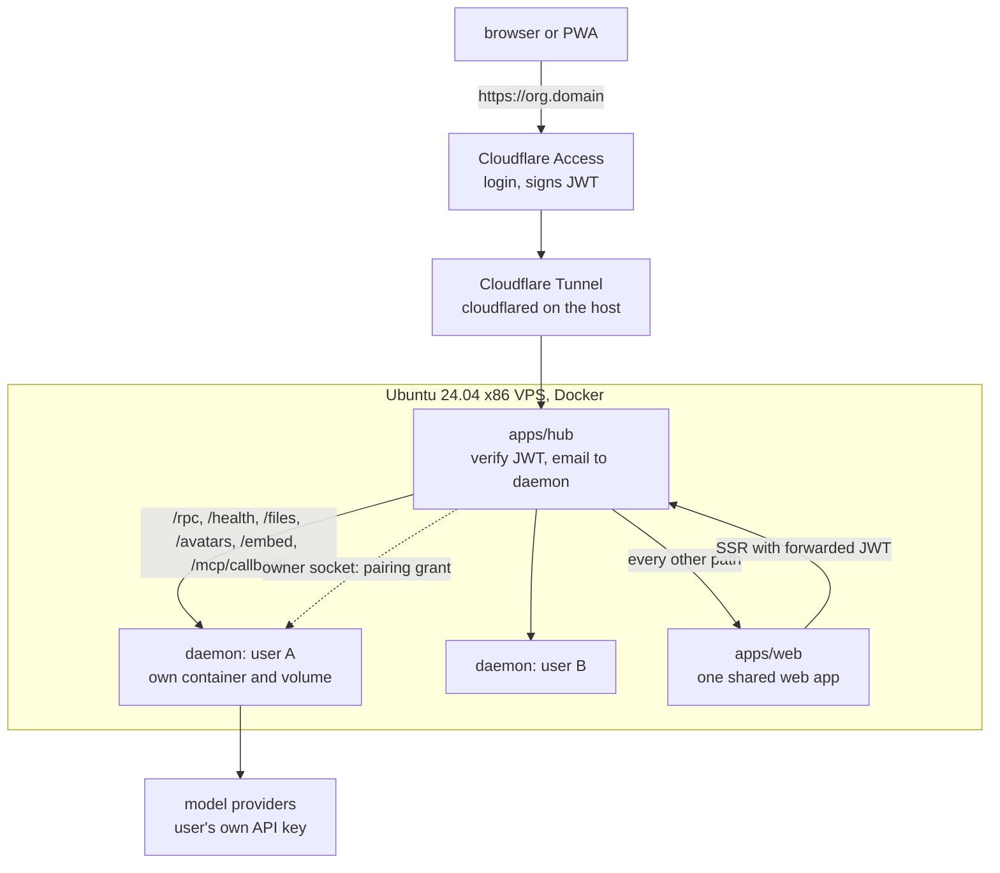

# Team workspace

How Orbs serves a small team (3-7 users per installation) without making the daemon multi-user. Human setup guides: [`docs/team-workspace/`](../../docs/team-workspace/README.md). Keep this file and those guides current when the design, phase status or a gotcha changes.

## Design

Each user gets an unchanged single-owner daemon in its own hardened Linux container. One hub per organization is the only front door: Cloudflare Access logs the user in, the hub verifies the Access JWT, maps the email to that user's daemon and forwards. The daemon never learns about users; its owner is whoever the hub routes to it.

- Hub routes by verified identity only. Cookies, `x-bots-server-id`, `Host` and `x-forwarded-*` never choose the daemon. Users come from `HUB_DATA_DIR/users.json` (email to id, `daemonUrl`, `socketPath`); the hub pins each daemon's serverId in `pins.json` on first contact and checks `/health` against it before forwarding. Hub env: `ACCESS_TEAM_DOMAIN`, `ACCESS_AUD`, `HUB_HOST`, `HUB_PORT`, `HUB_DATA_DIR`, `HUB_WEB_URL` `HUB_PUBLIC_URL`. Behaviour and wire details: the Hub section of [`api.md`](api.md).
- First visit: the hub mints a pairing grant over that daemon's owner socket and redirects to `/connect?code=<payload>`; the page redeems it at once with the default device name. No PIN, no device-name form. The device token lives in the web cookie as today.
- Daemon: `DAEMON_PUBLIC_URLS` makes it advertise only those origins and accept them as browser Origins. Web: `WEB_HUB_URL` turns on hub mode; SSR sends every daemon call to the hub with the request's Access JWT and the web server answers 404 on daemon paths. Do not confuse it with the hub's `HUB_WEB_URL` (where the hub sends non-daemon paths).
- Cloudflare (`bun scripts/deploy.ts cloudflare apply|emails|destroy`): one remotely managed tunnel per server, its routes kept in Cloudflare (team host to `http://hub:47192`, cloudflared also checks the Access JWT except on the exact icon paths), Access policies and apps, and a proxied DNS record created last. Objects are owned by exact names built from `--name orbs-<team>` (DNS by the comment `orbs deploy <name>`); the script refuses foreign objects on its hostnames. The allow policy's emails come from `users.yaml`, the same list `apply` renders daemons from (`emails --users -` reads it over ssh). The Cloudflare token stays on the admin's computer, so `apply` on the server cannot sync Access: adding or removing someone is `apply` on the server, then `cloudflare emails` from the admin's computer. The server gets `ORBS_PUBLIC_HOST`, `ACCESS_TEAM_DOMAIN`, `ACCESS_AUD` and `TUNNEL_TOKEN` in `/opt/orbs/.env`; cloudflared runs as `deploy/cloudflare/cloudflared.compose.yaml` on a `tunnel` network shared only with the hub.
- Images (`deploy/docker/Dockerfile`): Bun bundles without `node_modules`, the artifact embed prebuilt, uid 1000 under tini, read-only root. All daemon state lives on the user's `/data` volume: `DATA_DIR`, `HOME=/data/home` and `PI_CODING_AGENT_DIR=/data/pi`.
- Deployment (`deploy/compose/`, `/opt/orbs` on the server): `users.yaml` (`users: {<id>: <email>}`) is the only list of people. `bun deploy.ts apply` renders `users.compose.yaml` (per id: service `daemon-<id>` extending `daemon.yaml`, network `user-<id>`, volume `data-<id>`) and `hub/users.json` (`http://daemon-<id>:47191`, `/ipc/<id>/rpc.sock`), creates `ipc/<id>`, brings everything but the hub up with `--remove-orphans`, creates the hub only if missing, and connects or disconnects the hub to user networks at run time so the hub (and every WebSocket) survives adds and removes. Owner sockets live in one `ipc` volume: each daemon mounts only its subfolder at `/data/data/ipc`, the hub mounts the whole volume at `/ipc`. `backup`, `restore` and `purge` run tar or rm in the networkless root `tools` service. Upgrades are `ORBS_TAG` in `.env` plus `docker compose up -d --wait`. Model keys reach daemons as provider env vars from `.env`.

## Decisions

| Decision | Why |
| --- | --- |
| One single-owner daemon per user, one container and volume each; no users table in the daemon | The container is the only isolation between users: a bot's bash sees the whole container. Keeps the daemon's security model intact |
| One public hostname per organization behind a Cloudflare Tunnel; Access is the login | No open inbound ports; Access gives identity, OTP or IdP, and revocation without Orbs accounts |
| The hub routes by the verified `Cf-Access-Jwt-Assertion` (fallback `CF_Authorization` cookie); clients never choose their daemon | Cookie-named addresses made the web server an SSRF and wrong-daemon surface |
| The hub reaches each daemon's owner socket through a mount of only `data/ipc`, as the daemon's uid | The socket serves only pairing bootstrap; the Docker socket would make the internet-facing hub root on the host. The user's bot controls that folder, so the hub must not trust what it finds there (risk 1) |
| No admin device and no impersonation. Admin may audit everything, but only through an admin panel over the owner socket, never as the user | A device paired into a user's daemon steals that user's pushes and can be revoked by them; acting as the user blurs accountability |
| Notifications stay one device per notification, chosen per daemon as today | The daemon only knows its own user's devices once admin devices are gone |
| Models: Pi's provider system unchanged, each user's own API keys. No shared subscription logins, no model gateway yet | Provider terms forbid routing other users through one subscription: Anthropic's "Authentication and credential use" quoted in `ijpatricio/spike-hetzner:spikes/hetzner/FINDINGS.md` Spike 6, section 6; OpenAI forbids sharing account credentials (same section). [`cliproxy.md`](cliproxy.md) is for a single owner's own subscription only |
| Remotely managed tunnel; cloudflared as a container with only `TUNNEL_TOKEN`; one script owns tunnel, Access and DNS | One secret on the server and no config file; re-running the script restores routes, apps and DNS; the connector needs no host install and sits on a network with only the hub |
| Access emails follow `users.yaml`; no Access service tokens | One list of people. A token without "Access: Service Tokens: Edit" cannot create them (Phase 1 spike), so nothing depends on them |
| Target: x86 Ubuntu 24.04 VPS with Docker; web and PWA first | Proven on Hetzner; native clients need a Cloudflare login first (Phase 7) |
| Sizing: 512 MiB limit per daemon; plan up to 6 users on 4 GB and about 14 on 8 GB | Measured idle on the x86 test server (Hetzner, 2 vCPU, 3.7 GiB usable, wave 3): daemons 104-110 MiB in `docker stats` (about 150 MB RSS) after one turn, web 34-53 MiB, cloudflared 15-36 MiB, hub 12 MiB, each under 0.5% CPU; OS, dockerd and containerd about 470 MiB. An artifact preview reached 190 MiB on arm64 (PR #4). Six daemons all at their 512 MiB limit fit in 4 GB with the shared services; typical use would fit two to three times more, but nothing caps the sum below the limits |

## Phases

| Phase | Scope | Status |
| --- | --- | --- |
| 1 | Spikes: container, multi-daemon, shared models, Hetzner with Tunnel and Access | done |
| 2 | Fleet by hand. Wave 1: (A) daemon, web and hub images, PR #4; (B) hub, PR #3; (C) daemon public-origin env and web hub mode, PR #2; (D) these records, PR #1. Wave 2: (E) Compose deployment and users, PR #6; (F) Cloudflare script and cloudflared service, PR #5. Wave 3: a from-scratch install on a fresh x86 server by following only `docs/team-workspace/`, guide fixes and the `orbs-deploy` skill | wave 3 in review; everything up to the Access login verified on the real server (forged JWTs refused, isolation, hardening, reboot, add/remove, backup/restore, upgrade/rollback); a real login by the owner pending |
| 3 | Hub user management and login polish | planned |
| 4 | Permissions and an admin channel over the owner socket | planned |
| 5 | Admin panel UI with a read-only conversation viewer | planned |
| 6 | Hardening: bot tools in a separate sandbox, outbound limits, backups, optional model gateway with per-user keys | planned |
| 7 | Clients: PWA push, Android build, stores, native login via Cloudflare Managed OAuth | planned |
| 8 | Computer use: headless browser, then a desktop container per user, then a cloud desktop | planned |
| 9 | Templates and per-user model overrides | planned |

## Risks and gotchas

Most important first. Spike sources are on branches, read with `git show <branch>:<path>`: container = `ijpatricio/spike-container:spikes/container/FINDINGS.md`, multi = `ijpatricio/spike-multi-daemon:spikes/multi-daemon/FINDINGS.md`, models = `ijpatricio/spike-shared-models:spikes/shared-models/FINDINGS.md`, hetzner = `ijpatricio/spike-hetzner:spikes/hetzner/FINDINGS.md`. "Review" = the independent Phase 2 wave 1 review of PRs #1-#4.

1. **Until Phase 6 a bot controls its own daemon and its own `data/ipc` folder.** Bash and Pi's in-process `read` run as the daemon uid: bash can call `data/ipc/rpc.sock` and mint an owner device on its own daemon, and both read `credentials.key`, `app.sqlite`, `auth.json` and `models.json`. Env vars reach bash unfiltered. AppArmor exec stacking (`orbs-daemon//&orbs-bot`) blocks bash only; `read` and non-bash children (stdio MCP) stay unconfined. Because the hub mounts that same folder, a bot can try to replace `rpc.sock` with a symlink to another user's socket. The hub refuses a `socketPath` that is not a real socket or sits below a symlinked folder, refuses duplicate `daemonUrl`/`socketPath` entries and a serverId already pinned to another user. One gap remains: the check and the connect are separate steps (fetch cannot connect from a file descriptor), so a bot can swap the socket in between; the grant it gets is for another daemon's server ID, which the hub refuses to hand out, and the bot cannot reach that daemon anyway. Per-daemon networks reachable only by the hub are the real boundary (risk 29). Do not deploy beyond a trusted team before Phase 6. Sources: multi Q2, models Q4, hetzner Q5, review finding 1, the Hub section of `api.md`.
2. **Pairing throttles are per user, not per organization.** Each daemon receives only its own user's traffic through the hub, so its peer-keyed `public` and redeem throttles count that user's devices and hub calls together. Every wrong PIN counts against all live grants of that daemon, so a user's own mistakes (or their bot) can block their own pairing for a while. The hub mints at most 5 grants per user per 10 minutes. Sources: hetzner Q2, multi Q2, PR #3 `api.md` Hub section.
3. **The first redeem on a daemon deletes all other socket-issued grants**, so a hub grant races the startup pairing link. The hub pairs before handing links out. Source: multi Q2, hetzner Q6.
4. **Removing a user cuts access within seconds.** Removing the entry from `users.json` gives 403 within about a second, and open WebSockets are rechecked every 5 s and closed (1008) when the user is gone or the Access token expired. A missing, unreadable or invalid file means zero users: everyone gets 403 and the hub logs an error until it is fixed, including at startup. Source: review finding 2, `api.md` Hub.
5. **`users.json` must give each user a unique daemon.** A copied `daemonUrl` or `socketPath` would route one person to another person's daemon; the hub rejects such a file (zero users), and `pins.json` lets a server ID belong to one user only. Source: review finding 3.
6. **Wrong-daemon routing after container IPs change.** Recreated containers took each other's IPs; stale cookie addresses and a stale name in the long-running Bun web server (2-5.5 min, root cause unknown, `BUN_CONFIG_DNS_TIME_TO_LIVE_SECONDS` did not help) sent alice's requests to carol. Server ID and token checks stopped any data crossing, but the web client cleared the session. Hub mode removes cookie-named addresses. With one network per user holding only that daemon and the hub, a stale name or IP can only point at the same user's daemon or nothing, so fixed IPs are not needed; the serverId pin covers the rest. Recreating one daemon on OrbStack kept its IP and the hub reached it at once. Sources: hetzner Q3, PR E.
7. **Hub mode misconfiguration reopens the old surface.** Without `WEB_HUB_URL` the web server falls back to its cookie-address proxy, which from the web container can reach any internal daemon. `WEB_HUB_URL` (web, points at the hub) and `HUB_WEB_URL` (hub, points at the web app) are easy to swap. The hub answers 400 to paths with empty or dot segments (`//rpc`) before routing. `HUB_PUBLIC_URL` is required: the hub sets `X-Forwarded-Proto` and `X-Forwarded-Host` from it. Unset `DAEMON_PUBLIC_URLS` or `ACCESS_*` fail closed. `vite dev` fronts one fixed daemon; only the built server works with several. Sources: review finding 5, multi Q1, hetzner Q3.
8. **A public origin gets 403 from every daemon** unless it is in `DAEMON_PUBLIC_URLS` or `DAEMON_ALLOWED_ORIGINS`: the hub passes the browser `Origin` through. Origins must be bare (no path), so native clients need host-based routing. Sources: hetzner Q3, PR #2.
9. **After "revoked" or "replaced" the hub re-pairs the browser.** `GET /connect` without `code` mints a grant whenever the request has no `bots.connection` cookie for this user's daemon, including after `?reason=…`; the 5-grants-per-10-minutes limit ends any loop. Source: review finding 4, `api.md` Hub.
10. **`HOME` must live on the volume** (`HOME=/data/home`, set by the image): Pi's global skills (`~/.agents/skills`), `~/.agents/AGENTS.md`, `~/.agents/mcp.json` and bot dotfiles otherwise vanish or are unwritable under `--read-only`. Sources: container 4-5, models risk 9.
11. **Pi needs a writable Pi dir even to read credentials** (lock directory `auth.json.lock`, `models-store.json`). A read-only Pi dir breaks every turn; a file bind mount into a missing `/data/pi` makes Docker create the directory as root and every turn silently stalls (the image pre-creates `/data/home` and `/data/pi` as uid 1000; its wrapper creates them on an empty bind mount). Mount shared files as symlinks or nested read-only mounts inside a writable per-user Pi dir; never bind-mount `auth.json` alone (it disables cross-process locking). Sources: models Q2, Q5; hetzner Q2; PR #4.
12. **Settings → Providers stores API keys and OAuth logins in plaintext `auth.json`**, not the encrypted credentials table, and a stored key beats `models.json` and env. `models.json` is read once at start (restart to apply); skills and instructions are picked up within 30 s. Source: models Q1, Q2.
13. **Images.** PR #4 ships the desktop server bundles (no `node_modules`) with the artifact embed prebuilt: daemon image 89 MB compressed for amd64, web 51 MB, hub 44 MB. All three ran together hardened on OrbStack (arm64): two daemons idled at 140-150 MiB after a turn, web at 100 MiB and hub at 33 MiB. Bundles run with `bun --no-install`, or an optional `require` makes Bun download from npm at runtime and crash with `EROFS` on a read-only root. A daemon run from source still builds the embed at runtime (Bun.build + Tailwind, about 450 MiB). The daemon image has no git, curl or ffmpeg (videos get no poster). Build on CI or a workstation, not the production host (dockerd held 790 MB; the build cache reached 14 GB). Bun on x64 needs AVX2. Sources: PR #4, container 1, hetzner Q1, Q4.
14. **Hub image env** (review finding 6): the image sets `HUB_HOST=0.0.0.0`, `HUB_PORT=47192` and `HUB_DATA_DIR=/data`, exposes 47192 and checks `/hub/health`; `HUB_WEB_URL`, `HUB_PUBLIC_URL`, `ACCESS_TEAM_DOMAIN` and `ACCESS_AUD` come at run time. Compose mounts the shared `ipc` volume at `/ipc`, so each `socketPath` is `/ipc/<id>/rpc.sock` with no symlinks; a volume subpath per user would force a hub recreate on every add. The hub bundle is about 0.5 MB.
15. **Owner socket constraints.** No peer-credential check: any same-uid process can mint a grant. The hub must run as the daemon's uid (socket 0600, directory 0700 with an owner check); every image runs as uid 1000, the hub included. Distinct uids per user would need one hub process per uid. The mount must be read-write and exist before the hub starts. Host uid 1000 equals the container uid, which matters for bind mounts; a high uid or userns-remap is a later hardening option. Unix socket paths are limited (104 bytes on macOS). Sources: multi Q2, hetzner Q5, Q6, PR #4.
16. **Bun as PID 1 ignores SIGTERM**: the images run tini, so stops take about 0.2 s; any other Bun container needs an init. Use `restart: unless-stopped`; routines and alarms run only while the daemon runs, and an overdue routine fires once on start. Sources: hetzner Q7, container 4, PR #4.
17. **PWA behind Access.** The manifest, its icons and `/favicon.ico` 302 to the login unless an Access Bypass covers `/img/favicon/*` and `/favicon.ico` (the hub also lets those icon files, not their folder, through without a JWT). The script creates one bypass app with both paths and a tunnel route that skips cloudflared's JWT check only for `^/(?:img/favicon/[^/]+|favicon\.ico)$`. On session expiry the web client sees a redirect on `/health` and reloads at most once a minute so Access can sign the user in; the app session defaults to 24 h. iOS standalone login cookie handoff is untested. Sources: hetzner Q5, PR #2, PR #3.
18. **Native clients and Access.** Managed OAuth sends `Authorization: Bearer`, the header Orbs uses for device tokens, so the device token must move first. React Native's WebSocket needs Access headers on the upgrade. Don't build on cloudflared's undocumented CLI handoff. Source: hetzner Q4.
19. **Hub state must persist** in `HUB_DATA_DIR` (`users.json`, `pins.json`) on a volume. A pin mismatch is a 502 with an admin-facing log line, never a forward; change `pins.json` only after confirming which daemon belongs to whom (for example after a deliberate daemon reset). Sources: hetzner Q6, `api.md` Hub.
20. **Any paired device can revoke every other device and change daemon-wide settings** (providers, addresses). Acceptable while each daemon has only its own user's devices; admin roles are Phase 4. Sources: multi Q4, models Q3.
21. **Push targets one device per daemon and carries no serverId**; each daemon needs outbound access to `exp.host`. Push receipts and `DeviceNotRegistered` are not handled. Source: multi Q5.
22. **`bots.create` rejects the default `thinkingLevel: 'off'` for some models** (Opus 5.5): anything provisioning default bots must send it. Source: container 3.
23. **Keep the 512 MiB limit per daemon** until server measurements exist; a heavy tool run adds to the base, and `orbs pair` runs a second Bun of about 110 MiB in the same cgroup. `apt`, `npm -g` and `pip` by bots fail under a read-only root and no root user. Sources: container 5, hetzner Q4, PR #4.
24. **A `?code=` link pairs automatically in every mode** (PR #2): in single-daemon mode a crafted link can pair an unpaired browser to another server without a click. Source: review finding 7.
25. **Access bypass paths match more than they say.** `//img/favicon/x`, `/img/./favicon/x`, `/IMG/FAVICON/x`, `/favicon.ico/x`, `/img/favicon/`, `/img/favicon/..%2frpc` and `/img/favicon/..;/rpc` all passed the Access bypass at the edge. cloudflared's JWT check refused each (403, "no access token in request"), so only the exact icon paths reached the origin. Keep `originRequest.access.required` on the main route and the strict icon route. Plain `..` and `%2e%2e` forms are normalized by the edge and get the login 302. Source: Phase 2 piece F probes against `orbs-test.example.com` (PR description).
26. **The tunnel token is a full connector credential.** Whoever holds `TUNNEL_TOKEN` can run a connector for the tunnel and receive the team's traffic; it lives only in `/opt/orbs/.env` (mode 600). The routes live in Cloudflare: anyone with the API token can change them, and dashboard edits are undone by the next `apply`. `destroy` needs the connector stopped first, then deletes DNS, tunnel, apps and policies in that order. Source: piece F.
27. **Docker networks reach host services.** From a container on the `tunnel` network, the host's sshd answered at `host.docker.internal:22` (the SSH route relies on it). Any host service listening on `0.0.0.0` is reachable from every bridge network, daemons included; "reachable only by the hub" holds between containers, not for host ports. Source: piece F, busybox `nc` on the test server.
28. **The account holds unrelated objects with an `orbs` prefix** (`orbs`, `orbs-pwa-icons` Access apps on `orbs.example.com`). Ownership is by exact name, never by prefix; `--name` must start with `orbs-`. Source: piece F account listing.
29. **Isolation between users is Docker's per-bridge drop rule** (`DOCKER` chain: `! -i br-X -o br-X -j DROP`), not anything Orbs adds. On a stock Linux dockerd (docker:29-dind) daemon A could not reach daemon B by name or IP, the web app, cloudflared or the hub's other addresses, while reaching the internet; the hub reached every daemon; this held for a user added later and after a dockerd restart. **OrbStack does not enforce it**: there daemon A reached B's IP. Prove isolation on Linux, never on a Mac. Daemons still reach host services (risk 27) and the provider metadata service (risk 37); outbound limits are Phase 6. The same proof on the x86 Hetzner server: daemon A could not reach B by name or IP, nor the web app, cloudflared or the hub's addresses on other networks; the hub reached both. Sources: PR E, wave 3.
30. **A nested mount into a fresh volume makes Docker create the missing parent as root**: mounting `ipc/<id>` at `/data/data/ipc` left `/data/data` root-owned and unwritable. The daemon image pre-creates `/data/data/ipc` owned by uid 1000. Source: PR E.
31. **`apply` changes the hub's networks at run time.** `docker network connect` adds a new user's network to the running hub; a full `docker compose up` later recreates the hub with the same networks from `users.compose.yaml` (dropping every WebSocket once, as any upgrade does). The connections survive a dockerd restart. Source: PR E.
32. **The hub keeps pins in memory and rewrites the whole `pins.json`**, so `purge` stops the hub, removes the user's pin and starts it again; otherwise a re-added id gets 502 forever. Source: PR E, `daemon.service.ts`.
33. **Backups are a tar of the whole volume with the daemon stopped**, not `orbs backup`: the app bundle leaves out `/data/pi` (provider auth) and `/data/home` (skills, instructions). The tar holds `credentials.key` and `auth.json`. `restore` takes a safety backup first. A restore to an older image after a migration is unsupported. Source: PR E, `backup.constants.ts`.
34. **Shared model keys are plain env vars on every daemon** (`ANTHROPIC_API_KEY`, `OPENAI_API_KEY`, `GEMINI_API_KEY`, `OPENROUTER_API_KEY`, `MISTRAL_API_KEY`, `GROQ_API_KEY`, `XAI_API_KEY`, `DEEPSEEK_API_KEY`); Pi ignores empty ones. Every user's bot can read them. The daemon service lists them one by one: never give daemons the whole `.env` (it holds `TUNNEL_TOKEN`). Source: PR E, pi-ai `env-api-keys.js`.
35. **Docker Compose tries to pull a missing image tag** (`pull access denied for orbs-daemon`): load images before changing `ORBS_TAG`. Source: PR E.
36. **The hub reloads `users.json` lazily**: on the first request at least a second after the last check, not on a timer or file watch. Its `Users loaded` log line keeps the old count after `apply` until someone uses Orbs, so check `grep -c daemonUrl hub/users.json` instead. Source: wave 3, `user-query.find.ts`.
37. **Daemons reach the cloud provider's metadata service.** On Hetzner, every daemon read `http://169.254.169.254/hetzner/v1/metadata/` including `user-data`, and opened TCP to the host's sshd on its bridge gateway and public IP. Never put secrets in a server's user-data or cloud-init; Phase 6 outbound limits should block 169.254.169.254 and the host. Source: wave 3, `Bun.connect` and `fetch` from `orbs-daemon-owner-1`.
38. **No way to provision a bot for a person without a device.** The daemon CLI has only `start`, `pair`, `service` and `backup`; `bots.create` needs a paired device. Wave 3 created test bots by redeeming a grant from `pairing.bootstrap` on the owner socket inside the daemon's container, calling `bots.create`, then `devices.revoke` (device table empty afterwards). An admin path over the owner socket belongs in Phase 3 or 4; templates are Phase 9. Source: wave 3.
39. **Nothing else may join an `orbs_user-<id>` network.** Besides breaking isolation, `apply` removing that person runs `docker network rm`, which fails while another container is attached. The wave 3 test mock model was attached to both user networks for this reason and must be removed before those users. Source: wave 3, `connectHub` in `scripts/deploy.ts`.
40. **`docker stats` reads lower than RSS** for Bun containers (daemon 105 MiB vs about 150 MB RSS): stats subtract reclaimable page cache. Size by `docker stats` and the cgroup limit, not `ps`. Source: wave 3.
41. **The token read can fail silently.** A locked 1Password makes `$(op read …)` empty; the script now refuses an empty `CLOUDFLARE_API_TOKEN` instead of reporting Cloudflare's `6003 Invalid request headers`. `cloudflare.env` (holds `TUNNEL_TOKEN`) is in `.gitignore`, as the install writes it in the checkout. Source: wave 3.
