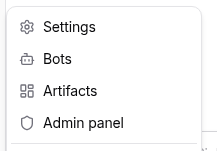
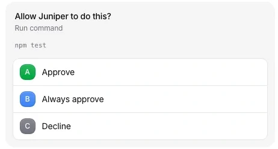

# Vinci changelog

## v0.1.11 - API in Docker installs

*2026-11-24*

- The main Compose stack now starts the internal Vinci API. Its health check calls `GET /` and expects HTTP 200 with `ok`.

```diff
+ $ docker compose exec -T api php -r 'echo file_get_contents("http://127.0.0.1:8080/");'
+ ok
```

- Release builds publish `vinci-api` for AMD64 and ARM64 alongside the other Vinci images.

## v0.1.10 - Chat progress and release images

*2026-11-20*

- Chat shows a short status while a bot works. Admins and people using Advanced mode can see the individual steps.
- Choose a version bump when making a release. Each release tag builds all six Docker images for AMD64 and ARM64 and publishes them to GitHub Container Registry.

```diff
- bun run release
+ bun run release patch
```

Use `minor` for a feature release or `major` for a breaking change.

## v0.1.9 - Languages and bot settings

*2026-11-18*

- The app is now called Vinci. English, European Portuguese, German, Spanish and French are available.
- Admins can open the admin panel from the app menu, edit a bot’s MCP servers as JSON and refresh its tool list. Validation errors name the field to fix.



- Click an attached image to preview it before sending.

## v0.1.8 - Sandboxes, backups and attachments

*2026-11-16*

- Solo and team installs now use the same Docker setup. Bot tools and command-based MCP servers run in a separate sandbox for each person.
- Nightly backups can be encrypted, copied to S3-compatible storage and restored from there.
- The installable web app supports push notifications. Bots can read images and PDFs, and attachments have a 10 MB upload limit.
- For local development, `bun run dev:web` starts the hub and web app with a login link. Add `--sandbox` to run bot tools in the Linux sandbox.

## v0.1.7 - Team installs

*2026-11-12*

- A team can sign in through Cloudflare Access and use one Docker installation. The hub routes each person to their own daemon.
- Admins can set shared defaults, suggest bots and inspect conversations in a read-only viewer. The panel records admin actions.
- Before switching back to global settings, the panel lists the overrides you’ll lose.
- Bot owners can switch individual local skills on or off. On iOS, videos open fullscreen and routines are grouped into upcoming and past.

## v0.1.6 - Linux desktop and scheduled routines

*2026-11-06*

- The desktop app now runs on Linux.
- Each bot can have its own MCP servers, keep notes and run scheduled routines that survive restarts.
- Bot instructions can be up to 64,000 characters.

## v0.1.5 - Bot activity and reaction GIFs

*2026-11-05*

- Chat shows what a bot is doing while it works.
- Bots can send reaction GIFs without an API key and send requests directly to the bot responsible.

## v0.1.4 - Desktop updates

*2026-11-05*

- The desktop app can update from GitHub Releases.
- The message box shows its placeholder again in WebKit.

## v0.1.3 - Chat compaction and video previews

*2026-11-05*

- Chat shows progress while it compacts a long conversation and offers the action when it can help.
- Videos show a preview frame in WebKit and open in QuickTime on Mac.
- The credentials proxy now requires a token for each run and redacts it from output.

## v0.1.2 - Files and media in chat

*2026-11-04*

- Bots can send files. Open images and play audio or video from chat.
- On iOS, pairing links, pinned chats and Tailscale connections over mobile data work again.

## v0.1.1 - Context usage and shared tools on iOS TestFlight

*2026-10-31*

- See how much of a bot’s context window a conversation has used.
- Choose which shared skills and MCP servers each bot can use from iOS.
- Bots can keep a private conversation with another bot and notify you when they have a result.

## v0.0.2 - First-run setup and tool approvals

*2026-10-26*

- First-run setup walked you through connecting a model, choosing tool permissions and creating a bot.



- Pair a device with a six-digit PIN. Sidebar groups sync across devices.
- Open a bot’s Activity page to see its tool calls, waits and handoffs as they happen.
- Backup format 3 requires a fresh backup. Older backups cannot be restored by this version.
- The app gained its cloud icon.

| Before | After |
| --- | --- |
|  |  |

## v0.0.1 - Bot chat on web, iOS and Mac

*2026-10-24*

- The first internal build, then called Orbs, brought bot chat to web, iOS and Mac. Bots could run routines, exchange messages and share files or interactive pages.
- Devices paired to the same server. On Mac you could run it locally or select another Mac on your network. [Watch the original server picker with a demo Mac](media/v0.0.1/choose-server.mp4)
- Bots could request approval for tools and ask for credentials through a private prompt.
