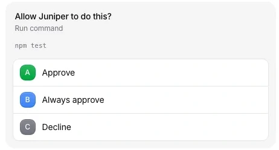

*2026-10-26*

- First-run setup walked you through connecting a model, choosing tool permissions and creating a bot.

- Pair a device with a six-digit PIN. Sidebar groups sync across devices.
- Open a bot’s Activity page to see its tool calls, waits and handoffs as they happen.
- Backup format 3 requires a fresh backup. Older backups cannot be restored by this version.
- The app gained its cloud icon.

| Before | After |
| --- | --- |
|  |  |
