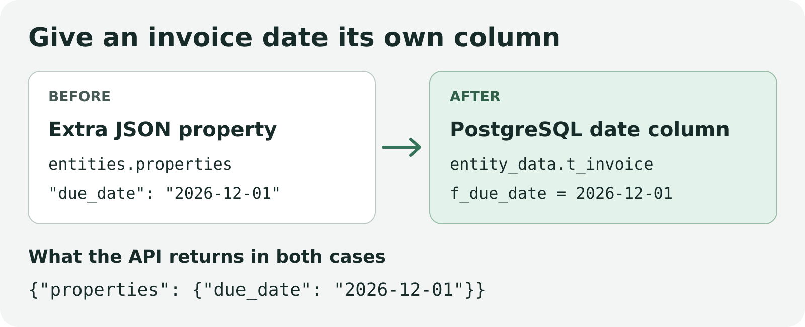

*2026-11-28*

Bots can now define record types such as invoices. An invoice can start with a free-form due date. Define `due_date` as a date field and Vinci moves existing values into a PostgreSQL date column. Removing the field returns those values to the record’s extra properties.

A single link can be read from either end. Set Ada’s employer to Acme, and Ada appears in Acme’s employees.

Set `VINCI_DB_API_TOKEN` to enable the entity API on your install.
