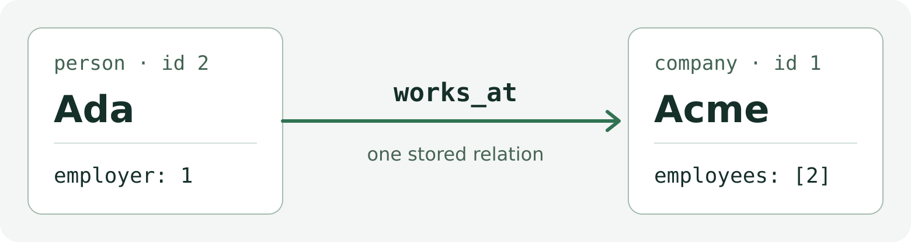

*2026-11-28*

Vinci now has a data model for records that bots share. Define a type such as `person` or `company`, give it fields, and create entities of that type. Each type gets its own PostgreSQL table so you can also query its fields with SQL.

### How the example is stored

| Table | What it holds |
| --- | --- |
| `entities` | Shared record IDs, types, and names, including Ada and Acme. |
| `entity.person` | One row per person. A declared text field called `city` gets a `city text` column. |
| `relations` | One row with `from_entity_id = 2`, `label = 'works_at'`, and `to_entity_id = 1`. |

### How to use the API

With the types and relation fields defined as shown, these requests use the same link:

| Request | Result |
| --- | --- |
| `PATCH /api/entities/2` with `{"related":{"employer":1}}` | Sets Acme as Ada’s employer. |
| `GET /api/entities/1` | Acme’s response includes `"related":{"employees":[2]}`. |

Set `VINCI_DB_API_TOKEN` on the install and send it as a bearer token with each request.
