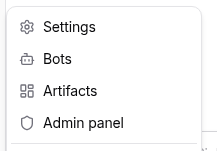

*2026-11-18*

- The app is now called Vinci. English, European Portuguese, German, Spanish and French are available.
- Admins can open the admin panel from the app menu, edit a bot’s MCP servers as JSON and refresh its tool list. Validation errors name the field to fix.

- Click an attached image to preview it before sending.
