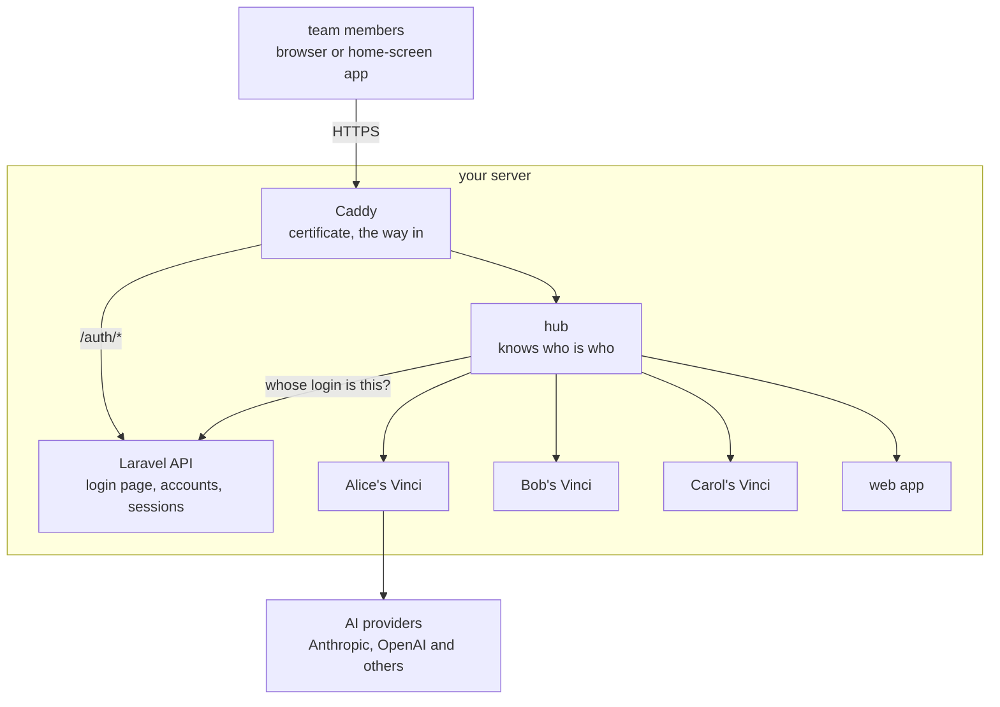
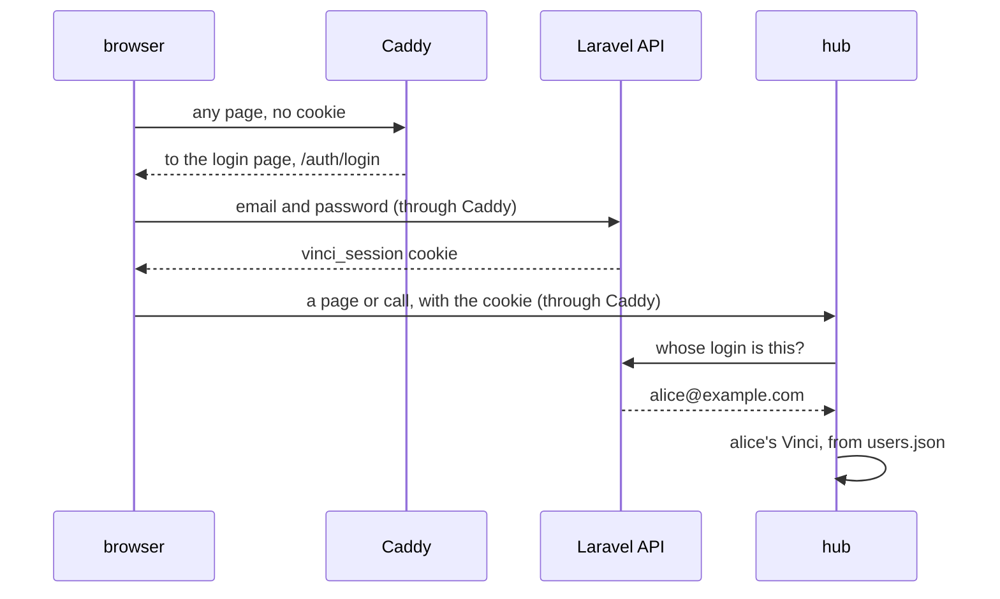

Vinci installs one way: on one Linux server, with Docker, the hub and the admin panel. It serves a small team, about 3 to 7 people. A person on their own installs the same thing and is its only admin and only user: see [Just me](install.md#just-me).

> [!WARNING]
> This is a first version. It was installed from scratch on a test server by following these guides, the admin panel included (November 2026), but no team uses it yet.
> Bots run their tools in a sandbox that cannot read keys or act as the person, but a bot that runs commands (the **Normal** and **No questions** modes) can still read and send anything in that person's bot folders, and it can read the `env` values (secrets included) of MCP servers that run a command, which run in the same sandbox. Use this only with people you trust.

## What it is

- Every person gets their own Vinci, with their own bots, chats, files and model keys.
- Each person's Vinci runs in its own locked-down container on the server, and their bots' commands in a second one, their sandbox, which holds no keys. In the app, people only ever see their own bots and data.
- Everyone uses one web address, for example `https://acme.example.com`. They open it in a browser or add it to their home screen.
- Vinci handles the login: email and password. The admin panel makes each person's first password and shows it once; the person changes it in their settings.
- After login, Vinci sends each person to their own bots automatically. The first visit pairs the browser on its own: no PIN, no questions.
- The server answers on ports 80 and 443, with a free Let's Encrypt certificate. A server that cannot open ports can use a Cloudflare Tunnel instead.

## The picture



## Who does what

**The admin** (one person, usually whoever set up the server):

- sets up the server once
- adds and removes people
- gives each person a model API key, or makes them an advanced user so they can add their own
- sets up bots, skills and tools for a person when asked
- runs backups and upgrades

**Each user**:

- logs in with their email and uses their own bots
- sees a simpler app: the admin sets the security settings, model providers and shared sources; an admin can make someone an **advanced user**, who also gets those settings (except the security ones). See [What people see](admin.md#what-people-see)
- cannot see anyone else's bots or chats

The admin does not log in as a user and cannot chat as them. Admins use the admin panel at `/admin` to add, disable and remove people and to set up their bots and settings through each person's private door, which refuses chat messages, approvals and pairing. Settings everyone shares and the bots offered to new people live in **Global settings**, a hidden workspace nobody logs into; each person follows each global section or has it overridden.

## How login works

There is one login: email and password, kept by the install's Laravel API (`apps/api`) in its PostgreSQL database. Nothing outside the server, Cloudflare included, takes part in it.



Who checks what:

- **Caddy** serves HTTPS, sends `/auth/*` to the API and everything else to the hub. It only looks at whether the `vinci_session` cookie is there: without it, the visitor goes to the login page. It vouches for nobody.
- **The Laravel API** shows the login page, checks passwords and keeps one login per browser: a [Sanctum](https://laravel.com/docs/sanctum) token in the `vinci_session` cookie, stored only as a hash.
- **The hub** asks the API whose login a cookie is, on every request and again every 5 seconds for open connections, and trusts no header for identity. It then finds the person by email in its user list and sends them to their own Vinci, or to the admin panel for an admin.

What ends a login, everywhere within 5 seconds, open chats included:

- **Sign out**: this browser's login, also any copy of its cookie.
- **Change password**: the person's other logins; this browser stays signed in.
- **Reset password** in the admin panel, or `vinci:user` on the server: all of that person's logins.
- **Remove** in the admin panel: the account and all of its logins (an admin from the admin list keeps theirs, to open the panel). **Turn off sign-in** (disable) keeps the login, but the hub refuses it with *Your sign-in is turned off*.
- 7 days after it was made.

Wrong passwords lock an email for a while: 5 from one address in a minute, or 20 from any addresses in an hour (wrong current passwords at **Change password** count toward the hourly limit). The login page says how long. An email with no account is locked the same way, so the page never tells which accounts exist. To lift every lock at once, on the server: `docker compose exec -T api php artisan cache:clear` in `/opt/vinci` ([Troubleshooting](troubleshooting.md#the-login-page-says-too-many-attempts)).

The first admin's password: with an install by hand or by an agent, `docker compose exec -T api php artisan vinci:user <email>` prints it once ([install, step 7](install.md#7-start-vinci)). With cloud-init it is in `/opt/vinci/admin-password`, readable by root only, until that admin changes it: a password change by an email in `HUB_ADMIN_EMAILS` has the provisioner delete the file. Everyone else gets their password from the admin panel, shown once.

More: [Logins](install.md#logins) in the install guide, and [Passwords and logins](admin.md#passwords-and-logins) for admins.

## Three ways to install

All three give the same install. Each needs a server as in [What you need](#what-you-need).

| Way | What it needs besides the server | Pick it when |
| --- | --- | --- |
| [By hand](install.md), steps 1 to 9 | Root SSH to the server, Bun and a checkout of this repository on your computer | You want to see and check each step, or the server already exists |
| [One prompt to an agent](install.md#the-whole-install-in-one-prompt) | The same, plus an AI coding agent with SSH access and the checkout (agents in this repository have the `vinci-deploy` skill) | You want the by-hand install done for you, checks included |
| [Cloud-init](install.md#install-with-cloud-init) | A new server at a provider that takes user data (Hetzner: **Cloud config**), Ubuntu 24.04 or 26.04, a DNS `A` record already pointing at it, ports 80 and 443 open | You create a fresh server and want it to install itself in a few minutes |

Cloud-init makes one admin, who is also the only user at first, and sets no model key: add people and a key in the admin panel afterwards. It does not set up the tunnel.

**The optional Cloudflare Tunnel.** For a server without a public address or open ports (behind a home router, or a provider that blocks inbound traffic), cloudflared on the server dials out to Cloudflare, and Cloudflare carries HTTPS to Caddy. The login stays the same Laravel login. You need a domain on Cloudflare and an API token for the tunnel and its DNS record; `bun scripts/deploy.ts cloudflare apply` makes both. Only the by-hand and agent installs set it up: [Optional: Cloudflare Tunnel](install.md#optional-cloudflare-tunnel).

## Deploy and upgrade at a glance

**Where the images come from.** GitHub Actions builds every image and publishes it, public, to GitHub Container Registry as `ghcr.io/meetvinci/vinci-<image>`. The server pulls without logging in. Tags ([Images from CI](admin.md#images-from-ci)):

- a release, such as `v0.2.0`: what a team should run;
- `main`: the latest commit on main;
- a full commit: every push to main, and any branch built with `gh workflow run images.yml --ref <branch>`.

`VINCI_TAG` in `/opt/vinci/.env` says which tag the server runs.

**An upgrade**, on the server in `/opt/vinci`, after copying the new release's deployment files there ([Upgrades](admin.md#upgrades) has every detail):

```sh
for image in daemon sandbox web hub provisioner firewall api; do docker pull -q ghcr.io/meetvinci/vinci-$image:v0.2.0; done
bun deploy.ts nightly && bun deploy.ts nightly status
sed -i 's/^VINCI_TAG=.*/VINCI_TAG=v0.2.0/' .env && docker compose up -d --wait
bun deploy.ts apply
```

That is: pull the new images, back everyone up, switch to the new tag, then write the per-person files with the new `deploy.ts`.

**Check after:** `docker compose ps` shows every container healthy on the new tag, `bun deploy.ts status` exits 0, and `bun scripts/deploy.ts check https://<host>` from your checkout prints only `ok` lines.

**Roll back:** copy the old version's deployment files back, set the old tag, run `docker compose up -d --wait` and `bun deploy.ts apply`. If the new version changed people's data, restore the backup from step 2 ([Roll back](admin.md#roll-back)).

**Older installs that log in through Cloudflare Access** must move once before they upgrade: [Move from Cloudflare Access](admin.md#move-from-cloudflare-access).

## What you need

- A Linux server: Ubuntu 24.04, x86, with Docker. 4 GB of memory fits up to 5 people; 8 GB fits about 13 (the global settings take one more person's share).
- A hostname whose DNS you can point at the server (a Cloudflare account only for the optional tunnel).
- An API key from a model provider (for example Anthropic or OpenAI) for each person, or one each person brings.

Shared logins from a Claude or ChatGPT subscription are not supported: the providers' terms do not allow one subscription to serve several people.

## Guides

- [Install](install.md): set up the server, for a team or [just you](install.md#just-me).
- [Install the app on your phone and computer](install-app.md): for everyone on the team: home screen or dock, and notifications.
- [Admin tasks](admin.md): the admin panel, global settings and suggested bots, people, keys, bots, backups, upgrades.
- [Configuration](configuration.md): every setting and file.
- [Troubleshooting](troubleshooting.md): known problems and fixes.
- [Server tour](server-tour.md): a guided tour of a live install, to read with a terminal open: which containers run and who talks to whom, where everything is on disk, what happens at `apply` and at a reboot, what to watch during an install or an upgrade, and where each person's files are.

For agents working on the code: [`.agents/references/team-workspace.md`](../../.agents/references/team-workspace.md) holds the design decisions, status and known risks.
