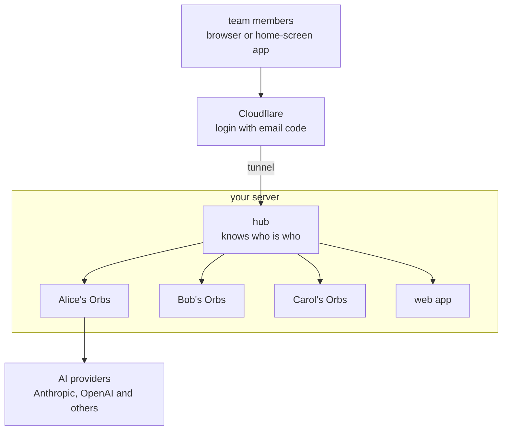

# Orbs for a team

Orbs normally runs on one person's computer. The team workspace runs it on one server for a small team, about 3 to 7 people.

> [!WARNING]
> This is a first version. It has not yet been installed from scratch on a real server.
> Until the hardening phase, a bot has full control of its own user's Orbs: it can read that person's keys and give itself access as them. Keeping it away from other people's Orbs depends on the hub's checks and on each person's Orbs being reachable only by the hub. Use this only with people you trust.

## What it is

- Every person gets their own Orbs, with their own bots, chats, files and model keys.
- Each person's Orbs runs in its own locked-down container on the server. In the app, people only ever see their own bots and data.
- Everyone uses one web address, for example `https://acme.example.com`. They open it in a browser or add it to their home screen.
- Cloudflare handles the login. A person types their email and gets a one-time code. There are no Orbs passwords.
- After login, Orbs sends each person to their own bots automatically. The first visit pairs the browser on its own: no PIN, no questions.
- The server has no open ports. Cloudflare Tunnel connects it to the internet from the inside.

## The picture

## Who does what

**The admin** (one person, usually whoever set up the server):

- sets up the server and Cloudflare once
- adds and removes people
- gives each person a model API key, or lets them add their own
- sets up bots, skills and tools for a person when asked
- runs backups and upgrades

**Each user**:

- logs in with their email and uses their own bots
- can add their own model API key in **Settings → Providers**
- cannot see anyone else's bots or chats

The admin does not log in as a user. A later version adds an admin panel for checking on people's bots.

## What you need

- A Linux server: Ubuntu 24.04, x86, with Docker. 4 GB of memory fits about 5 people; 8 GB fits about 12.
- A domain on Cloudflare and a Cloudflare account.
- An API key from a model provider (for example Anthropic or OpenAI) for each person, or one each person brings.

Shared logins from a Claude or ChatGPT subscription are not supported: the providers' terms do not allow one subscription to serve several people.

## Guides

- [Install](install.md): set up the server and Cloudflare.
- [Admin tasks](admin.md): add and remove people, keys, bots, backups, upgrades.
- [Configuration](configuration.md): every setting and file.
- [Troubleshooting](troubleshooting.md): known problems and fixes.

For agents working on the code: [`.agents/references/team-workspace.md`](../../.agents/references/team-workspace.md) holds the design decisions, status and known risks.
