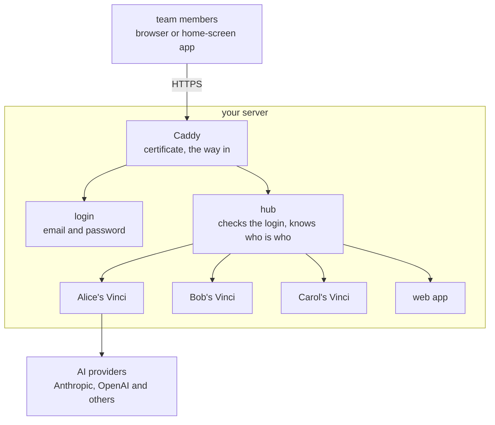

# Installing Vinci

Vinci installs one way: on one Linux server, with Docker, the hub and the admin panel. It serves a small team, about 3 to 7 people. A person on their own installs the same thing and is its only admin and only user: see [Just me](install.md#just-me).

> [!WARNING]
> This is a first version. It was installed from scratch on a test server by following these guides, the admin panel included (November 2026), but no team uses it yet.
> Bots run their tools in a sandbox that cannot read keys or act as the person, but a bot that runs commands (the **Normal** and **No questions** modes) can still read and send anything in that person's bot folders, and it can read the `env` values (secrets included) of MCP servers that run a command, which run in the same sandbox. Use this only with people you trust.

## What it is

- Every person gets their own Vinci, with their own bots, chats, files and model keys.
- Each person's Vinci runs in its own locked-down container on the server, and their bots' commands in a second one, their sandbox, which holds no keys. In the app, people only ever see their own bots and data.
- Everyone uses one web address, for example `https://acme.example.com`. They open it in a browser or add it to their home screen.
- Vinci handles the login: email and password. The admin panel makes each person's first password and shows it once; the person changes it in their settings.
- After login, Vinci sends each person to their own bots automatically. The first visit pairs the browser on its own: no PIN, no questions.
- The server answers on ports 80 and 443, with a free Let's Encrypt certificate. A server that cannot open ports can use a Cloudflare Tunnel instead.

## The picture

## Who does what

**The admin** (one person, usually whoever set up the server):

- sets up the server once
- adds and removes people
- gives each person a model API key, or makes them an advanced user so they can add their own
- sets up bots, skills and tools for a person when asked
- runs backups and upgrades

**Each user**:

- logs in with their email and uses their own bots
- sees a simpler app: the admin sets the security settings, model providers and shared sources; an admin can make someone an **advanced user**, who also gets those settings (except the security ones). See [What people see](admin.md#what-people-see)
- cannot see anyone else's bots or chats

The admin does not log in as a user and cannot chat as them. Admins use the admin panel at `/admin` to add, disable and remove people and to set up their bots and settings through each person's private door, which refuses chat messages, approvals and pairing. Settings everyone shares and the bots offered to new people live in **Global settings**, a hidden workspace nobody logs into; each person follows each global section or has it overridden.

## What you need

- A Linux server: Ubuntu 24.04, x86, with Docker. 4 GB of memory fits up to 5 people; 8 GB fits about 13 (the global settings take one more person's share).
- A hostname whose DNS you can point at the server (a Cloudflare account only for the optional tunnel).
- An API key from a model provider (for example Anthropic or OpenAI) for each person, or one each person brings.

Shared logins from a Claude or ChatGPT subscription are not supported: the providers' terms do not allow one subscription to serve several people.

## Guides

- [Install](install.md): set up the server, for a team or [just you](install.md#just-me).
- [Install the app on your phone and computer](install-app.md): for everyone on the team: home screen or dock, and notifications.
- [Admin tasks](admin.md): the admin panel, global settings and suggested bots, people, keys, bots, backups, upgrades.
- [Configuration](configuration.md): every setting and file.
- [Troubleshooting](troubleshooting.md): known problems and fixes.
- [Server tour](server-tour.html): a guided tour of a live install, to read with a terminal open: which containers run and who talks to whom, where everything is on disk, what happens at `apply` and at a reboot, what to watch during an install or an upgrade, and where each person's files are. Open it in a browser.

For agents working on the code: [`.agents/references/team-workspace.md`](../../.agents/references/team-workspace.md) holds the design decisions, status and known risks.
